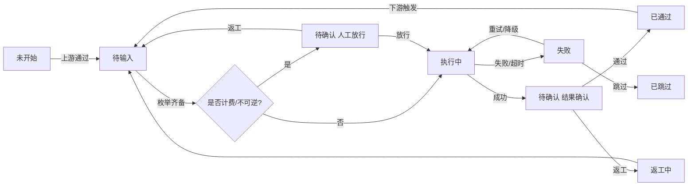

# 通用视频创作项目管理工作台｜结构化需求设计文档 v1.0

> 文档日期：2026-11-09
> 蓝本来源：`D:\WorkBuddy_space\WorkBudddy全流程短视频创作空间\短剧实测\` 及同级 `带货短剧方案可行性评估与本机部署分析.md`
> 演进阶段：**需求盘点**（本轮不进入页面搭建 / 数据接入 / 自动化流程 / 代码实现）
> 适用基准：以 2026-11-09 的蓝本文件状态与当日市面分类调研为准；涉及具体平台能力、按钮名、字段名、模型清单的部分一律标注「需以平台实际文档/界面核实」
> 标注口径：`[事实]` = 蓝本文件可核验的既有内容；`[设计]` = 本工作台的需求提案；`[待确认]` = 需拍板或需核实的决策点
> 数据纪律：本轮对蓝本目录**全程只读**，未创建、未改名、未删除任何既有文件；本文档为唯一新增文件

---

## 0. 结论前置

**一句话结论**：蓝本已经把「一个带货短视频项目」跑通并迭代了 5 轮，但它是一个**单项目、单目录、靠文档和人工约定维系**的执行痕迹；要做成通用工作台，核心不是补功能，而是把散落的东西收编成 5 个可管理对象：**项目 → 流程节点 → 枚举输入 → 文件/版本 → 调用与变更记录**。

**蓝本暴露的 5 个真实痛点（均为 [事实]）**

| # | 痛点 | 证据 |
|---|---|---|
| 1 | 提示词没有独立资产：散落在报告、说明文档、工具调用里，原文第 3 段提示词缺失且未补写 | `实跑复现报告.md` §1、`分镜01_修订内容.md` §3、`镜2人物重绘说明.md` §7 |
| 2 | 命名双轨且不统一：交付层用中文长名（`成片_动态紧凑版_滑切_人物统一版.mp4`），构建层用 ASCII 短名（`m02.mp4`、`cp_1.5.png`、`v2_9.10.png`） | 目录清单 |
| 3 | 版本靠文件名后缀链表达，无版本号、无机器可读清单 | `成片.mp4` → `成片_动态紧凑版.mp4` → `..._滑切.mp4` → `..._人物统一版.mp4` |
| 4 | 路径硬编码导致目录迁移要修 **30 处 / 7 个文件**，且出现 4 种路径写法 | `.workbuddy/memory/2026-11-09.md` §任务目录迁移 / §二次迁移 |
| 5 | 「覆盖 vs 新建」「是否放行计费生成」全靠人工约定与当轮确认，没有留痕机制 | `成片_人物统一版说明.md` §2、§七；`动态紧凑版说明.md` §五 |

**演进地图（首次接手，标注当前位置）**

```
需求盘点 → 页面搭建 → 数据接入 → 自动化流程 → 优化迭代
   ◉ 当前位置
```

**方案二选一（请拍板，本文档按 A 版展开）**

| 方案 | 范围 | 适合 | 本轮建议 |
|---|---|---|---|
| **A. 最小闭环型（MVP）** | 多项目 CRUD/切换 + 12 节点状态流 + 全枚举输入 + 目录/命名/变更记录规范 + 资产库基础 + 调用规则与记录模板 | 先把「管得住」跑通，真实生成调用后置 | **推荐** |
| B. 全面搭建型 | 在 A 之上，第一版即接真实技能/模型自动调用、无限画布、桌面打包、自动质检 | 一次性交付，但计费与写操作风险高、返工成本高 | 暂不推荐 |

**本轮明确不做**：写任何代码、创建项目实例目录、改动蓝本既有文件、接入线上真实业务数据、执行任何计费生成动作。

**我的假设（显式列出，未逐条向用户确认，按闸门「先给一版并标注假设」处理）**

| 编号 | 假设 | 若不成立需回到 |
|---|---|---|
| A1 | 第一版是**自研移动端优先 Web 工作台**，不是 Coze/Dify 等低代码平台内搭建 | Q01 |
| A2 | 单人使用、本地文件系统为主要存储，暂不引入云端数据库与多人协作 | Q02、Q03 |
| A3 | 第一版「调用 WorkBuddy」以**匹配规则 + 用户配置 + 结果记录 + 任务包导出**为主，真实自动调用需人工确认后触发 | Q04 |
| A4 | 项目文件全部落在用户为每个项目指定的自定义工作目录下，不使用云端对象存储 | Q05 |
| A5 | 沿用「新版本一律新建文件、不覆盖旧文件」「写操作先说明再等确认」的既有约定 | Q06 |

---

## 1. 蓝本流程逆向分析

### 1.1 证据清单

| 类别 | 文件 | 作用 |
|---|---|---|
| 原文评估 | `带货短剧方案可行性评估与本机部署分析.md` | 原文 18 步、3 段提示词（缺第 3 段）、产物数据、6 维评估、本机环境 |
| 实跑主报告 | `短剧实测/实跑复现报告.md` | 18 步对照、交付清单、差异、质检、复跑命令 |
| 脚本与清单 | `分镜脚本.md`、`配音清单.json`、`字幕01–04.txt` | 内容规格、配音参数、台词文本 |
| 构建脚本 | `_build/tts/tts.js`、`_build/work/filter*.txt` | TTS 生成、ffmpeg 滤镜、CRLF 处理 |
| 迭代说明 | `分镜01_修订内容.md`、`动态紧凑版说明.md`、`镜2人物重绘说明.md`、`成片_人物统一版说明.md` | 5 轮迭代的输入/输出/提示词/验收/回滚 |
| 工程记忆 | `.workbuddy/memory/2026-11-09.md` | 全流程时间线、技术坑、迁移记录、目录约定 |

### 1.2 目录现状（[事实]，已排除 `node_modules`）

```
短剧实测/
├─ 分镜01.png ~ 分镜04.png                 # 交付层：分镜图（1024×1536）
├─ 分镜02_重绘.png / 镜2人物对比.png / 成片镜2人物前后对比.png
├─ 分镜脚本.md / 字幕01–04.txt / 配音清单.json / font.ttf
├─ audio/voice01–04.mp3                    # 交付层：配音
├─ 成片.mp4                                # v1 静态版
├─ 成片_动态紧凑版.mp4                     # v2 叠化
├─ 成片_动态紧凑版_滑切.mp4                # v3 滑切（推荐）
├─ 成片_动态紧凑版_滑切_人物统一版.mp4      # v4 人物统一（最终推荐）
├─ 分镜01_修订版.mp4
├─ 实跑复现报告.md / 4 份「说明」md
└─ _build/                                 # 构建层：全部 ASCII 短名
   ├─ tts/       tts.js、package.json、package-lock.json、node_modules
   ├─ work/      img01–04.png、m01–m04.mp4、m02_旧短发版备份.mp4、
   │             v01–v04.mp3、sub01–04.txt、filter*.txt、compact*.mp4、
   │             qc2/qc12/qc24.png、cp_*.png / sl_*.png / v2_*.png / act_*.png / rev_*.png
   ├─ video/     「3D_动画电影风格_皮克斯式卡通_竖屏构图_分镜N_场景_ISO时间戳.mp4」
   └─ redraw/    「Image_to_image_edit_with_TWO_r_ISO时间戳.png」、panel_old/new.png
```

> [事实] 全量 627 文件 / 209 MB（含依赖）；业务层文件约 100 个。`_build/work` 用纯 ASCII 文件名是刻意规避中文路径 + CRLF 坑，见 `实跑复现报告.md` §六。

### 1.3 任务节点还原（[事实]：从原文 18 步 + 5 轮迭代归纳）

| 节点 | 名称 | 输入 | 处理 / 能力 | 输出（实际文件） | 验收/状态 |
|---|---|---|---|---|---|
| N00 | 立项建目录 | 用户需求、指定路径 | 新建目录 | `短剧实测/` | 已建 |
| N01 | 主题与规格确认 | 原文第 1 段提示词 | LLM 理解 | 30s / 9:16 / 4 镜 / 智能空气炸锅 / 3D 皮克斯 | 人工确认 |
| N02 | 分镜脚本生成 | N01 规格 | LLM 文本生成 | `分镜脚本.md`（《11.11 前夜，厨房大战》4 镜 + 台词 + 运镜字幕规格） | 人工确认 |
| N03 | 能力与工具盘点 | 环境 | 本地探测 + 联网检索 | ffmpeg 9.0.2(drawtext/zoompan/libx264/aac)、Node v22.22.2、内置绘图；缺 Python 与 edge-tts | 盘点表 |
| N04 | 分镜图生成 | 脚本镜号 + 风格枚举词 | 内置联网绘图 | `分镜01–04.png`（1024×1536） | 逐张目检 |
| N05 | 画面质检 | 4 张图 | 人工逐帧 | 分镜03 中文清晰；分镜02 中文模糊 + 机身误显「25」；分镜04 略变形 | **部分不通过，缺陷如实保留** |
| N06 | 配音 + 字幕 | 4 句台词、音色、语速 | Node `msedge-tts@2.1.1` / `zh-CN-XiaoxiaoNeural` / `+8%` | `audio/voice01–04.mp3`(16.2s)、`字幕01–04.txt`(UTF-8 LF)、`配音清单.json`、`tts.js` | `hasCR=false`×4 |
| N07 | 渲染合成 | 4 图 + 4 音 + 4 字幕 + font | ffmpeg filtergraph（zoompan + drawtext + concat + amix） | `_build/work/out.mp4` → `成片.mp4`（30.000s / 1080×1920 / 24fps / H.264 yuv420p / AAC 44.1k mono / faststart / 8.12MB） | 合成 113s |
| N08 | 质检与自愈 | 成片 | 全片解码、3 帧逐帧、CRLF 扫描、ffprobe | `qc2/qc12/qc24.png`、`实跑复现报告.md` | 解码 exit 0；字幕无「口」方块 |
| N09 | 归档交付 | 全部产物 | 清单 + 耗时汇报 | 交付清单 + 报告 | 技术验收（GUI 播放未执行） |
| N10 | 迭代① 图生视频 | 分镜图 + 动作提示词 | `VideoGen`（`buddy-multimodal-generation` 技能路由），**串行** | `_build/video/*.mp4`（768×1152 / 5.1667s / 24fps / 带 AAC 环境音） | 并行 3 段全部 5000ms 超时 → 串行成功 |
| N11 | 迭代② 紧凑剪辑 | 4 段动态 + 配音 | ffmpeg `xfade` + `tpad` + `adelay` + `amix` | `成片_动态紧凑版.mp4`(18.208s 叠化) / `..._滑切.mp4`(slideleft 推荐) | 叠化有「双人鬼影」→ 滑切消除 |
| N12 | 迭代③ 镜 1 修订 | 首帧图 + 修订提示词 | VideoGen + 音画对齐 | `分镜01_修订版.mp4`、`分镜01_修订内容.md` | 人声首字与字幕首字同帧；volumedetect 分段验收 |
| N13 | 迭代④ 镜 2 人物重绘 | 镜 1 人物参考 + 镜 2 场景参考 | `ImageGen` 双参考图（`image1`/`image2`） | `分镜02_重绘.png`、`镜2人物对比.png`、`镜2人物重绘说明.md` | 放大裁切对比确认非人物元素不变 |
| N14 | 迭代⑤ 人物统一成片 | 重绘图 + 原 filter | VideoGen 单段 + 备份替换 + 复跑合成 | `成片_动态紧凑版_滑切_人物统一版.mp4`、`成片_人物统一版说明.md` | 437 帧 / 18.208s；音轨能量与旧版完全一致；旧 3 片未覆盖 |
| N15 | 目录迁移 ×2 | 用户指定新路径 | 批量路径替换 | 30 处 / 7 文件修正；4 种路径写法全覆盖 | `node --check` 通过、旧路径 0 残留、文件数 627 不变 |

**关键流程特征（[事实]）**

- 不是一次性线性流程，而是「主线 9 节点 → 多轮局部返工 → 每轮新建文件保留旧版」的**回环式生产**。
- 每轮迭代都有：明确范围 → 人工确认 → 新文件不覆盖 → 说明文档 → 可回滚方法（如 `m02_旧短发版备份.mp4` 复制回 `m02.mp4` 重跑）。
- 质检贯穿全程（画面质检、CRLF、抽帧、解码、能量对比），是「验收前置」而非末端一步。
- 生成类动作（绘图、VideoGen）按积分计费，**实际扣费未经核实**，且执行前需告知/确认。

### 1.4 输入输出清单（[事实]）

| 类型 | 具体项 |
|---|---|
| 文本输入 | 原文 3 段提示词（第 3 段缺失）、分镜脚本、4 句台词、生图/生视频/图生图提示词、ffmpeg 滤镜脚本 |
| 结构化输入 | `配音清单.json`（voice / rate / lines[].text,audio,subtitle,subtitleHasCR,audioBytes）、`package.json` |
| 素材输入 | 4 张分镜图、1 张重绘图、人物参考图、`font.ttf`(simhei)、4 个 mp3、4 个字幕 txt |
| 工具/环境输入 | ffmpeg 9.0.2、Node v22.22.2、msedge-tts、内置绘图、ImageGen、VideoGen |
| 文本产物 | 分镜脚本、实跑复现报告、4 份迭代说明、修订内容 |
| 图像产物 | 4 张分镜图 + 重绘图 + 2 张对比图 + 大量质检帧/裁切帧 |
| 音频产物 | 4 个配音 mp3 |
| 视频产物 | 4 段 5s 动态片段、1 个镜 1 修订片段、4 个成片版本 |
| 验收产物 | `配音清单.json` 自检字段、`qc*.png`、报告内 ffprobe/解码/能量实测值 |

### 1.5 提示词资产现状（[事实]）

| 类别 | 存放位置 | 完整性 |
|---|---|---|
| 需求侧 3 段提示词（原文） | `带货短剧方案可行性评估与本机部署分析.md` §1.3 逐字收录 | **第 3 段原文未给出，未自行补写** |
| 生视频提示词（修订版全文） | `分镜01_修订内容.md` §3 | 完整，含与上版逐字差异表 |
| 图生图提示词（英文全文） | `镜2人物重绘说明.md` §7 | 完整，含 `size=1024x1536`、`quality=high`、`image1/image2` 参数 |
| 人物约束补丁 | `成片_人物统一版说明.md` §2 | 完整，注明「动作/运镜/场景描述逐字未改」 |
| 生图风格词 | 散落在文件名 `3D_动画电影风格_皮克斯式卡通_竖屏构图_分镜N_场景` | 仅片段，无独立文件 |

> **这是工作台最该解决的一点**：提示词是核心生产资产，却以「文档段落 / 文件名 / 工具调用参数」三种形态散落，无法按项目、按节点、按版本检索与复用。

### 1.6 命名方式现状（[事实]）

| 模式 | 示例 | 用途 |
|---|---|---|
| 中文业务名 + 两位序号 | `分镜01.png`、`字幕01.txt`、`audio/voice01.mp3` | 交付层，按镜号 1:1 |
| 中文业务名 + 后缀链 | `成片_动态紧凑版_滑切_人物统一版.mp4` | 版本表达，靠后缀堆叠 |
| 中文业务名 + 用途后缀 | `分镜01_修订版.mp4`、`分镜02_重绘.png`、`镜2人物对比.png`、`成片镜2人物前后对比.png` | 变体与对比图 |
| ASCII 短名 + 序号 | `img01.png`、`m01.mp4`、`v01.mp3`、`sub01.txt`、`filter.txt` | 构建层，规避中文路径 |
| ASCII 短名 + 数值 | `cp_1.5.png`、`sl_9.10.png`、`rev_4.95.png`、`v2_16.0.png` | 质检抽帧（前缀=版本/用途，数字=时间戳秒） |
| ASCII 短名 + 中文备份说明 | `m02_旧短发版备份.mp4`、`compact_slide_v2.mp4` | 备份与二次合成 |
| 工具原始产物名 | `3D_动画电影风格_皮克斯式卡通_竖屏构图_分镜1_夜晚厨房_2026-11-09T07-03-58.mp4`、`Image_to_image_edit_with_TWO_r_2026-11-09T09-07-46.png` | 生成工具直接落盘，含风格词 + 场景 + ISO 时间戳 |
| 文档名 | `实跑复现报告.md`、`动态紧凑版说明.md`、`成片_人物统一版说明.md` | 说明与验收记录 |

**归纳出的规则缺陷**：无统一版本号；无状态标识（draft/final）；显示名与磁盘名混用；备份与正式产物同级；文档内绝对路径硬编码；复用/引用关系不可查。

### 1.7 既有事实 vs 待确认项（严格分列）

**[事实] 已确定，可直接作为设计输入**

1. 项目规格参数确实存在且可枚举：30s / 9:16 / 4 镜 / 3D 动画电影风格·皮克斯式卡通 / 竖屏 / 中文女声 / `+8%` / 1080×1920 / 24fps / H.264 yuv420p / AAC 44.1k mono / faststart。
2. 音色是可复用资产：`zh-CN-XiaoxiaoNeural`（晓晓）+ `+8%` 在多次迭代中保持不变。
3. 角色一致性是真实痛点：4 段人物发型/服装不一致，靠「镜 1 人物参考图 + 双参考图重绘」解决，且只修了镜 2。
4. 质检项是可枚举的：CRLF、中文渲染、抽帧时刻（2/12/24s 或 1.5/6.5/11.5/16.0s）、全片解码、音轨能量、转场鬼影/黑帧。
5. 转场/编码/工具坑是可枚举知识：xfade fade 会鬼影、slideleft 不会；ffmpeg 9.0.2 不支持 `-filter_complex_script`；并行 VideoGen 超时。
6. 「新版本不覆盖旧文件」「复跑命令 + 回滚方法写进说明文档」是被反复执行的真实约定。
7. 输出编码必须保证浏览器可预览（原文踩过「编码不支持在线预览」，本次用 H.264 + faststart 规避）。

**[待确认] 不得写入事实，需拍板或核实**

| 编号 | 待确认项 | 影响 |
|---|---|---|
| Q01 | 工作台形态：自研 Web vs 低代码平台内搭建 | 决定全部技术章节 |
| Q02 | 是否多人协作 / 权限模型 | 决定项目与资产库的隔离设计 |
| Q03 | 数据存储：本地文件 / 本地数据库 / 云端 | 决定变更记录与资产索引实现 |
| Q04 | 第一版是否允许真实自动调用计费技能与模型 | 决定安全与人工确认节点设计 |
| Q05 | 工作目录是否允许跨盘符、网络盘、中文路径 | 决定路径校验与 ASCII 别名策略 |
| Q06 | 「不覆盖旧文件」「写前确认」是否升格为系统硬约束 | 决定写入层设计 |
| Q07 | 主题是否必须 100% 枚举化（含自定义标签的准入流程） | 决定枚举字典治理规则 |
| Q08 | 项目类型清单与各自流程模板 | 决定节点模板映射 |
| Q09 | 枚举字典由谁维护、新增选项的评审流程 | 决定配置中心设计 |
| Q10 | 资产授权 / AI 生成标识 / 水印处理策略（蓝本明确「原文未涉及」） | 决定资产元数据与合规字段 |
| Q11 | 桌面打包技术选型 | 决定兼容性章节 |
| Q12 | 单文件上传上限、总容量上限、清理策略 | 决定上传与 `_build` 治理 |
| Q13 | 是否接入线上真实业务数据（默认否） | 安全红线 |
| Q14 | 积分/成本是否记录、是否展示估算值 | 决定调用记录成本字段 |
| Q15 | 目录名 `WorkBudddy`（3 个 d）是否为笔误 | 蓝本记忆已标「待用户核对」，影响默认工作目录示例 |
| Q16 | 页面视觉是否需要跟随系统深色/浅色 | 决定主题层 |
| Q17 | 提示词是否允许「只读查看 + 复制」但禁止任何编辑 | 与全枚举输入强相关 |
| Q18 | 项目大纲中哪些字段允许受控自由文本 | 与「禁止自由文本」边界相关 |
| Q19 | 变更记录是否允许删除/归档 | 决定不可变性设计 |
| Q20 | 第一版是否需要离线可用 | 决定资源与缓存策略 |

---

## 2. 需求总览

### 2.1 目标

把「一次性的、靠人记的、靠文件名表达版本的视频创作流程」，升级为**可管理多个不同类型视频项目、流程可视、状态可追、输入可控、产物可循、资产可复用**的通用工作台。类型不限于带货短视频。

### 2.2 功能域清单（覆盖用户全部要求）

| 编号 | 功能域 | 对应用户要求 | 章节 |
|---|---|---|---|
| FR-01 | 多项目创建 / 切换 / 管理，类型不限 | ① | §3 |
| FR-02 | 可视化进度流程、节点状态与流转、每节点可见可操作输入输出区 | ② | §4 |
| FR-03 | 全枚举输入字段 + 预设选项 + 仅选择控件 + 主题枚举化 | ③ | §5 |
| FR-04 | 自定义工作目录、目录规范、统一命名、项目大纲、完整变更记录 | ④ | §6 |
| FR-05 | WorkBuddy 技能/专家/模型匹配规则、自定义配置、结果记录 | ⑤ | §7 |
| FR-06 | 资产库：图片/角色/音色录入、分类、元数据、跨项目复用、版本状态 | ⑥ | §8 |
| FR-07 | 第一版移动端优先页面范围 / 信息架构 / 窄屏约束 / 桌面打包兼容 / 演进边界 | ⑦ | §9 |
| FR-08 | 视觉基调、信息密度、组件呈现（参照 libTV / 即梦） | ⑧ | §10 |
| FR-09 | 需求边界、非功能要求、可验收标准 | ⑨ | §11 |

### 2.3 数据对象关系（[设计]）

```
项目 Project ──< 版本 Version ──< 节点实例 NodeRun ──< 调用记录 CallRecord
   │                                  │
   │                                  ├── 输入快照（全枚举）
   │                                  ├── 提示词快照（只读）
   │                                  └── 输出资产（引用 Asset）
   │
   ├── 项目大纲 Outline ── 枚举字段集合
   ├── 变更记录 Changelog（追加、不可变）
   └── 资产引用 AssetRef ──> 资产库 Asset（图片 / 角色 / 音色 / …）
                                  └── 可被多个项目引用
```

---

## 3. FR-01 项目域：创建 / 切换 / 管理

### 3.1 项目实体字段（[设计]，除注明外均为枚举控件）

| 字段 | 控件 | 说明 |
|---|---|---|
| `project_id` | 系统生成（只读展示） | `P_<YYYYMMDD>_<3位序号>`，不可编辑 |
| `project_code` | 选择 + 系统建议 | 用作文件名的 ASCII 代号，如 `AF30`；由项目类型 + 主题标签自动建议，用户从建议项中单选 |
| 显示名称 | 由枚举自动生成（只读展示 + 从候选标题模板单选） | 禁止自由文本输入，见 §5.4 |
| `project_type` | 单选（下拉/分段） | 见 §5.2 类型枚举 |
| `platform_target` | 多选标签 | 投放平台，影响推荐分辨率/比例/帧率 |
| 规格包 | 单选 | 分辨率 / 比例 / 风格 / 帧率 / 时长 / 编码（见 §5） |
| `work_dir` | 目录选择器（系统目录选择，非文本输入） | 见 §6.1 |
| `outline` | 表单（全枚举） | 见 §6.4 |
| 项目状态 | 只读徽标 | 进行中 / 待确认 / 已交付 / 已归档 / 已暂停（系统流转） |
| 当前版本 | 只读 | 指向最近一个 `Version` |
| 创建/更新时间 | 只读 | ISO 8601 |

### 3.2 项目操作矩阵

| 操作 | 入口 | 约束 |
|---|---|---|
| 创建 | 项目列表「新建」→ 全枚举向导（3 步：类型 → 规格包 → 工作目录） | 创建后 `project_type` 不可改；改需派生新项目 |
| 切换 | 顶部项目切换器（下拉单选）+ 列表点击 | 切换时保留各项目当前节点位置；不跨项目串数据 |
| 复制为模板 | 项目详情「另存为模板」 | 复制大纲与枚举配置，不复制产物文件 |
| 归档 | 项目详情 → 二次确认 | 只读化，不删除文件 |
| 删除 | 项目详情 → **人工确认节点** | 第一版仅允许「解除登记」（不动磁盘文件）；物理删除列入 v2 且需说明影响范围 + 等确认 |
| 检索/筛选 | 按类型、状态、平台、更新时间（全部选择控件） | 无文本搜索框 |

### 3.3 项目类型 → 流程模板映射（[设计]，MVP 最简版）

| 项目类型 | 默认节点链（节点定义见 §4） | 与蓝本关系 |
|---|---|---|
| 带货短视频 | N01→N02→N03→N04→N05→N06→N07→N08→N09 | 蓝本主线 |
| 剧情短剧 / 漫剧 | 上述 + 角色建库、分集大纲、多镜一致性节点 | 蓝本 N13/N14 的通用化 |
| 口播 / 知识科普 | N01→N02→N03→N06→N07→N08→N09 | 跳过生图/生视频 |
| 产品宣传片 | 主线 + 产品特写、卖点字幕节点 | 蓝本「顶部加产品卖点大字」后续动作 |
| 图文动效 / Vlog | 主线（素材以上传为主） | — |
| 音乐 MV / 混剪 | 主线 + 音频驱动、卡点节点 | — |
| 自定义模板 | 从节点清单勾选组成 | 需 Q08 拍板 |

> 模板是「节点子集 + 默认枚举值」，不是硬编码流程；用户可在配置页调整节点启用状态（开关控件），调整写入变更记录。

---

## 4. FR-02 流程域：可视化进度、状态与节点输入输出区

### 4.1 MVP 最简流程（先跑通，不上一来就搞复杂编排）

```
(立项) → [N01 主题/规格] → [N02 大纲/脚本] → [N03 素材准备] → [N04 生成执行] → [N05 质检确认] → (交付)
              ↑                                        │
              └──────────── 返工 / 重做 ←──────────────┘
```

完整版 12 节点（[设计]，与蓝本映射）：

| 节点码 | 名称 | 节点类型 | 蓝本对应 |
|---|---|---|---|
| N01 | 主题与规格确认 | 人工 + 枚举输入 | 原文第 3 步 |
| N02 | 项目大纲 / 分镜脚本 | 生成 + 人工确认 | `分镜脚本.md` |
| N03 | 能力与资源盘点 | 只读探测 | 原文第 5–6 步 |
| N04 | 资产准备（上传 / 引用 / 角色建库） | 人工 | 分镜图、参考图、音色、字体 |
| N05 | 提示词生成与查看 | 生成 + 只读 | 散落的 4 类提示词 |
| N06 | 分镜图 / 素材生成 | 生成（计费，需确认） | N04 原文 / ImageGen |
| N07 | 画面质检 | 人工 + 自动项 | 原文第 9–10 步 |
| N08 | 配音 / 字幕 / 音色 | 生成 + 人工确认 | `tts.js`、配音清单 |
| N09 | 片段生成（图生视频） | 生成（计费，需确认） | VideoGen 串行 |
| N10 | 剪辑合成 | 生成 + 人工确认 | ffmpeg filtergraph |
| N11 | 成片质检与验收 | 人工 + 自动项 | 3 帧质检、全片解码 |
| N12 | 归档交付 | 人工确认 | 交付清单 + 报告 |

### 4.2 节点状态机（[设计]）

| 状态 | 含义 | 允许的操作 |
|---|---|---|
| `未开始` | 上游未完成 | 查看（只读） |
| `待输入` | 上游完成，枚举输入未齐 | 选择输入项、上传素材 |
| `待确认` | 输入齐备 / 生成完成，等待人工放行 | 通过 / 返工 / 跳过 |
| `执行中` | 调用进行中 | 查看进度、取消 |
| `已通过` | 人工确认通过 | 查看、发起返工（生成新版本） |
| `返工中` | 被打回，需重新执行 | 修改枚举选项、重新生成 |
| `失败` | 调用超时 / 报错 / 降级失败 | 重试、切换降级链、跳过 |
| `已跳过` | 模板未启用或人工跳过 | 查看跳过原因 |

**流转图**



**流转规则**：① 上游非 `已通过/已跳过` 时下游保持 `未开始`；② 每次状态变化写一条变更记录（§6.5）；③ `已通过` 节点被返工时，其下游全部回到 `未开始`，但**已生成文件不删除**（蓝本「不覆盖旧文件」）；④ 计费生成、覆盖等价操作、对外发布、删除 必须经 `待确认` 人工放行，确认前不得执行。

### 4.3 节点详情「三区」结构（每个节点可见、可操作）

| 区 | 内容 | 控件 |
|---|---|---|
| **输入区** | 本节点全部枚举字段（§5）、依赖的上游产物、素材上传/引用入口 | 单选/多选/标签芯片/分段/步进器/目录与文件选择器；**无任何文本输入框** |
| **执行区** | 生成的提示词全文（只读代码块 + 复制 + 版本对比）、匹配的技能/专家/模型标签、参数快照、执行日志、耗时与成本估算 | 只读展示 + 「重新生成」「查看上一版」「导出任务包」按钮 |
| **输出区** | 产物缩略图/播放器、文件路径（末两级 + 复制全路径）、命名与版本、质检结果、状态徽标 | 「通过 / 返工 / 跳过」三选；返工原因从枚举中单选；结果确认留痕 |

**四类指定操作的落地**

| 操作 | 位置 | 交互 |
|---|---|---|
| 主题选择 | N01 输入区 | 标签芯片多选（题材/场景/卖点/情绪/人群），实时显示组合结果与系统建议标题（单选采纳），见 §5.4 |
| 输出提示词查看 | 执行区 | 只读、可折叠、一键复制、可查看与上一版逐字差异（蓝本 `分镜01_修订内容.md` 已用此形态）；**禁止编辑** |
| 素材上传 | N04 输入区 | 系统文件选择器 → 自动归类到内容分类 → 自动按 §6.3 重命名 → 登记资产元数据与来源；支持从资产库「引用」而非重复上传 |
| 结果确认 | 输出区 | 通过 / 返工 / 跳过；返工原因枚举；确认人、时间、版本写入变更记录；通过后自动解锁下游 |

### 4.4 流程图可视化要求（移动端优先，[设计]）

- 主视图：**纵向步骤条**（节点码 + 名称 + 状态徽标 + 完成时间 + 产物数量），当前节点高亮并展开三区。
- 辅助视图：顶部横向迷你进度条（已完成 / 总数），可横向滑动但不承载操作。
- 返工回环：在节点卡片上以「返工来源：N07 → 第 2 次」标签表达，不画连线（窄屏不可读）。
- 桌面版（v2）才引入画布视图与连线；第一版**禁止拖拽画布**。

---

## 5. FR-03 输入域：全枚举字段与预设选项

### 5.1 强制设计规则（[设计]，本工作台的核心约束）

1. **所有可枚举输入字段，界面上只提供选择控件**：单选按钮 / 下拉 / 分段控件 / 多选标签芯片 / 级联选择 / 步进器 / 开关 / 日期与目录选择器。**禁止出现可接受任意字符的文本框**。
2. 提示词、路径、显示名、文件名等由系统按枚举组合 + 模板**自动生成并只读展示**，用户通过改选项来改变结果，不直接改文本。
3. 确需补充说明的场景（返工原因、变更说明、缺陷描述）一律提供**枚举原因码 + 可选受控短文本**（长度上限、禁止换行、禁止路径/密钥）；是否开放受控文本列入 Q18。
4. 枚举字典是版本化配置资产：新增/停用选项需走评审并记入变更记录，**不允许运行时自由新增选项**（否则退化成变相自由输入）。
5. 每个选项保留「依据」与「核实状态」两个元数据，界面可在「选项说明」里查看，避免把未核实的平台能力当成事实。
6. 所有输入在提交时生成**输入快照**并绑定节点实例与提示词版本，保证可复跑、可追溯（对应蓝本 `配音清单.json` 的做法）。

### 5.2 调研依据（[事实]：2026-11-09 检索所得，具体字段以各平台官方最新文档为准）

| 来源 | 关键结论 |
|---|---|
| 极客智坊《创建视频任务》参数表 | 即梦 Seedance：480p/720p/1080p，比例 16:9 / 4:3 / 1:1 / 3:4 / 9:16 / 21:9；可灵 Kling：720p(std)/1080p(pro)/4k(v3 起)，比例 16:9 / 9:16 / 1:1；通义万相：480p/720p/1080p；Sora-1 明确列出 1080×1920、1920×1080、1080×1080 等尺寸 |
| 腾讯云开发者社区《视频生成模型 API 接入实战》 | 三家统一参数维度：分辨率、宽高比、时长、帧率、运动强度、首尾帧、镜头控制；分辨率 480p/720p/1080p，比例 16:9/9:16/1:1，时长 5s/10s |
| 短视频平台参数规范类资料（闪控猫、上海知映、剪辑教练等） | 抖音/快手/视频号/小红书：9:16、1080×1920、30fps、MP4/H.264、AAC；B站/YouTube：16:9、1920×1080；24fps 电影感 / 30fps 通用 / 60fps 运动；25fps 国内标准 |
| AI 视频风格汇总与提示词攻略（18183、Seedance2Prompt、翔宇工作流等） | 风格分写实影像 / 国风 / 二次元动画 / 科幻潮流 / 复古艺术手绘五大分支，约 18 类；另有情绪、灯光、运镜等维度 |
| LibTV / 即梦短剧工作室相关报道（网易、CSDN、搜狐、起剖） | LibTV：深色无限画布、节点式项目铺开、脚本/角色图在左 + 画布在右、每个视频组可查看与改提示词和参数、主体库存角色/场景/道具跨集调用；即梦短剧工作室：剧本→资产→分镜→生成→剪辑一条龙、资产全局共享、480P 试生成样片、智能预演、标签化输入（如 #泛人群 #悬疑 #反转） |

> 上述第 5 项用于视觉与信息架构参照（§10）；按钮名、字段名、具体界面布局**需以平台实际界面核实**，本报告不照抄。

### 5.3 全枚举字段总表（[设计]）

> 「依据」列：调研 = §5.2 来源；蓝本 = 源目录实证；通用 = 行业通识。标「待核实」的项需 Q09/Q14 拍板后启用。

#### A. 规格类（用户明确要求至少覆盖分辨率 / 风格 / 长宽比）

| 字段 | 控件 | 预设选项 | 依据 | 默认 | 多选 |
|---|---|---|---|---|---|
| 视频分辨率 `resolution` | 单选分段 | `480P` / `720P` / `1080P` / `2K` / `4K` | 调研：Seedance 480/720/1080；可灵 720p/1080p/4k；2K 为常见中间档**待核实** | `1080P` | 否 |
| 长宽比 `aspect_ratio` | 单选网格（带比例缩略图） | `9:16` / `16:9` / `1:1` / `4:3` / `3:4` / `21:9` | 调研：即梦 Seedance 六种；可灵三种 | `9:16` | 否 |
| 具体像素 `pixel_size` | 只读（由分辨率 × 比例联动） | `1080×1920` / `1920×1080` / `1080×1080` / `720×1280` / `1280×720` / `2160×3840` / `3840×2160` / `1024×1536` / `768×1152` | 调研 + 蓝本（分镜图 1024×1536、片段 768×1152、成片 1080×1920） | 联动 | — |
| 视觉风格 `style` | 两级级联（大类 → 具体风格） | 见 §5.3 风格字典 | 调研 5 分支 18 类 + 蓝本 3D 皮克斯 | `3D 动画 / 皮克斯式卡通` | 否（主风格） |
| 辅助风格 `style_modifier` | 多选（最多 1 项，避免冲突） | 柔光 / 胶片颗粒 / 高反差 / 低饱和 / 暖调 / 冷调 / 无 | 调研提示词攻略（「最多叠加一个辅助风格」） | `无` | 是（限 1） |
| 帧率 `fps` | 单选 | `24` / `25` / `30` / `60` | 调研 + 蓝本 24fps | `30` | 否 |
| 单片段时长 `clip_seconds` | 单选 | `5s` / `10s` | 调研（三家主流） | `5s` | 否 |
| 成片时长档 `duration_band` | 单选 | `≤15s` / `15–30s` / `30–60s` / `1–3min` / `3–10min` / `>10min` | 调研平台规范 + 蓝本 30s / 18.208s | `15–30s` | 否 |
| 镜头数 `shot_count` | 步进器（1–30） | 整数枚举 | 蓝本 4 镜 | `4` | — |
| 输出容器 `container` | 单选 | `MP4` / `MOV` / `WebM` | 调研（MP4 兼容性最强） | `MP4` | 否 |
| 视频编码 `video_codec` | 单选 | `H.264` / `H.265(HEVC)` | 调研 + 蓝本 H.264 | `H.264` | 否 |
| 像素格式 `pix_fmt` | 单选 | `yuv420p` / `yuv444p` | 蓝本 yuv420p | `yuv420p` | 否 |
| 音频编码/采样 `audio_codec` | 单选 | `AAC 44.1kHz mono` / `AAC 44.1kHz stereo` / `AAC 48kHz stereo` | 蓝本 + 调研 | `AAC 44.1kHz mono` | 否 |
| 浏览器可预览 `faststart` | 开关 | 开 / 关 | 蓝本（踩过编码不支持预览） | 开 | — |

#### B. 主题类（用户明确要求说明枚举化方式）

| 字段 | 控件 | 预设选项 | 依据 |
|---|---|---|---|
| 主题·题材 `theme_genre` | 标签芯片多选（≤2） | 带货种草 / 剧情反转 / 生活日常 / 知识科普 / 产品测评 / 品牌宣传 / 情感共鸣 / 节日热点 / 教程演示 / 采访口播 / 旅行记录 / 音乐舞蹈 | 蓝本（双 11 前夜带货 + 剧情冲突）+ 调研赛道分类 |
| 主题·场景 `theme_scene` | 标签芯片多选（≤2） | 厨房 / 客厅 / 办公室 / 街头 / 商场 / 户外自然 / 摄影棚纯色 / 车内 / 教室 / 虚拟场景 | 蓝本（夜晚厨房） |
| 主题·卖点 `theme_selling` | 标签芯片多选（≤2） | 省时省力 / 健康低脂 / 性价比 / 颜值设计 / 智能便捷 / 限时优惠 / 品质质感 / 情感陪伴 | 蓝本（30 秒/低脂晚餐/不耽误追剧） |
| 主题·情绪 `theme_mood` | 单选 | 治愈清新 / 欢快活泼 / 戏剧张力 / 悬疑紧张 / 史诗宏大 / 宁静舒缓 / 幽默诙谐 / 高级冷调 | 调研（mood 枚举 + 风格攻略） |
| 目标人群 `audience` | 多选标签 | 泛人群 / 上班族 / 宝妈 / 学生 / 银发 / 小微商家 / 极客 / 女性向 / 男性向 | 调研（即梦标签化输入 #泛人群） |
| 叙事结构 `narrative` | 单选 | 冲突-转折-解决 / 问题-方案-证据 / 前后对比 / 清单罗列 / 悬念揭晓 / 时间流水 | 蓝本 4 镜冲突结构 |
| 系统建议标题 | **单选采纳**（由标签组合生成 3 个候选） | 候选标题由模板渲染，非自由输入 | 蓝本《11.11 前夜，厨房大战》为生成结果 |

#### C. 生产类

| 字段 | 控件 | 预设选项 |
|---|---|---|
| 项目类型 `project_type` | 单选 | 带货短视频 / 剧情短剧·漫剧 / 口播科普 / 产品宣传片 / 图文动效·Vlog / 音乐 MV·混剪 / 自定义模板 |
| 投放平台 `platform_target` | 多选标签 | 抖音 / 快手 / 微信视频号 / 小红书 / B站 / 微博 / YouTube / 自有渠道 |
| 运镜 `camera_move` | 多选 | 缓慢推近 / 拉远 / 左右摇 / 环绕 / 固定 / 手持轻晃 / 跟随 / 极慢推镜 |
| 转场 `transition` | 单选 | 硬切 / 叠化(fade) / 左滑(slideleft) / 右滑 / 淡入淡出 / 无 |
| 字幕位置 `subtitle_pos` | 单选 | 底部居中 / 底部居中+半透明条 / 顶部 / 中部 / 不烧录 |
| 字幕字体 `subtitle_font` | 单选（资产库引用） | 思源黑体 / 微软雅黑 / simhei / 系统默认 / 自定义（从资产库选） |
| 音色 `voice_id` | 单选（资产库引用） | `zh-CN-XiaoxiaoNeural`（晓晓）等，见 §8 |
| 语速 `voice_rate` | 单选 | `-10%` / `0%` / `+8%` / `+15%` / `+25%` |
| 配音语言 `voice_lang` | 单选 | 普通话 / 粤语 / 英语 / 日语 / 方言（待核实） |
| 背景音 `bgm_policy` | 单选 | 无 BGM / 片段自带环境音(压低 -20dB) / 平台曲库 / 自定义（资产库选） |
| 质检项集 `qc_items` | 多选 | CRLF 检查 / 中文渲染 / 抽帧目检 / 全片解码 / 音轨能量 / 转场鬼影 / 人物一致性 / 水印检查 / 编码可预览 |
| 抽帧时刻 `qc_timestamps` | 多选（预设时刻组） | `2/12/24s` / `1.5/6.5/11.5/16.0s` / `4.80/9.10s`(转场) / 自定义档（步进器） |
| 生成档位 `render_tier` | 单选 | 样片(480P/Draft) / 标准(720P) / 正式(1080P) / 高清(4K) |
| 并发策略 `concurrency` | 单选 | 串行(默认) / 低并发(2) / 高并发(≥3，需确认) |
| 水印策略 `watermark_policy` | 单选 | 保留 / 字幕条压暗遮挡 / 后期处理(待核实) / 不处理 |
| AI 生成标识 `ai_label` | 单选 | 按平台要求添加 / 不添加 / 待核实（蓝本「原文未涉及」） |

#### D. 治理类

| 字段 | 控件 | 预设选项 |
|---|---|---|
| 文件类型分类 `file_class` | 单选 | 输入 / 提示词 / 素材 / 产物 / 质检 / 构建中间物 / 文档 |
| 内容分类 `content_class` | 单选 | 主题 / 规格 / 脚本 / 分镜图 / 角色 / 场景 / 道具 / 片段 / 配音 / 字幕 / 字体 / BGM / 成片 / 质检帧 / 报告 |
| 版本状态 `version_status` | 只读徽标（系统流转） | 草稿 / 待审 / 已启用 / 已弃用 / 已归档 |
| 资产状态 `asset_status` | 只读徽标 | 草稿 / 待审 / 已启用 / 已弃用 / 已归档 |
| 变更原因码 `reason_code` | 单选 | 需求变更 / 质检不通过 / 人物一致性 / 中文渲染缺陷 / 参数调整 / 工具失败 / 目录迁移 / 版本回滚 / 合规要求 / 其他 |
| 返工原因码 `rework_reason` | 单选 | 风格不符 / 人物不一致 / 文字错误 / 时长超标 / 音画不同步 / 编码不兼容 / 生成失败 / 其他 |
| 状态（节点/项目） | 只读徽标 | 见 §4.2 / §3.1 |

### 5.4 主题枚举化方式（[设计]，重点说明）

**问题**：主题天然像自由文本。若允许手输，「全枚举、只选择控件」的规则立刻被击穿。

**方案：标签组合 → 主题 ID → 提示词模板变量**

```
用户操作：题材[带货种草, 剧情反转] + 场景[厨房] + 卖点[省时省力] + 情绪[戏剧张力] + 人群[上班族]
   ↓ 系统生成
主题 ID：THM-G01-G02|S01|P01|M03|A02（有序拼接，可去重、可检索、可复用）
   ↓ 模板渲染
主题显示名（只读）：「双十一前夜·厨房里的省时反击」
   ↓ 注入
提示词变量：{{theme_tags}} {{scene}} {{selling_points}} {{mood}} {{audience}}
   ↓ 生成
N02 大纲 / N05 提示词（只读、可复制、可版本对比）
```

- 标签字典只增不改不改码：新增标签由 Q09 的评审流程加入字典并升字典版本，用户不能临时造词。
- 组合数量上限、冲突校验（如 `写实摄影` 与 `皮克斯 3D` 不可同时选为主风格）由系统自动拦截并给出枚举化的替代建议。
- 系统生成 3 个候选标题，用户**单选采纳**，不提供编辑框；若都不满意，回到标签区改标签重新生成。
- 主题快照随项目大纲、提示词版本一起存档，保证复跑时可还原（对应蓝本「台词逐字未改」的严谨做法）。

### 5.5 组合约束与联动（[设计]）

| 约束 | 规则 |
|---|---|
| 分辨率 × 比例 | 自动推导 `pixel_size`；不支持的组合（如 4K × 21:9）标红并禁用，给出可选替代项 |
| 平台 → 推荐规格 | 选抖音/快手/视频号/小红书 → 默认 `9:16 + 1080×1920 + 30fps + H.264/MP4`；选 B站/YouTube → `16:9 + 1920×1080`；用户可改但需选择理由（原因码） |
| 生成档位 → 分辨率 | 样片固定 480P，正式固定为项目分辨率；切换档位写变更记录 |
| 转场 × 人物一致性 | 当选 `叠化(fade)` 且人物一致性质检未通过时，系统建议 `左滑(slideleft)`（蓝本实证） |
| 并发策略 | 默认 `串行`，选择高并发需人工确认（蓝本 VideoGen 并行 5000ms 超时） |
| 计费阈值 | 任何 `生成` 类节点执行前进入 `待确认`，展示估算成本与 `cost.verified=false` 标记（蓝本「实际扣费未经核实」） |

---

## 6. FR-04 文件域：工作目录 / 目录规范 / 命名 / 大纲 / 变更记录

### 6.1 自定义工作目录（[设计]）

| 项 | 规则 |
|---|---|
| 字段 | 每个项目独立 `work_dir`，通过**系统目录选择器**指定，禁止手输路径 |
| 默认 | `<工作空间>/projects/<project_id>_<project_code>/`；蓝本项目默认值沿用 `D:\WorkBuddy_space\WorkBudddy全流程短视频创作空间\`（Q15 待核对 3 个 d） |
| 校验 | 路径存在、可写、非系统目录/桌面/下载根、剩余空间充足、不在 `node_modules` 内；中文路径允许但**自动登记 ASCII 构建别名**（蓝本实证中文路径 + CRLF 坑） |
| 存储 | 内部一律存**相对路径**（相对 `work_dir`）；绝对路径只在展示与调用边界生成 |
| 变更 | 改 `work_dir` = 目录迁移事件：先展示影响清单（文件数 / 引用处数 / 是否可逆）→ 人工确认 → 执行 → 全量引用校验 → 写变更记录（蓝本 30 处 / 7 文件修正的通用化） |
| 禁止 | 不递归删除、不批量覆盖、不清空目录（对齐用户「线上数据只读 / 写前说明并等确认」硬规则） |

### 6.2 目录规范：版本 / 文件类型 / 内容分类 三层（[设计]）

```
<work_dir>/<project_id>_<project_code>/
├─ project.meta.json              # 项目元数据 + 大纲 + 枚举快照
├─ changelog.jsonl                # 追加式完整变更记录（不可变）
├─ outline.md                     # 项目大纲（由枚举渲染，只读）
├─ prompt.index.json              # 提示词索引（节点 / 版本 / 快照 ID）
├─ _shared/                       # 跨版本共享索引（只存引用，不存文件副本）
├─ v1/                            # 【版本层】
│  ├─ 01_input/                   # 【文件类型层】输入
│  │   ├─ theme/  spec/  reference/
│  ├─ 02_prompt/                  # 提示词
│  │   ├─ script/  image/  video/  audio/  edit/
│  ├─ 03_asset/                   # 素材
│  │   ├─ image/  character/  scene/  prop/  voice/  bgm/  font/
│  ├─ 04_output/                  # 产物【内容分类层在末级】
│  │   ├─ storyboard/  clip/  audio/  subtitle/  master/  qc/
│  ├─ 05_review/                  # 质检与确认留痕
│  │   ├─ frames/  reports/  confirmations/
│  └─ 06_build/                   # 构建中间物（纯 ASCII 名，可清理、不纳入交付）
├─ v2/  ...                       # 每次「成片级」迭代新建版本目录
└─ vN/  ...
```

- 三层顺序固定：`版本 / 文件类型 / 内容分类`，任何文件必须能由三元组唯一定位。
- `06_build/` 对应蓝本 `_build/`；ASCII 短名规则保留，但由系统生成并登记映射，不再靠人工记 `m02` 是什么。
- 版本目录创建时机：N12 归档确认或任何「成片级」返工时；同一版本内小修订用文件级 `_rNN`，不新建版本目录。

### 6.3 统一命名规则（[设计]）

**磁盘名（ASCII，规避中文路径与 CRLF 坑）**

```
<project_code>_v<version>_<node_code>_<content_class>-<seq>_<status>_<rev>_<timestamp>.<ext>
```

| 段 | 规则 | 示例 |
|---|---|---|
| `project_code` | 2–8 位大写字母数字 | `AF30` |
| `version` | `v` + 整数 | `v3` |
| `node_code` | N01–N12 | `N04` |
| `content_class` | §5.3 D 的枚举码（小写 ASCII） | `shot` / `voice` / `master` / `qcframe` |
| `seq` | 两位序号 | `02` |
| `status` | `draft` / `review` / `final` / `deprecated` | `final` |
| `rev` | `r01` 起，每次重生成递增 | `r02` |
| `timestamp` | `YYYYMMDDTHHmm`（Asia/Shanghai） | `20261109T1724` |
| `ext` | 原扩展名小写 | `png` / `mp4` / `mp3` / `md` |

**命名示例（对照蓝本，展示名与磁盘名分离）**

| 蓝本原文件 | 统一磁盘名 | 展示名（元数据 `display_name`，只读） |
|---|---|---|
| `分镜02.png` | `AF30_v1_N04_shot-02_final_r01_20261109T1401.png` | 分镜02 |
| `分镜02_重绘.png` | `AF30_v1_N04_shot-02_final_r02_20261109T1709.png` | 分镜02·人物重绘 |
| `audio/voice01.mp3` | `AF30_v1_N08_voice-01_final_r01_20261109T1408.mp3` | 配音01（晓晓 +8%） |
| `字幕01.txt` | `AF30_v1_N08_subtitle-01_final_r01_20261109T1408.txt` | 字幕01（UTF-8 LF） |
| `成片.mp4` | `AF30_v1_N10_master-01_final_r01_20261109T1414.mp4` | 成片·静态版 |
| `成片_动态紧凑版_滑切.mp4` | `AF30_v3_N10_master-01_final_r01_20261109T1649.mp4` | 成片·动态紧凑·滑切 |
| `成片_动态紧凑版_滑切_人物统一版.mp4` | `AF30_v4_N10_master-01_final_r01_20261109T1724.mp4` | 成片·人物统一（推荐） |
| `m02_旧短发版备份.mp4` | `AF30_v2_06_build/clip-02_backup_r01_20261109T1631.mp4` | 镜2片段·旧短发版备份 |
| `qc2.png` | `AF30_v1_N11_qcframe-01_final_r01_20261109T1414.png` | 质检帧 t=2s |
| `3D_动画电影风格_..._09-22-17.mp4` | 归位重命名 + 原文件名存 `source_name` 元数据 | — |

**规则约束**：主名 ≤ 80 字符；仅 `[A-Za-z0-9_-]`；禁止空格、中文、括号、系统保留字；同名冲突自动升 `rev`；**任何情况下不覆盖已有文件**；备份文件统一归 `06_build/`，不与正式产物同级；原始工具产物落盘后立即归位重命名并保留原名元数据。

### 6.4 项目大纲字段（[设计]）

| 分组 | 字段 | 控件 | 来源 |
|---|---|---|---|
| 标识 | 项目 ID / 代号 / 类型 / 显示名 | 系统生成（只读）或单选采纳 | §3.1 |
| 主题 | 题材 / 场景 / 卖点 / 情绪 / 人群 / 叙事结构 | 全枚举 | §5.4 |
| 规格 | 分辨率 / 比例 / 像素 / 风格 / 辅助风格 / 帧率 / 时长 / 镜头数 / 编码 / 音频 | 全枚举 + 联动只读 | §5.3 A |
| 投放 | 平台 / 发布时段 / 是否商投（合规待核实） | 全枚举 | §5.3 C |
| 内容 | 每镜：镜号 / 场景 / 角色动作 / 台词 / 产品特写 / 运镜 / 字幕 / 配音 | 结构化的枚举 + 系统生成文本（只读） | 蓝本 `分镜脚本.md` 表头 |
| 资产 | 关联角色 / 场景 / 道具 / 音色 / 字体 | 从资产库引用（选择器） | §8 |
| 流程 | 启用的节点链 / 当前节点 / 版本 | 只读 + 开关配置 | §4 |
| 验收 | 质检项集 / 抽帧时刻 / 通过标准 | 多选枚举 | §5.3 C |
| 合规 | AI 生成标识 / 授权状态 / 水印策略 | 全枚举（多数待核实） | Q10 |

> 大纲以 `outline.md`（人读）+ `project.meta.json`（机读）双份落盘，内容由同一份枚举快照渲染，不允许两份手工分别编辑。

### 6.5 完整变更记录格式（[设计]）

**文件**：`changelog.jsonl`，每行一条 JSON，**追加写、不可修改、不可删除**；回滚通过新增 `action=rollback` 记录实现（对齐蓝本「保留旧片 + 写回滚方法」）。

**字段定义**

| 字段 | 类型 | 说明 |
|---|---|---|
| `seq` | int | 单调递增序号 |
| `id` | string | `chg_<timestamp>_<4位序号>` |
| `ts` | string | ISO 8601 带时区（`+08:00`） |
| `actor` | enum | `user` / `workbuddy` / `system` |
| `project_id` / `version` / `node_id` | string | 定位三元组 |
| `action` | enum | `create` / `update` / `rename` / `move` / `confirm` / `reject` / `rollback` / `config_change` / `archive` / `delete_register` |
| `target` | object | `{path, asset_id, field, node_id}` |
| `before` / `after` | object | 变更前后值（枚举码，不含大文本） |
| `diff_summary` | string | 系统生成的受控摘要（非自由输入） |
| `reason_code` | enum | §5.3 D 原因码 |
| `reason_note` | string/null | 受控短文本（≤100 字，Q18 决定是否开放） |
| `source` | object | `{call_id, skill, expert, model, prompt_snapshot_id}` |
| `input_snapshot_id` | string | 指向本次枚举输入快照 |
| `revert_to` | string/null | 回滚目标的 `id` |
| `confirmed_by` / `confirmed_at` | string | 人工放行留痕（计费/不可逆动作必填） |
| `hash_before` / `hash_after` | string | 文件哈希（文件类变更必填） |

**示例**

```json
{"seq":42,"id":"chg_20261109T172426_0042","ts":"2026-11-09T17:24:26+08:00","actor":"workbuddy","project_id":"P_20261109_001","version":"v4","node_id":"N10","action":"create","target":{"path":"v4/04_output/master/AF30_v4_N10_master-01_final_r01_20261109T1724.mp4","asset_id":"AST_0088"},"before":null,"after":{"version_status":"final","duration_s":18.208,"frames":437,"codec":"h264"},"diff_summary":"新增成片 v4；时间轴/配音/字幕/转场参数与 v3 一致；镜2人物统一","reason_code":"人物一致性","reason_note":null,"source":{"call_id":"call_0031","skill":null,"expert":null,"model":null,"prompt_snapshot_id":"PS_N09_v4_r02"},"input_snapshot_id":"IN_N10_v4_r01","revert_to":null,"confirmed_by":"user","confirmed_at":"2026-11-09T17:13:00+08:00","hash_before":null,"hash_after":"sha256:..."}
```

**展示**：项目详情「变更时间线」，按版本/节点/时间筛选（全选择控件），可查看任意两条记录的字段 diff，可一键生成回滚任务包（不自动执行）。

---

## 7. FR-05 调度域：WorkBuddy 技能 / 专家 / 模型匹配与调用

> **能力边界声明**：以下技能/工具名称来自蓝本实证（VideoGen、ImageGen、`buddy-multimodal-generation`、`msedge-tts`、ffmpeg、ffprobe）与 WorkBuddy 平台公开形态；**具体可用清单、参数、版本、专家名称需以平台实际能力与文档核实**，不得据此硬承诺。

### 7.1 节点 → 能力路由表（[设计] + 蓝本映射）

| 节点 | 能力标签 | 首选（蓝本实证） | 降级候选 | 并发/限制 | 人工确认 |
|---|---|---|---|---|---|
| N02 大纲/脚本 | `text_generation` | 文本模型 | 其他可用文本模型 / 本地模板 | 常规 | 是（结果确认） |
| N03 资源盘点 | `env_probe` | 本地脚本（只读探测） | 手动登记 | 只读 | 否 |
| N04 资产准备 | `asset_ingest` | 本地文件 + 资产库 | — | 单文件上限 Q12 | 否 |
| N05 提示词生成 | `prompt_render` | 枚举模板渲染（本地） | 文本模型辅助 | 常规 | 否（只读查看） |
| N06 生图 / 重绘 | `image_gen` / `image_edit` | `ImageGen`（多参考图 `image1`/`image2`） | 其他生图能力 / 复用已有资产 | 串行优先 | **是（计费）** |
| N07 画面质检 | `qc_visual` | 人工逐帧 + 本地抽帧 | 自动项（中文渲染检测，待核实） | — | 是（结果确认） |
| N08 配音字幕 | `tts` | 本地 TTS 通道（蓝本 Node `msedge-tts@2.1.1` / `zh-CN-XiaoxiaoNeural` / `+8%`） | 其他音色 / 上传音频 | 串行 | 是 |
| N09 图生视频 | `video_gen` | `VideoGen`（`buddy-multimodal-generation` 技能路由） | 静态图 + 运镜合成（ffmpeg zoompan） | **强制串行**（蓝本并行 5000ms 超时） | **是（计费）** |
| N10 剪辑合成 | `video_compose` | 本地 ffmpeg（xfade / tpad / drawtext / amix / zoompan） | 导出任务包交外部执行 | CPU 密集 | 是 |
| N11 成片质检 | `qc_media` | ffprobe + `ffmpeg -f null -` 全片解码 + 抽帧 | 人工播放验收 | — | 是 |
| N12 归档交付 | `archive` | 本地文件操作 + 清单生成 | — | 不覆盖 | 是 |

> 蓝本实证坑位固化为规则：ffmpeg 9.0.2 不支持 `-filter_complex_script`；字幕强制 UTF-8 + LF；合成在纯 ASCII 工作目录；输出 H.264/yuv420p + faststart；`xfade=fade` 在人物不一致时产生鬼影，改 `slideleft`；`tpad=stop_mode=clone` 补帧避免黑帧。这些作为「工具约束枚举」写入配置，不让用户手填命令。

### 7.2 匹配规则（[设计]）

```
1. 节点声明 capability_tag（只读枚举）
2. 生成候选集：user_override > node_default > platform_recommended
3. 可用性检查：能力是否可用 / 是否需要 Python 等运行时 / 是否计费 / 是否有额度（蓝本 Python 不可用即降级到 Node 通道）
4. 过滤：按用户自定义配置（并发上限、允许档位、是否允许计费、允许的能力类型）
5. 排序：优先级 → 成本估算 → 历史成功率（如有）
6. 输出匹配结果（只读展示）+ 降级链
7. 若命中计费 / 不可逆 / 对外动作 → 进入「待确认·人工放行」，确认前不执行
8. 执行 → 写 CallRecord → 失败按重试/降级策略处理 → 结果写回输出区
```

- **优先级**：用户自定义覆盖 > 节点默认 > 平台推荐；覆盖动作写变更记录并注明原因码。
- **降级链**：至少 1 条；全部失败则节点置 `失败` 并提示可选动作（重试 / 换档 / 跳过 / 导出任务包），不静默失败。
- **重试**：默认最多 3 次，退避 1s/2s/4s；仅对超时、5xx、网络错误重试；4xx/参数/权限错误不重试（参考库通用规则）。
- **并发**：默认串行；高并发需人工确认并记录原因。
- **超时**：文本类 30s，生图/生视频按平台建议设置并可调（选择控件），长任务异步 + 状态轮询。

### 7.3 用户自定义配置项（[设计]，全部选择控件）

| 配置项 | 控件 | 默认 | 说明 |
|---|---|---|---|
| 节点能力覆盖 | 每个节点一个单选（候选清单来自平台实际可用项） | 无覆盖 | 记录到 `project.meta.json` |
| 默认文本模型 / 生图能力 / 生视频能力 | 单选 | 节点默认 | 名称需平台核实 |
| 默认专家 | 单选（平台专家列表） | 不指定 | 专家名称待核实，不编造 |
| 并发策略 | 单选 | 串行 | §5.5 |
| 超时档 | 单选 | 标准 | 短/标准/长 |
| 重试次数 | 步进器 0–5 | 3 | — |
| 允许计费生成 | 开关 | 关 | 开后每次仍需单独确认 |
| 成本估算展示 | 开关 | 开 | 标注「估算、未经核实」 |
| 生成档位 | 单选 | 标准(720P) | 样片优先可省钱（即梦 480P 试生成参照） |
| 是否允许 4K | 开关 | 关 | — |
| 输出规格覆盖 | 单选规格包 | 跟随项目大纲 | — |
| 质检项集 | 多选 | 全部默认项 | §5.3 C |
| 音色 / 语速 / 字体 | 单选（资产库引用） | 蓝本默认 | §8 |
| 工作目录 / 命名模板 / 版本策略 | 目录选择器 + 单选 | §6 默认 | — |
| 水印 / AI 标识 / 授权策略 | 单选 | 待核实 | Q10 |
| 日志级别 | 单选 | 标准 | 日志不含密钥与原文敏感信息 |

### 7.4 调用结果记录格式（[设计]）

```json
{
  "call_id": "call_0031",
  "project_id": "P_20261109_001",
  "version": "v4",
  "node_id": "N09",
  "capability_tag": "video_gen",
  "matched": {"type": "skill", "name": "VideoGen", "source": "node_default"},
  "candidates": [{"type":"skill","name":"VideoGen"}, {"type":"local_tool","name":"ffmpeg_zoompan"}],
  "degraded_from": null,
  "params": {"image":"AST_0077","seconds":"5s","concurrency":"serial","render_tier":"正式(1080P)"},
  "prompt_snapshot_id": "PS_N09_v4_r02",
  "started_at": "2026-11-09T17:13:05+08:00",
  "finished_at": "2026-11-09T17:14:12+08:00",
  "duration_ms": 67000,
  "status": "succeeded",
  "retry": {"count": 0, "max": 3, "backoff": "1s/2s/4s"},
  "cost": {"unit": "credit", "amount": null, "estimated_range": "50-100", "verified": false},
  "outputs": [{"asset_id":"AST_0088","path":"v4/04_output/clip/...mp4","version_status":"final"}],
  "error": null,
  "confirmed_by": "user",
  "confirmed_at": "2026-11-09T17:13:00+08:00"
}
```

**记录纪律**：`cost.verified=false` 必须显式保留（蓝本多次注明「实际扣费未经核实」）；`status` 枚举 `succeeded / failed / timeout / degraded / skipped / cancelled`；失败必填 `error.code` 与可操作建议；所有记录可通过节点执行区查看（只读）。

### 7.5 安全约束（对齐用户硬规则）

- 密钥 / Token 只通过安全配置注入，**不硬编码、不写入提示词、不写入日志、不写入变更记录、不写入本文档**。
- **线上真实业务数据只读**：第一版不接线上业务库；任何写库、批量写入、删除记录、导入覆盖等动作，必须先说明影响范围（改哪个表/字段、影响多少条、是否可逆）→ 等待当轮明确确认 → 才能执行；同一条消息里提出请求不等于确认。
- 计费生成、覆盖等价操作、对外发布、删除 = 强制人工确认节点；不可逆操作额外强调不可恢复。
- 需要造测试数据才能验证时，先说明并征得同意，用完立即清理并告知。
- 每个项目仅能访问自己的 `work_dir`，资产跨项目复用走只读引用，不复制、不改写源项目文件。

---

## 8. FR-06 资产域：图片 / 角色 / 音色资产库

### 8.1 资产类型与分类（[设计]）

| 类型 | 二级分类（枚举） | 蓝本对应 |
|---|---|---|
| 图片 `image` | 分镜图 / 参考图 / 重绘图 / 场景 / 道具 / 产品特写 / 质检帧 / 对比图 | `分镜01–04.png`、`分镜02_重绘.png`、`panel_old/new.png`、`qc*.png` |
| 角色 `character` | 人物三视图 / 身份参考 / 发型 / 服装 / 表情 | 镜 1 人物作为 `image1` 身份参考；4 段人物不一致是核心痛点 |
| 音色 `voice` | 中文女声 / 中文男声 / 童声 / 方言 / 外语 / 环境音 | `zh-CN-XiaoxiaoNeural` + `+8%` |
| 扩展（v1 可选） | 场景 / 道具 / 音频片段 / BGM / 字体 | `font.ttf`(simhei)、4 段 AAC 环境音 |

### 8.2 元数据字段（[设计]，全部枚举或系统生成）

| 字段 | 控件/来源 | 说明 |
|---|---|---|
| `asset_id` | 系统生成 | `AST_<4位序号>` |
| `display_name` | 系统生成（只读） | 中文展示名，与磁盘名分离 |
| `disk_name` / `path` | 系统按 §6.3 生成 | 相对路径 |
| `asset_type` / `category` | 单选 | §8.1 |
| `source` | 单选 | 上传 / 生成 / 资产库引用 / 外部导入 |
| `source_project` / `source_node` / `source_call_id` | 系统生成 | 来源追溯 |
| `style` / `resolution` / `aspect_ratio` / `fps` / `duration` | 枚举快照 | 生成时的规格，便于筛选复用 |
| `voice_id` / `voice_rate` / `voice_lang` | 单选 | 音色类专用 |
| `character_id` / `lock_level` | 单选 | 角色锁定（强 / 弱 / 不锁） |
| `version` / `version_status` | 系统流转 | 草稿 / 待审 / 已启用 / 已弃用 / 已归档 |
| `watermark` | 单选 | 无 / AI 生成标识 / 平台水印 / 待核实 |
| `license_status` | 单选 | 自有 / 已授权 / 待核实 / 商用待确认（蓝本「原文未涉及」） |
| `ai_generated` | 只读布尔 | AI 生成内容标识 |
| `qc_status` / `qc_items` | 只读 + 多选 | 质检结果 |
| `prompt_snapshot_id` | 系统生成 | 可复跑 |
| `reference_count` / `ref_projects` | 系统维护 | 跨项目引用 |
| `hash` / `size_bytes` / `created_at` / `updated_at` | 系统生成 | 去重、完整性、时间 |

### 8.3 录入流程（[设计]）

```
选择文件/资产来源（文件选择器或资产库引用）
 → 系统自动读元数据（尺寸/时长/编码/哈希）
 → 用户补全枚举字段（类型/分类/风格/角色/音色/授权状态）
 → 系统按 §6.3 重命名并归入 03_asset/<分类>/
 → 生成 asset_id + display_name + 版本 v1（草稿）
 → 质检/确认 → 版本状态置「已启用」
 → 写变更记录
```

- 不提供「名称」文本框；`display_name` 由「项目代号 + 类型 + 分类 + 序号 + 关键规格」自动生成，可从系统给出的 3 个候选中单选采纳。
- 重复文件按 `hash` 提示「已存在，是否改为引用」（二选一按钮），不静默产生副本。

### 8.4 跨项目复用与版本状态（[设计]）

| 规则 | 说明 |
|---|---|
| 引用而非复制 | 项目内保存 `AssetRef{asset_id, version, snapshot_hash, usage}`，文件实体只在资产库一份 |
| 版本锁定 | 引用绑定具体版本；源资产升级生成新版本后，历史引用仍指向旧版，保证旧成片可复跑（蓝本「旧 3 片未覆盖」） |
| 弃用不删除 | `已弃用` 资产对历史项目仍可读，仅不允许新引用 |
| 引用计数 | 展示「被 N 个项目引用」；引用数为 0 才允许归档 |
| 角色一致性 | 项目大纲必须绑定 `character_id`；N06/N09 生成时强制附带角色参考图；未绑定时节点置 `待输入`（蓝本人物不一致根因在生图阶段） |
| 音色复用 | 音色资产全局共享，`voice_rate` 作为引用级覆盖参数（不新增资产） |
| 授权与合规 | `license_status=待核实/商用待确认` 的资产在商投场景禁用并提示（Q10） |

---

## 9. FR-07 前端域：第一版移动端优先网页工作台

### 9.1 页面范围（[设计]）

| # | 页面 | v1 必做 | 关键内容 |
|---|---|---|---|
| P1 | 项目列表 / 新建向导 | 是 | 项目卡（类型/状态/当前节点/版本/更新时间）、筛选、3 步全枚举新建向导 |
| P2 | 项目总览 | 是 | 大纲摘要、规格包、进度条、当前节点、最近变更、快捷入口 |
| P3 | 流程视图 | 是 | 纵向步骤条 + 节点状态 + 返工标签 |
| P4 | 节点详情（三区） | 是 | 输入区 / 执行区 / 输出区，含主题选择、提示词查看、素材上传、结果确认 |
| P5 | 提示词详情 | 是 | 只读全文、复制、版本对比、输入快照 |
| P6 | 资产库 | 是 | 分类浏览、缩略卡、元数据、引用关系、版本状态 |
| P7 | 资产录入 / 详情 | 是 | 枚举补全、引用选择、版本时间线 |
| P8 | 变更记录时间线 | 是 | 筛选、字段 diff、回滚任务包导出 |
| P9 | 调用配置与记录 | 是 | 配置项（全选择控件）、匹配结果只读、CallRecord 列表 |
| P10 | 项目设置 | 是 | 工作目录、命名模板、版本策略、模板节点开关 |
| P11 | 无限画布 / 拖拽编排 | 否（v2） | — |
| P12 | 多人协作 / 权限 / 云同步 | 否（v3） | — |
| P13 | 桌面打包壳 | 否（v2） | 仅预留兼容层 |

### 9.2 信息架构（[设计]）

```
底部 Tab（4 个，固定）
├─ 项目      → P1 → P2 → [P3 ↔ P4] → P5 / P8
├─ 资产      → P6 → P7
├─ 配置      → P9 / P10
└─ 我的      → 主题设置 / 枚举字典版本 / 关于 / 数据导入导出

全局：顶部项目切换器（下拉单选）+ 当前项目状态徽标
节点详情：底部固定操作条（主操作 1 个 + 次级操作折叠）
```

- 层级 ≤ 3 层可到达任何功能；不做汉堡菜单与深层嵌套。
- 项目切换器全局常驻，避免跨项目串数据（FR-01）。

### 9.3 窄屏交互约束（[设计]）

| 维度 | 约束 |
|---|---|
| 基准视口 | 375×812 / 390×844 / 430×932；最小可用 320px；安全区适配 |
| 布局 | 单列；无侧边栏；无横向多栏表单；表格改为卡片或「标签-值」两行块 |
| 触控 | 可点区域 ≥ 44×44px；相邻控件间距 ≥ 8px；主操作拇指可达（底部 56–72px 操作条） |
| 选择控件 | 单选 ≤ 5 项用分段/单选卡；> 5 项用全屏或底部抽屉单选；多选一律标签芯片；级联用两级抽屉；**全程不出现文本输入框** |
| 流程 | 纵向步骤条为主，横向迷你进度条辅助；禁止连线画布、禁止拖拽排序、禁止 hover 依赖 |
| 上传 | 系统文件选择器；单文件上限与格式白名单（Q12）；显示进度、失败原因与重试按钮；上传后自动归类与重命名 |
| 提示词 | 默认折叠显示前 3 行 + 「查看全部」；等宽字体；一键复制；版本差异高亮；只读 |
| 媒体预览 | 图片缩略卡（带状态角标）；视频内联播放器，编码强制 H.264/AAC + faststart（蓝本踩过「不支持在线预览」）；不支持时提供「用本地播放器打开」提示 |
| 长文本/路径 | 中文展示名可换行；磁盘路径只显示末两级 + 复制全路径；不自动横向滚动 |
| 反馈 | 状态变化用底部轻提示 + 徽标同步；破坏性/计费操作用二次确认弹层，明确列出影响范围 |
| 弱网/离线 | 已加载数据只读缓存；提交失败不丢输入快照，可重试（Q20） |
| 无障碍 | 正文 ≥ 14px；对比度 ≥ 4.5:1；状态不只靠颜色（加图标/文字）；支持系统字号 |

### 9.4 桌面应用打包的兼容性要求（[设计]，v2 落地但 v1 必须预留）

| 要求 | 说明 |
|---|---|
| 单一代码库 | 同一套 Web 前端，响应式断点 768 / 1024 / 1440；桌面版只增加「画布视图」与「多栏」，不重写页面 |
| 不绑定移动专属能力 | 不依赖触摸手势、设备方向、移动端分享 API 作为唯一路径；所有交互有鼠标/键盘等价物 |
| 文件系统抽象层 | 统一 `FileAdapter` 接口（读/写/列举/选择目录/哈希）；Web 端与桌面端各一套实现；业务层不直接碰 `file://` 或系统路径 |
| 路径表示 | 内部统一 POSIX 风格相对路径；仅在与系统交互的边界转换为 Windows 反斜杠；不把绝对路径写进任何文档/配置/提示词（蓝本 30 处修正的教训） |
| 资源与离线 | 静态资源相对路径、本地打包，不依赖 CDN；第一版按「可离线查看已加载数据」设计（Q20） |
| 窗口与缩放 | 支持 1280×720 起、系统缩放 100%/125%/150%；布局不因缩放截断关键操作 |
| 主题 | 深浅色跟随系统或用户选择（Q16），媒体预览区保持深色沉浸 |
| 数据迁移 | 项目配置、变更记录、资产索引可整体导出/导入（JSON）；迁移后自动校验路径引用完整性 |
| 打包选型 | Electron / Tauri / PWA 等**待 Q11 拍板**；本文档不假定具体方案，不编造其 API |

### 9.5 演进边界（[设计]）

| 阶段 | 包含 | 明确不做 |
|---|---|---|
| **v1 移动端优先 Web（本设计目标）** | P1–P10；状态机；全枚举输入；目录/命名/变更记录规范落盘与预览；资产库基础；调用规则 + 配置 + 记录模板 + 任务包导出；验收清单 | 真实自动调用计费模型、无限画布、拖拽编排、桌面打包、自动质检执行、AI 自动修复、多人协作、云同步、线上业务数据写入 |
| v1.x | 补真实调用链（每次人工确认后触发）、自动质检项、桌面打包壳 | 仍不做多人协作 |
| v2 | 画布视图、批量生成、模板市场、角色一致性自动校验 | — |
| v3 | 协作、权限、云同步、成本与效果看板 | — |

> 「通过 WorkBuddy 匹配并调用」在 v1 的形态是：**规则匹配 + 用户配置 + 结果记录 + 可导出的任务包**；真实自动执行需 Q04 拍板，且必须保留人工确认节点。

---

## 10. FR-08 视觉域：参照 libTV / 即梦

> 参照的是**信息组织方式**，不是照抄具体按钮名、字段名或界面截图；具体平台界面**需以实际版本核实**（2026-11 检索到的相关报道见 §5.2）。

### 10.1 参照要点（[事实]：调研所得）

| 平台 | 可借鉴的形态 |
|---|---|
| LibTV | 深色无限画布承载整个项目；脚本/角色图在左、画布在右；每个「视频组」节点可展开查看提示词与生成参数；主体库把角色/场景/道具存成资产供跨集调用；节点式而非单一输入框 |
| 即梦短剧工作室 | 剧本 → 资产 → 分镜 → 生成 → 剪辑一条龙；资产全局共享、改一处全局同步；480P 样片先试再提清晰度；智能预演先验证整体节奏；标签化需求输入 |
| 共同点 | 以**媒体缩略卡**为主要信息单元；状态在卡片上可见；参数集中在选中对象旁；流程/资产同屏，不来回切工具 |

### 10.2 视觉基调（[设计]）

| 项 | 规则 |
|---|---|
| 整体 | 「浅色工作台 + 深色媒体沉浸区」双基调：列表/表单/设置用浅色中性底（#FFFFFF / #F5F7FA），保证移动端可读；媒体预览、流程画布、播放器区域用深色（#12141A 级），呼应 libTV/即梦的沉浸感 |
| 强调色 | 单一品牌色（青蓝或紫）仅用于选中态、进行中、主操作；不做多色渐变堆砌 |
| 状态色 | 进行中=强调色、已通过=绿、待确认=琥珀、返工/失败=红、未开始=中性灰；**同时配文字/图标**，不只靠颜色 |
| 层级 | 卡片圆角 8–12px、弱阴影、细分隔线；不用重边框；留白充足 |
| 字体 | 系统无衬线；提示词/路径/参数用等宽字体；中文字重克制（常规/中黑/加粗三档） |
| 图标 | 线性图标统一线宽；节点类型、文件类型、状态各有固定图标 |
| 动效 | 仅用于状态切换与抽屉进出，≤200ms；不做装饰性动画 |

### 10.3 信息密度（[设计]）

| 场景 | 密度 | 做法 |
|---|---|---|
| 移动端节点详情 | 低 | 每屏 1 个主任务 + 1 个主操作；三区用折叠/分步，输入项分组，每组 ≤ 5 项 |
| 移动端项目列表 / 资产库 | 中 | 单列卡片或双列缩略网格；每卡只显示 名称 + 状态 + 1 个关键指标 |
| 媒体预览 / 质检 | 中高 | 缩略图 + 状态角标 + 时刻/版本标签；可横向滑动浏览同组帧 |
| 桌面画布（v2） | 高 | 沿用参照平台的高密度节点铺开；参数面板贴附选中节点 |

### 10.4 组件呈现（[设计]）

| 组件 | 呈现 |
|---|---|
| 项目卡 | 封面缩略 + 类型标签 + 状态徽标 + 进度「N/12」+ 当前版本 + 更新时间 |
| 流程步骤条 | 纵向节点序列；左侧状态圆点 + 连线；右侧节点码/名称/时间/产物数；当前节点展开为三区 |
| 节点三区 | 输入区（分组选择控件）/ 执行区（只读提示词代码块 + 匹配标签 + 日志）/ 输出区（媒体卡 + 通过/返工/跳过） |
| 枚举选择器 | 单选卡（带比例/风格缩略图）、标签芯片、底部抽屉列表、步进器、开关；统一「已选 N 项」反馈 |
| 媒体缩略卡 | 图/视频封面 + 状态角标 + 版本 + 时长/尺寸 + 长按或「…」查看元数据；支持并排对比（蓝本三宫格对比图） |
| 提示词代码块 | 深色等宽只读区，行号可省，差异高亮，顶部显示「节点 / 版本 / 输入快照 ID / 复制」 |
| 结果确认条 | 底部固定：主按钮「通过」+ 次级「返工」「跳过」；返工弹出原因码单选 |
| 变更时间线 | 竖向时间线，每条显示 时间 / 动作 / 目标 / 原因码 / 操作者；可展开 diff |
| 资产选择器 | 分类 Tab + 缩略网格 + 已选计数；区分「引用」与「上传」两种入口 |
| 空/错/加载态 | 空态给下一步动作按钮；错误态给可操作建议（不暴露技术栈细节）；加载态显示阶段名（如「正在生成分镜图」） |

---

## 11. FR-09 需求边界、非功能要求与可验收标准

### 11.1 需求边界

**本阶段（本文档）**
- 只输出需求设计文档；不写代码、不建项目实例目录、不改蓝本既有文件、不接入线上数据。
- 文档中的枚举选项为**需求提案**，其中分辨率/比例/风格/帧率等依据 §5.2 调研；标注「待核实」的项在启用前必须核实平台实际能力。

**第一版产品不做**
- 真实自动调用计费技能/模型（除非 Q04 放行并保留人工确认）；无限画布与拖拽编排；桌面打包壳；自动质检与 AI 自愈；多人协作 / 权限 / 云同步；线上真实业务数据写入；批量删除或覆盖既有产物；自由文本输入任何可枚举字段。

**能力边界（不承诺做不到的事）**
- 不承诺「100% 准确识别画面缺陷」「跨平台强实时同步」「全网素材抓取」「生成结果零返工」。
- 不承诺浏览器内肉眼播放一定顺畅（蓝本明确「浏览器肉眼播放未验证」），只承诺输出编码满足可预览约束 + 提供技术验收项。
- 不承诺商用合规（AI 生成标识、字体/配音/素材授权、广告法与平台审核），蓝本标注「原文未涉及」，列为 Q10。

### 11.2 非功能要求（[设计]）

| 类别 | 要求 |
|---|---|
| 性能 | 首屏可交互 < 2s（本地数据）；节点切换 < 300ms；100 项资产列表渲染 < 1s；长任务异步 + 状态轮询，不阻塞界面 |
| 可靠性 | 变更记录追加不丢；写文件前校验目标不存在（不覆盖）；崩溃后可从 `project.meta.json` + `changelog.jsonl` 恢复状态；失败必有可操作提示 |
| 安全 | 密钥走安全配置、不硬编码不入日志；每项目仅可访问自身 `work_dir`；删除/覆盖/批量写入/对外发布需人工确认并说明影响范围；**线上真实业务数据只读**（用户硬规则，见 §7.5）；敏感字段脱敏 |
| 兼容性 | 移动端浏览器（基准视口见 §9.3）+ 桌面打包断点；H.264/AAC + faststart 输出；路径跨 Windows/POSIX 抽象 |
| 可维护性 | 枚举字典版本化、可导出；路径全相对；命名模板集中配置；提示词模板与枚举解耦；配置项有说明 |
| 成本 | 计费动作先展示估算并标注「未经核实」；默认样片档优先；默认串行避免无谓重试；调用记录保留成本字段 |
| 可访问性 | 对比度、字号、触控尺寸、状态不只靠颜色；键盘可达（桌面） |
| 可追溯 | 任一产物可反查：项目 → 版本 → 节点 → 输入快照 → 提示词版本 → 调用记录 → 变更记录 |

### 11.3 可验收标准（[设计]，逐条可判定）

| 编号 | 验收项 | 判定方法 | 通过标准 |
|---|---|---|---|
| AC-01 | 多项目创建 | 连续创建 3 个不同类型项目 | 各自 `project_id`、`work_dir`、大纲独立；互不串数据 |
| AC-02 | 项目切换 | A 项目停在 N06，切到 B 再切回 | A 仍停在 N06，输入快照与产物完好 |
| AC-03 | 类型模板 | 分别创建带货短视频 / 口播科普 | 节点链按 §3.3 模板正确裁剪 |
| AC-04 | 流程可视 | 打开任一项目流程视图 | 12 节点（或模板子集）状态、当前节点、返工次数全部可见 |
| AC-05 | 状态流转 | 走一遍 N01→N02→返工→通过 | 状态按 §4.2 流转；下游正确回退；每条变化有变更记录 |
| AC-06 | 人工确认闸门 | 触发一次「生成」类节点 | 未确认前不执行、不产生文件、不产生调用记录 |
| AC-07 | 节点三区 | 打开 N04 / N05 / N07 | 输入区、执行区、输出区均可见可操作 |
| AC-08 | 主题选择 | 完成一次标签组合 | 生成主题 ID + 3 个候选标题，单选采纳；全程无文本框 |
| AC-09 | 提示词查看 | 打开任一提示词 | 只读、可复制、可看与上一版逐字差异、带输入快照 ID；无编辑入口 |
| AC-10 | 素材上传 | 上传 1 图 + 1 音 | 自动归类、自动按 §6.3 重命名、登记元数据与资产 ID |
| AC-11 | 结果确认 | 对 N07 点「返工」 | 必选原因码；确认人/时间/版本写入变更记录；下游回退 |
| AC-12 | **零自由文本** | 遍历全部输入页 | 所有可枚举字段均为选择控件；不存在可输入任意字符的文本框（受控短文本按 Q18 单独判定） |
| AC-13 | 枚举字典 | 查看分辨率/比例/风格选项 | 与 §5.3 一致，每项可见「依据」与核实状态 |
| AC-14 | 组合联动 | 选 1080P + 9:16 | 像素自动为 1080×1920；选不支持组合时禁用并给替代项 |
| AC-15 | 输入快照 | 改一次规格后复跑 | 新旧快照可对比，提示词版本随之更新 |
| AC-16 | 自定义工作目录 | 为项目指定新目录并校验 | 目录结构按 §6.2 三层生成；内部全相对路径 |
| AC-17 | 目录迁移 | 模拟一次 `work_dir` 变更 | 先展示影响清单 → 人工确认 → 引用 0 残留（对标蓝本 30 处修正） |
| AC-18 | 统一命名 | 检查 10 个新产物 | 全部符合 §6.3 规则；无中文主名、无覆盖、备份在 `06_build/` |
| AC-19 | 展示名分离 | 查看文件详情 | 磁盘 ASCII 名与中文 `display_name` 同时可见且映射正确 |
| AC-20 | 项目大纲 | 打开大纲 | 字段齐全，`outline.md` 与 `project.meta.json` 内容一致 |
| AC-21 | 变更记录 | 制造 5 次变更 | `changelog.jsonl` 5 条、序号连续、字段齐全、不可编辑；回滚以新增记录实现 |
| AC-22 | 能力匹配 | 打开 N06/N09 配置 | 显示候选集、首选、降级链、来源（默认/覆盖）；无编造的专家名 |
| AC-23 | 用户配置 | 修改并发策略与生成档位 | 配置写 `project.meta.json` 并记变更；覆盖优先级生效 |
| AC-24 | 调用记录 | 完成一次（或模拟一次）调用 | CallRecord 字段齐全，成本 `verified=false` 显式保留，失败有错误码 |
| AC-25 | 降级与重试 | 模拟一次超时 | 按 1s/2s/4s 重试 ≤3 次；仍失败则降级或置 `失败` 并给可操作建议 |
| AC-26 | 资产录入 | 录入图片 / 角色 / 音色各 1 | 元数据齐全、版本 `草稿→已启用`、哈希去重提示可用 |
| AC-27 | 跨项目复用 | 在 B 项目引用 A 的角色资产 | 以引用方式使用，不复制文件；引用计数 +1；历史版本锁定不被升级影响 |
| AC-28 | 角色一致性约束 | 未绑定角色直接进 N06 | 节点保持 `待输入` 并提示绑定 |
| AC-29 | 窄屏交互 | 375 / 390 / 430 三档走查 P1–P10 | 无横向溢出、无 hover 依赖、触控 ≥44px、主操作拇指可达 |
| AC-30 | 选择器 | 逐页检查 | 全部为选择控件；长列表用抽屉；级联两级可达 |
| AC-31 | 媒体预览 | 预览一次成片 | H.264/AAC + faststart 可内联播放；不支持时给本地播放器提示 |
| AC-32 | 桌面兼容预留 | 静态审查代码结构 | 存在 `FileAdapter` 抽象；业务层无绝对路径、无 `file://` 假设、无 CDN 强依赖 |
| AC-33 | 视觉一致性 | 走查 P1–P10 | 双基调、单一强调色、状态色+文字、组件符合 §10.4 |
| AC-34 | 边界与异常 | 空项目 / 空资产库 / 超大文件 / 特殊字符展示名 / 断网 | 均有空态或友好提示，不崩溃、不丢输入快照 |
| AC-35 | 安全 | 检查配置、日志、变更记录 | 无密钥明文；删除/覆盖/批量写入均有确认；线上真实业务数据零写入 |
| AC-36 | 可追溯 | 任选 1 个成片反查 | 能完整还原 项目/版本/节点/输入快照/提示词/调用/变更 链路 |

---

## 12. 待确认项汇总（需拍板，含建议默认）

| 编号 | 决策点 | 建议默认 | 影响章节 |
|---|---|---|---|
| Q01 | 自研 Web vs 低代码平台 | 自研移动端优先 Web | §9 全章 |
| Q02 | 是否多人协作 | 否（单人） | §3、§8 |
| Q03 | 存储形态 | 本地文件 + JSON 索引，不上云 | §6、§8 |
| Q04 | v1 是否真实自动调用计费能力 | 否，仅规则/配置/记录/任务包导出 | §7、§9.5 |
| Q05 | 工作目录范围（跨盘/网络盘/中文） | 允许本地盘，中文路径需 ASCII 构建别名 | §6.1 |
| Q06 | 「不覆盖 + 写前确认」是否硬约束 | 是，升格为系统级 | §6.3、§7.5 |
| Q07 | 主题 100% 枚举化 | 是，标签组合 + 字典评审 | §5.4 |
| Q08 | 项目类型与流程模板清单 | 采用 §3.3 六类 + 自定义 | §3.3 |
| Q09 | 枚举字典维护与新增流程 | 版本化字典 + 评审，不允许运行时新增 | §5.1 |
| Q10 | 授权 / AI 标识 / 水印策略 | 全部标「待核实」，商投场景禁用 | §7.3、§8.2 |
| Q11 | 桌面打包选型 | 待定，v1 只预留抽象层 | §9.4 |
| Q12 | 上传大小与容量上限 | 单文件 200MB、项目 2GB（待确认） | §7.1、§9.3 |
| Q13 | 是否接线上业务数据 | 否，只读红线 | §7.5 |
| Q14 | 成本是否记录 / 展示估算 | 记录，估算标「未经核实」 | §7.4 |
| Q15 | 目录名 `WorkBudddy`（3 个 d） | 按字面保留，待用户核对 | §6.1 |
| Q16 | 深浅色主题 | 跟随系统 + 媒体区固定深色 | §10.2 |
| Q17 | 提示词只读但可复制 | 是，禁止编辑 | §4.3、§9.3 |
| Q18 | 是否开放受控短文本 | 默认不开放，仅原因码 | §5.1、§6.5 |
| Q19 | 变更记录可删除/归档 | 不可删除，仅追加与回滚记录 | §6.5 |
| Q20 | 第一版离线可用 | 只读缓存可用，写入需在线 | §9.3 |

---

## 附录 A：工作台档案（七节，本轮建档）

> 更新时间：2026-11-09 ｜ 演进阶段：需求盘点

**1. 使用场景**
把带货短视频等视频创作流程从「单目录 + 人工约定」升级为通用项目管理工作台；单人、本地文件为主；日常按项目逐节点推进，含返工与多版本成片。

**2. 页面清单**

| 名称 | 类型 | 入口 | 用途 |
|---|---|---|---|
| 项目列表 / 新建向导 | 页面 | Tab「项目」 | 多项目创建、筛选、切换 |
| 项目总览 | 页面 | 项目卡 | 大纲、规格、进度、最近变更 |
| 流程视图 | 页面 | 项目详情 | 12 节点状态可视化 |
| 节点详情（三区） | 页面 | 流程视图 | 输入/执行/输出与结果确认 |
| 提示词详情 | 页面 | 节点执行区 | 只读查看、复制、版本对比 |
| 资产库 / 资产详情 | 页面 | Tab「资产」 | 图片/角色/音色录入与复用 |
| 变更记录时间线 | 页面 | 项目详情 | 追溯与回滚任务包 |
| 调用配置与记录 | 页面 | Tab「配置」 | 能力匹配规则、配置、CallRecord |
| 项目设置 | 页面 | Tab「配置」 | 工作目录、命名、版本策略 |

**3. 数据源清单**

| 数据源 | 类型 | 关键字段 | 同步方式与频率 |
|---|---|---|---|
| 蓝本流程目录 | 本地文件 | 见 §1.2–§1.6 | 本轮只读分析，一次性 |
| `project.meta.json` | 本地 JSON | 项目元数据、大纲、枚举快照 | 事件触发（每次确认/配置变更） |
| `changelog.jsonl` | 本地 JSONL | 见 §6.5 | 追加写，实时 |
| `prompt.index.json` | 本地 JSON | 提示词版本与快照 ID | 事件触发 |
| 资产索引 | 本地 JSON | `asset_id`、版本、`hash`、引用计数 | 事件触发 |
| 调用记录 | 本地 JSONL | 见 §7.4 | 每次调用追加 |

> 以上字段均来自本设计提案；蓝本实有字段以 §1 事实清单为准，未臆造业务字段。

**4. 自动化规则**

| 规则 | 触发条件 | 执行逻辑 | 异常兜底 |
|---|---|---|---|
| 状态流转 | 节点结果确认 / 上游通过 | 按 §4.2 状态机推进，下游解锁或回退 | 失败置 `失败`，给重试/降级/跳过 |
| 能力匹配 | 节点进入执行 | §7.2 八步匹配 + 降级链 | 3 次重试后退避，仍失败则降级或人工介入 |
| 命名与归档 | 产物落盘 | §6.3 自动命名 + 三层目录归位 | 同名冲突自动升 `rev`，不覆盖 |
| 变更留痕 | 任何写操作 / 状态变化 | 追加 `changelog.jsonl` | 写入失败则阻断本次操作并提示 |
| 人工确认 | 计费 / 不可逆 / 对外动作 | 展示影响范围 → 等待当轮明确确认 → 执行 | 未确认前不执行、不落盘 |

**5. 权限说明**
- 可查看/可编辑角色：第一版单人全权限；多人协作与 RBAC 列为 v3。
- 密钥存放位置：仅通过安全配置/环境变量注入（名称待 Q11 后确定），**不写入项目文件、提示词、日志、变更记录或本文档**。
- 目录权限：每项目仅可访问自身 `work_dir`；资产跨项目为只读引用。
- 线上真实业务数据：只读，不写入（用户硬规则）。

**6. 待优化项**
- [ ] Q01–Q20 全部待确认项需拍板
- [ ] 枚举字典中「2K」「方言音色」「自动水印处理」「中文渲染自动检测」等标「待核实」项需核实平台能力
- [ ] 商用合规（AI 标识、字体/配音/素材授权、广告法与平台审核）蓝本明确未涉及
- [ ] 浏览器内肉眼播放顺畅性未验证（蓝本遗留）
- [ ] 人物一致性仅能靠角色绑定 + 参考图约束，不能保证生成结果零跳变
- [ ] 目录名 `WorkBudddy` 拼写待用户核对

**7. 变更记录**

| 日期 | 变更内容 | 原因 |
|---|---|---|
| 2026-11-09 | 建立档案；完成蓝本逆向分析与 v1.0 需求设计文档 | 用户要求以「短剧实测」流程为蓝本，输出通用视频创作项目管理工作台的结构化需求设计文档，本阶段不进入代码实现 |

---

## 附录 B：下次迭代卡

**下次迭代卡**
- 本次已交付：一份 v1.0 结构化需求设计文档（含蓝本事实分析、9 个功能域、36 条验收标准、20 项待确认、工作台档案）。
- 下次回来做什么：拍板 Q01–Q20 中的关键 5 项（Q01 工作台形态 / Q03 存储 / Q04 是否真实调用 / Q07 主题枚举化 / Q11 打包选型），并据此把 P1–P4（项目列表、项目总览、流程视图、节点详情三区）细化成移动端线框与枚举字典 v1，进入「页面搭建」阶段。
- 需带来的材料：关键 5 项的拍板结论、期望的第一版真实项目样例（1–2 个非带货类型，用来验证类型模板）、目标手机尺寸与使用习惯、是否已有偏好的图标/配色参考。

工作台用起来后每 1-2 周回来迭代一轮，比一次搭完更贴合实际流程。

**[待确认] 不得写入事实，需拍板或核实**

| 编号 | 待确认项                                                     | 影响                                             | 确认结果                                                |
| ---- | ------------------------------------------------------------ | ------------------------------------------------ | ------------------------------------------------------- |
| Q01  | 工作台形态：自研 Web vs 低代码平台内搭建                     | 决定全部技术章节                                 | Web 工作台                                              |
| Q02  | 是否多人协作 / 权限模型                                      | 决定项目与资产库的隔离设计                       | 先实现单人使用                                          |
| Q03  | 数据存储：本地文件 / 本地数据库 / 云端                       | 决定变更记录与资产索引实现                       | 先用本地存储                                            |
| Q04  | 第一版是否允许真实自动调用计费技能与模型                     | 决定安全与人工确认节点设计                       | 优先使用免费技能和模型，计费技能由用户选择或确认后使用  |
| Q05  | 工作目录是否允许跨盘符、网络盘、中文路径                     | 决定路径校验与 ASCII 别名策略                    | 不允许跨盘符、网络盘，允许中文路径                      |
| Q06  | 「不覆盖旧文件」「写前确认」是否升格为系统硬约束             | 决定写入层设计                                   | 升级为系统硬约束，用户可以手动删除                      |
| Q07  | 主题是否必须 100% 枚举化（含自定义标签的准入流程）           | 决定枚举字典治理规则                             | 否                                                      |
| Q08  | 项目类型清单与各自流程模板                                   | 决定节点模板映射                                 | 第一期使用不支持自定义模版，仅支持3.3中列出的项目类型   |
| Q09  | 枚举字典由谁维护、新增选项的评审流程                         | 决定配置中心设计                                 | 初始字典按调研、蓝本、行业通识默认 允许用户增加数据字典 |
| Q10  | 资产授权 / AI 生成标识 / 水印处理策略（蓝本明确「原文未涉及」） | 决定资产元数据与合规字段                         | 前期自用为主，成片不加水印                              |
| Q11  | 桌面打包技术选型                                             | 决定兼容性章节                                   | Electron                                                |
| Q12  | 单文件上传上限、总容量上限、清理策略                         | 决定上传与 `_build` 治理                         | 暂时个人使用，暂不限制                                  |
| Q13  | 是否接入线上真实业务数据（默认否）                           | 安全红线                                         | 否                                                      |
| Q14  | 积分/成本是否记录、是否展示估算值                            | 决定调用记录成本字段                             | 记录                                                    |
| Q15  | 目录名 `WorkBudddy`（3 个 d）是否为笔误                      | 蓝本记忆已标「待用户核对」，影响默认工作目录示例 | 笔误，请修正                                            |
| Q16  | 页面视觉是否需要跟随系统深色/浅色                            | 决定主题层                                       | 不跟随                                                  |
| Q17  | 提示词是否允许「只读查看 + 复制」但禁止任何编辑              | 与全枚举输入强相关                               | 允许编辑                                                |
| Q18  | 项目大纲中哪些字段允许受控自由文本                           | 与「禁止自由文本」边界相关                       | 不开放                                                  |
| Q19  | 变更记录是否允许删除/归档                                    | 决定不可变性设计                                 | 允许                                                    |
| Q20  | 第一版是否需要离线可用                                       | 决定资源与缓存策略                               | 否                                                      |

---

## 附：目录名修正说明（2026-11-09 22:56，R1 执行后补记）

本文为 **v1.0 历史版本**，正文内所有旧拼写绝对路径为迁移前的真实路径，按「历史版本不回改」原则保留原样，**现已不再指向现存目录**，请勿直接复制使用。

- 现行目录：`D:\WorkBuddy_space\WorkBuddy全流程短视频创作空间\`（Q15 确认为正确拼写，R1 已执行）。
- 生效需求以 **`通用视频创作项目管理工作台_需求设计文档_v1.1.md`（决策落地版）** 为准。
- 旧拼写目录完整保留为回滚副本，未删除任何数据；迁移前清单与文件副本见 `D:\WorkBuddy_space\_rename_backup_20261109_2256\`。
