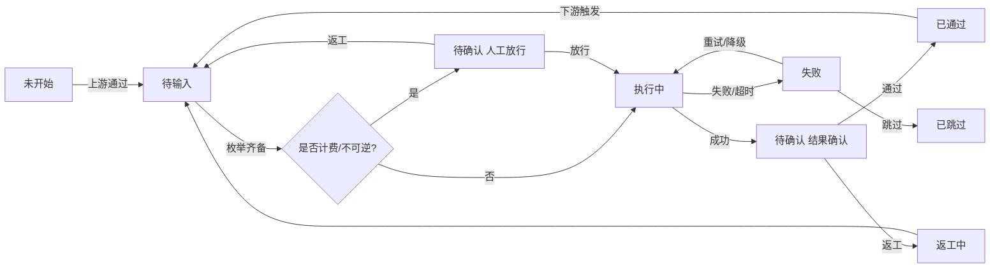

# 通用视频创作项目管理工作台｜结构化需求设计文档 v1.1（决策落地版）

> 文档日期：2026-11-09（v1.0 同日；v1.1 依据用户 22:3x 追加的 Q01–Q20 拍板结果修订）
> 蓝本来源：`D:\WorkBuddy_space\WorkBuddy全流程短视频创作空间\短剧实测\` 及同级 `带货短剧方案可行性评估与本机部署分析.md`
> 演进阶段：**页面搭建（第一期仅 PC 网页端）**；本轮交付静态可运行原型，未接后端与数据层；范围变更与交付物见 **§14**
> 决策状态：Q01–Q20 已由用户逐条拍板，原始记录见**附录 C**；落地对照见**§13**
> **优先级声明**：v1.0 正文中凡与 §13 / 附录 C 结论冲突的表述，**一律以 §13 为准**；§13 逐条列出被覆盖的章节与新条款
> 适用基准：以 2026-11-09 的蓝本文件状态与当日市面分类调研为准；涉及具体平台能力、按钮名、字段名、模型清单的部分一律标注「需以平台实际文档/界面核实」
> 标注口径：`[事实]` = 蓝本文件可核验的既有内容；`[设计]` = 本工作台的需求提案；`[已确认]` = 用户拍板结论；`[待确认]` = 历史标注（R1/R2/R3 闭环后已无残留待确认项）
> 数据纪律：本轮对蓝本目录**全程只读**，未创建、未改名、未删除任何既有文件；按 Q06「不覆盖旧文件」新建 v1.1，v1.0 原样保留
> 目录名：Q15 判定 `WorkBudddy`（3 个 d）为笔误（正确 `WorkBuddy`）；**R1 已于 2026-11-09 22:56 执行完成**，现行目录 `D:\WorkBuddy_space\WorkBuddy全流程短视频创作空间\`，旧拼写目录完整保留为回滚副本，详见 §6.1 / §13.3

---

## 0. 结论前置

**一句话结论**：蓝本已经把「一个带货短视频项目」跑通并迭代了 5 轮，但它是一个**单项目、单目录、靠文档和人工约定维系**的执行痕迹；要做成通用工作台，核心不是补功能，而是把散落的东西收编成 5 个可管理对象：**项目 → 流程节点 → 枚举输入 → 文件/版本 → 调用与变更记录**。

**蓝本暴露的 5 个真实痛点（均为 [事实]）**

| # | 痛点 | 证据 |
|---|---|---|
| 1 | 提示词没有独立资产：散落在报告、说明文档、工具调用里，原文第 3 段提示词缺失且未补写 | `实跑复现报告.md` §1、`分镜01_修订内容.md` §3、`镜2人物重绘说明.md` §7 |
| 2 | 命名双轨且不统一：交付层用中文长名（`成片_动态紧凑版_滑切_人物统一版.mp4`），构建层用 ASCII 短名（`m02.mp4`、`cp_1.5.png`、`v2_9.10.png`） | 目录清单 |
| 3 | 版本靠文件名后缀链表达，无版本号、无机器可读清单 | `成片.mp4` → `成片_动态紧凑版.mp4` → `..._滑切.mp4` → `..._人物统一版.mp4` |
| 4 | 路径硬编码导致目录迁移要修 **30 处 / 7 个文件**，且出现 4 种路径写法 | `.workbuddy/memory/2026-11-09.md` §任务目录迁移 / §二次迁移 |
| 5 | 「覆盖 vs 新建」「是否放行计费生成」全靠人工约定与当轮确认，没有留痕机制 | `成片_人物统一版说明.md` §2、§七；`动态紧凑版说明.md` §五 |

**演进地图（首次接手，标注当前位置）**

```
需求盘点 → 页面搭建 → 数据接入 → 自动化流程 → 优化迭代
   ◉ 当前位置
```

**方案二选一（已拍板：Q01 = 自研 Web 工作台，采用 A 版最小闭环型）**

| 方案 | 范围 | 适合 | 本轮建议 |
|---|---|---|---|
| **A. 最小闭环型（MVP）** | 多项目 CRUD/切换 + 12 节点状态流 + 全枚举输入 + 目录/命名/变更记录规范 + 资产库基础 + 调用规则与记录模板 | 先把「管得住」跑通，真实生成调用后置 | **推荐** |
| B. 全面搭建型 | 在 A 之上，第一版即接真实技能/模型自动调用、无限画布、桌面打包、自动质检 | 一次性交付，但计费与写操作风险高、返工成本高 | 暂不推荐 |

**本轮明确不做**：写任何代码、创建项目实例目录、改动蓝本既有文件的历史内容、接入线上真实业务数据、执行任何计费生成动作、覆盖 v1.0 文档（Q06 硬约束）、**删除旧拼写目录（R1 保留为回滚副本，待用户手动清理）**。

**原假设收敛情况（v1.0 的 5 条假设，均已由 Q01–Q20 证实或修订）**

| 编号 | 原假设 | 拍板结论 | 状态 |
|---|---|---|---|
| A1 | 自研移动端优先 Web 工作台 | Q01「Web 工作台」 | 已确认 |
| A2 | 单人、本地文件存储 | Q02「先实现单人使用」、Q03「先用本地存储」 | 已确认 |
| A3 | v1 只做规则/配置/记录，不真实自动调用 | **Q04 修订**：优先免费技能与模型并允许真实调用；计费能力由用户选择或确认后使用 | **已修订** |
| A4 | 自定义工作目录、不上云 | Q05 追加约束：不允许跨盘符、不允许网络盘，允许中文路径 | 已确认（加约束） |
| A5 | 不覆盖旧文件、写前确认 | **Q06 升格为系统硬约束**，并允许「用户手动删除」 | 已确认（升格） |

> **冲突提示**：Q07 / Q17 / Q19 / Q04 / Q11 / Q15 与 v1.0 正文的核心约束正面冲突，已在 §13 逐条列出覆盖条款，正文关键处同步修订。

---

## 1. 蓝本流程逆向分析

### 1.1 证据清单

| 类别 | 文件 | 作用 |
|---|---|---|
| 原文评估 | `带货短剧方案可行性评估与本机部署分析.md` | 原文 18 步、3 段提示词（缺第 3 段）、产物数据、6 维评估、本机环境 |
| 实跑主报告 | `短剧实测/实跑复现报告.md` | 18 步对照、交付清单、差异、质检、复跑命令 |
| 脚本与清单 | `分镜脚本.md`、`配音清单.json`、`字幕01–04.txt` | 内容规格、配音参数、台词文本 |
| 构建脚本 | `_build/tts/tts.js`、`_build/work/filter*.txt` | TTS 生成、ffmpeg 滤镜、CRLF 处理 |
| 迭代说明 | `分镜01_修订内容.md`、`动态紧凑版说明.md`、`镜2人物重绘说明.md`、`成片_人物统一版说明.md` | 5 轮迭代的输入/输出/提示词/验收/回滚 |
| 工程记忆 | `.workbuddy/memory/2026-11-09.md` | 全流程时间线、技术坑、迁移记录、目录约定 |

### 1.2 目录现状（[事实]，已排除 `node_modules`）

```
短剧实测/
├─ 分镜01.png ~ 分镜04.png                 # 交付层：分镜图（1024×1536）
├─ 分镜02_重绘.png / 镜2人物对比.png / 成片镜2人物前后对比.png
├─ 分镜脚本.md / 字幕01–04.txt / 配音清单.json / font.ttf
├─ audio/voice01–04.mp3                    # 交付层：配音
├─ 成片.mp4                                # v1 静态版
├─ 成片_动态紧凑版.mp4                     # v2 叠化
├─ 成片_动态紧凑版_滑切.mp4                # v3 滑切（推荐）
├─ 成片_动态紧凑版_滑切_人物统一版.mp4      # v4 人物统一（最终推荐）
├─ 分镜01_修订版.mp4
├─ 实跑复现报告.md / 4 份「说明」md
└─ _build/                                 # 构建层：全部 ASCII 短名
   ├─ tts/       tts.js、package.json、package-lock.json、node_modules
   ├─ work/      img01–04.png、m01–m04.mp4、m02_旧短发版备份.mp4、
   │             v01–v04.mp3、sub01–04.txt、filter*.txt、compact*.mp4、
   │             qc2/qc12/qc24.png、cp_*.png / sl_*.png / v2_*.png / act_*.png / rev_*.png
   ├─ video/     「3D_动画电影风格_皮克斯式卡通_竖屏构图_分镜N_场景_ISO时间戳.mp4」
   └─ redraw/    「Image_to_image_edit_with_TWO_r_ISO时间戳.png」、panel_old/new.png
```

> [事实] 全量 627 文件 / 209 MB（含依赖）；业务层文件约 100 个。`_build/work` 用纯 ASCII 文件名是刻意规避中文路径 + CRLF 坑，见 `实跑复现报告.md` §六。

### 1.3 任务节点还原（[事实]：从原文 18 步 + 5 轮迭代归纳）

| 节点 | 名称 | 输入 | 处理 / 能力 | 输出（实际文件） | 验收/状态 |
|---|---|---|---|---|---|
| N00 | 立项建目录 | 用户需求、指定路径 | 新建目录 | `短剧实测/` | 已建 |
| N01 | 主题与规格确认 | 原文第 1 段提示词 | LLM 理解 | 30s / 9:16 / 4 镜 / 智能空气炸锅 / 3D 皮克斯 | 人工确认 |
| N02 | 分镜脚本生成 | N01 规格 | LLM 文本生成 | `分镜脚本.md`（《11.11 前夜，厨房大战》4 镜 + 台词 + 运镜字幕规格） | 人工确认 |
| N03 | 能力与工具盘点 | 环境 | 本地探测 + 联网检索 | ffmpeg 9.0.2(drawtext/zoompan/libx264/aac)、Node v22.22.2、内置绘图；缺 Python 与 edge-tts | 盘点表 |
| N04 | 分镜图生成 | 脚本镜号 + 风格枚举词 | 内置联网绘图 | `分镜01–04.png`（1024×1536） | 逐张目检 |
| N05 | 画面质检 | 4 张图 | 人工逐帧 | 分镜03 中文清晰；分镜02 中文模糊 + 机身误显「25」；分镜04 略变形 | **部分不通过，缺陷如实保留** |
| N06 | 配音 + 字幕 | 4 句台词、音色、语速 | Node `msedge-tts@2.1.1` / `zh-CN-XiaoxiaoNeural` / `+8%` | `audio/voice01–04.mp3`(16.2s)、`字幕01–04.txt`(UTF-8 LF)、`配音清单.json`、`tts.js` | `hasCR=false`×4 |
| N07 | 渲染合成 | 4 图 + 4 音 + 4 字幕 + font | ffmpeg filtergraph（zoompan + drawtext + concat + amix） | `_build/work/out.mp4` → `成片.mp4`（30.000s / 1080×1920 / 24fps / H.264 yuv420p / AAC 44.1k mono / faststart / 8.12MB） | 合成 113s |
| N08 | 质检与自愈 | 成片 | 全片解码、3 帧逐帧、CRLF 扫描、ffprobe | `qc2/qc12/qc24.png`、`实跑复现报告.md` | 解码 exit 0；字幕无「口」方块 |
| N09 | 归档交付 | 全部产物 | 清单 + 耗时汇报 | 交付清单 + 报告 | 技术验收（GUI 播放未执行） |
| N10 | 迭代① 图生视频 | 分镜图 + 动作提示词 | `VideoGen`（`buddy-multimodal-generation` 技能路由），**串行** | `_build/video/*.mp4`（768×1152 / 5.1667s / 24fps / 带 AAC 环境音） | 并行 3 段全部 5000ms 超时 → 串行成功 |
| N11 | 迭代② 紧凑剪辑 | 4 段动态 + 配音 | ffmpeg `xfade` + `tpad` + `adelay` + `amix` | `成片_动态紧凑版.mp4`(18.208s 叠化) / `..._滑切.mp4`(slideleft 推荐) | 叠化有「双人鬼影」→ 滑切消除 |
| N12 | 迭代③ 镜 1 修订 | 首帧图 + 修订提示词 | VideoGen + 音画对齐 | `分镜01_修订版.mp4`、`分镜01_修订内容.md` | 人声首字与字幕首字同帧；volumedetect 分段验收 |
| N13 | 迭代④ 镜 2 人物重绘 | 镜 1 人物参考 + 镜 2 场景参考 | `ImageGen` 双参考图（`image1`/`image2`） | `分镜02_重绘.png`、`镜2人物对比.png`、`镜2人物重绘说明.md` | 放大裁切对比确认非人物元素不变 |
| N14 | 迭代⑤ 人物统一成片 | 重绘图 + 原 filter | VideoGen 单段 + 备份替换 + 复跑合成 | `成片_动态紧凑版_滑切_人物统一版.mp4`、`成片_人物统一版说明.md` | 437 帧 / 18.208s；音轨能量与旧版完全一致；旧 3 片未覆盖 |
| N15 | 目录迁移 ×2 | 用户指定新路径 | 批量路径替换 | 30 处 / 7 文件修正；4 种路径写法全覆盖 | `node --check` 通过、旧路径 0 残留、文件数 627 不变 |

**关键流程特征（[事实]）**

- 不是一次性线性流程，而是「主线 9 节点 → 多轮局部返工 → 每轮新建文件保留旧版」的**回环式生产**。
- 每轮迭代都有：明确范围 → 人工确认 → 新文件不覆盖 → 说明文档 → 可回滚方法（如 `m02_旧短发版备份.mp4` 复制回 `m02.mp4` 重跑）。
- 质检贯穿全程（画面质检、CRLF、抽帧、解码、能量对比），是「验收前置」而非末端一步。
- 生成类动作（绘图、VideoGen）按积分计费，**实际扣费未经核实**，且执行前需告知/确认。

### 1.4 输入输出清单（[事实]）

| 类型 | 具体项 |
|---|---|
| 文本输入 | 原文 3 段提示词（第 3 段缺失）、分镜脚本、4 句台词、生图/生视频/图生图提示词、ffmpeg 滤镜脚本 |
| 结构化输入 | `配音清单.json`（voice / rate / lines[].text,audio,subtitle,subtitleHasCR,audioBytes）、`package.json` |
| 素材输入 | 4 张分镜图、1 张重绘图、人物参考图、`font.ttf`(simhei)、4 个 mp3、4 个字幕 txt |
| 工具/环境输入 | ffmpeg 9.0.2、Node v22.22.2、msedge-tts、内置绘图、ImageGen、VideoGen |
| 文本产物 | 分镜脚本、实跑复现报告、4 份迭代说明、修订内容 |
| 图像产物 | 4 张分镜图 + 重绘图 + 2 张对比图 + 大量质检帧/裁切帧 |
| 音频产物 | 4 个配音 mp3 |
| 视频产物 | 4 段 5s 动态片段、1 个镜 1 修订片段、4 个成片版本 |
| 验收产物 | `配音清单.json` 自检字段、`qc*.png`、报告内 ffprobe/解码/能量实测值 |

### 1.5 提示词资产现状（[事实]）

| 类别 | 存放位置 | 完整性 |
|---|---|---|
| 需求侧 3 段提示词（原文） | `带货短剧方案可行性评估与本机部署分析.md` §1.3 逐字收录 | **第 3 段原文未给出，未自行补写** |
| 生视频提示词（修订版全文） | `分镜01_修订内容.md` §3 | 完整，含与上版逐字差异表 |
| 图生图提示词（英文全文） | `镜2人物重绘说明.md` §7 | 完整，含 `size=1024x1536`、`quality=high`、`image1/image2` 参数 |
| 人物约束补丁 | `成片_人物统一版说明.md` §2 | 完整，注明「动作/运镜/场景描述逐字未改」 |
| 生图风格词 | 散落在文件名 `3D_动画电影风格_皮克斯式卡通_竖屏构图_分镜N_场景` | 仅片段，无独立文件 |

> **这是工作台最该解决的一点**：提示词是核心生产资产，却以「文档段落 / 文件名 / 工具调用参数」三种形态散落，无法按项目、按节点、按版本检索与复用。

### 1.6 命名方式现状（[事实]）

| 模式 | 示例 | 用途 |
|---|---|---|
| 中文业务名 + 两位序号 | `分镜01.png`、`字幕01.txt`、`audio/voice01.mp3` | 交付层，按镜号 1:1 |
| 中文业务名 + 后缀链 | `成片_动态紧凑版_滑切_人物统一版.mp4` | 版本表达，靠后缀堆叠 |
| 中文业务名 + 用途后缀 | `分镜01_修订版.mp4`、`分镜02_重绘.png`、`镜2人物对比.png`、`成片镜2人物前后对比.png` | 变体与对比图 |
| ASCII 短名 + 序号 | `img01.png`、`m01.mp4`、`v01.mp3`、`sub01.txt`、`filter.txt` | 构建层，规避中文路径 |
| ASCII 短名 + 数值 | `cp_1.5.png`、`sl_9.10.png`、`rev_4.95.png`、`v2_16.0.png` | 质检抽帧（前缀=版本/用途，数字=时间戳秒） |
| ASCII 短名 + 中文备份说明 | `m02_旧短发版备份.mp4`、`compact_slide_v2.mp4` | 备份与二次合成 |
| 工具原始产物名 | `3D_动画电影风格_皮克斯式卡通_竖屏构图_分镜1_夜晚厨房_2026-11-09T07-03-58.mp4`、`Image_to_image_edit_with_TWO_r_2026-11-09T09-07-46.png` | 生成工具直接落盘，含风格词 + 场景 + ISO 时间戳 |
| 文档名 | `实跑复现报告.md`、`动态紧凑版说明.md`、`成片_人物统一版说明.md` | 说明与验收记录 |

**归纳出的规则缺陷**：无统一版本号；无状态标识（draft/final）；显示名与磁盘名混用；备份与正式产物同级；文档内绝对路径硬编码；复用/引用关系不可查。

### 1.7 既有事实 vs 待确认项（严格分列）

**[事实] 已确定，可直接作为设计输入**

1. 项目规格参数确实存在且可枚举：30s / 9:16 / 4 镜 / 3D 动画电影风格·皮克斯式卡通 / 竖屏 / 中文女声 / `+8%` / 1080×1920 / 24fps / H.264 yuv420p / AAC 44.1k mono / faststart。
2. 音色是可复用资产：`zh-CN-XiaoxiaoNeural`（晓晓）+ `+8%` 在多次迭代中保持不变。
3. 角色一致性是真实痛点：4 段人物发型/服装不一致，靠「镜 1 人物参考图 + 双参考图重绘」解决，且只修了镜 2。
4. 质检项是可枚举的：CRLF、中文渲染、抽帧时刻（2/12/24s 或 1.5/6.5/11.5/16.0s）、全片解码、音轨能量、转场鬼影/黑帧。
5. 转场/编码/工具坑是可枚举知识：xfade fade 会鬼影、slideleft 不会；ffmpeg 9.0.2 不支持 `-filter_complex_script`；并行 VideoGen 超时。
6. 「新版本不覆盖旧文件」「复跑命令 + 回滚方法写进说明文档」是被反复执行的真实约定。
7. 输出编码必须保证浏览器可预览（原文踩过「编码不支持在线预览」，本次用 H.264 + faststart 规避）。

**[原待确认项｜已于 2026-11-09 全部拍板，结论见 §12 / 附录 C]**

> 下表保留 v1.0 的原始问题与影响描述用于追溯；**结论不再以本表为准**，统一以 §12「决策结果表」与附录 C 用户原始记录为准。

| 编号 | 待确认项 | 影响 |
|---|---|---|
| Q01 | 工作台形态：自研 Web vs 低代码平台内搭建 | 决定全部技术章节 |
| Q02 | 是否多人协作 / 权限模型 | 决定项目与资产库的隔离设计 |
| Q03 | 数据存储：本地文件 / 本地数据库 / 云端 | 决定变更记录与资产索引实现 |
| Q04 | 第一版是否允许真实自动调用计费技能与模型 | 决定安全与人工确认节点设计 |
| Q05 | 工作目录是否允许跨盘符、网络盘、中文路径 | 决定路径校验与 ASCII 别名策略 |
| Q06 | 「不覆盖旧文件」「写前确认」是否升格为系统硬约束 | 决定写入层设计 |
| Q07 | 主题是否必须 100% 枚举化（含自定义标签的准入流程） | 决定枚举字典治理规则 |
| Q08 | 项目类型清单与各自流程模板 | 决定节点模板映射 |
| Q09 | 枚举字典由谁维护、新增选项的评审流程 | 决定配置中心设计 |
| Q10 | 资产授权 / AI 生成标识 / 水印处理策略（蓝本明确「原文未涉及」） | 决定资产元数据与合规字段 |
| Q11 | 桌面打包技术选型 | 决定兼容性章节 |
| Q12 | 单文件上传上限、总容量上限、清理策略 | 决定上传与 `_build` 治理 |
| Q13 | 是否接入线上真实业务数据（默认否） | 安全红线 |
| Q14 | 积分/成本是否记录、是否展示估算值 | 决定调用记录成本字段 |
| Q15 | 目录名 `WorkBudddy`（3 个 d）是否为笔误 | 蓝本记忆已标「待用户核对」，影响默认工作目录示例 |
| Q16 | 页面视觉是否需要跟随系统深色/浅色 | 决定主题层 |
| Q17 | 提示词是否允许「只读查看 + 复制」但禁止任何编辑 | 与全枚举输入强相关 |
| Q18 | 项目大纲中哪些字段允许受控自由文本 | 与「禁止自由文本」边界相关 |
| Q19 | 变更记录是否允许删除/归档 | 决定不可变性设计 |
| Q20 | 第一版是否需要离线可用 | 决定资源与缓存策略 |

---

## 2. 需求总览

### 2.1 目标

把「一次性的、靠人记的、靠文件名表达版本的视频创作流程」，升级为**可管理多个不同类型视频项目、流程可视、状态可追、输入可控、产物可循、资产可复用**的通用工作台。类型不限于带货短视频。

### 2.2 功能域清单（覆盖用户全部要求）

| 编号 | 功能域 | 对应用户要求 | 章节 |
|---|---|---|---|
| FR-01 | 多项目创建 / 切换 / 管理，类型不限 | ① | §3 |
| FR-02 | 可视化进度流程、节点状态与流转、每节点可见可操作输入输出区 | ② | §4 |
| FR-03 | 全枚举输入字段 + 预设选项 + 仅选择控件 + 主题枚举化 | ③ | §5 |
| FR-04 | 自定义工作目录、目录规范、统一命名、项目大纲、完整变更记录 | ④ | §6 |
| FR-05 | WorkBuddy 技能/专家/模型匹配规则、自定义配置、结果记录 | ⑤ | §7 |
| FR-06 | 资产库：图片/角色/音色录入、分类、元数据、跨项目复用、版本状态 | ⑥ | §8 |
| FR-07 | 第一版移动端优先页面范围 / 信息架构 / 窄屏约束 / 桌面打包兼容 / 演进边界 | ⑦ | §9 |
| FR-08 | 视觉基调、信息密度、组件呈现（参照 libTV / 即梦） | ⑧ | §10 |
| FR-09 | 需求边界、非功能要求、可验收标准 | ⑨ | §11 |

### 2.3 数据对象关系（[设计]）

```
项目 Project ──< 版本 Version ──< 节点实例 NodeRun ──< 调用记录 CallRecord
   │                                  │
   │                                  ├── 输入快照（全枚举）
   │                                  ├── 提示词快照（只读）
   │                                  └── 输出资产（引用 Asset）
   │
   ├── 项目大纲 Outline ── 枚举字段集合
   ├── 变更记录 Changelog（追加、不可变）
   └── 资产引用 AssetRef ──> 资产库 Asset（图片 / 角色 / 音色 / …）
                                  └── 可被多个项目引用
```

---

## 3. FR-01 项目域：创建 / 切换 / 管理

### 3.1 项目实体字段（[设计]，除注明外均为枚举控件）

| 字段 | 控件 | 说明 |
|---|---|---|
| `project_id` | 系统生成（只读展示） | `P_<YYYYMMDD>_<3位序号>`，不可编辑 |
| `project_code` | 选择 + 系统建议 | 用作文件名的 ASCII 代号，如 `AF30`；由项目类型 + 主题标签自动建议，用户从建议项中单选 |
| 显示名称 | 由枚举自动生成（只读展示 + 从候选标题模板单选） | 禁止自由文本输入，见 §5.4 |
| `project_type` | 单选（下拉/分段） | 见 §5.2 类型枚举 |
| `platform_target` | 多选标签 | 投放平台，影响推荐分辨率/比例/帧率 |
| 规格包 | 单选 | 分辨率 / 比例 / 风格 / 帧率 / 时长 / 编码（见 §5） |
| `work_dir` | 目录选择器（系统目录选择，非文本输入） | 见 §6.1 |
| `outline` | 表单（全枚举） | 见 §6.4 |
| 项目状态 | 只读徽标 | 进行中 / 待确认 / 已交付 / 已归档 / 已暂停（系统流转） |
| 当前版本 | 只读 | 指向最近一个 `Version` |
| 创建/更新时间 | 只读 | ISO 8601 |

### 3.2 项目操作矩阵

| 操作 | 入口 | 约束 |
|---|---|---|
| 创建 | 项目列表「新建」→ 全枚举向导（3 步：类型 → 规格包 → 工作目录） | 创建后 `project_type` 不可改；改需派生新项目 |
| 切换 | 顶部项目切换器（下拉单选）+ 列表点击 | 切换时保留各项目当前节点位置；不跨项目串数据 |
| 复制为模板 | 项目详情「另存为模板」 | 复制大纲与枚举配置，不复制产物文件 |
| 归档 | 项目详情 → 二次确认 | 只读化，不删除文件 |
| 删除 | 项目详情 → **人工确认节点** | 第一版仅允许「解除登记」（不动磁盘文件）；物理删除列入 v2 且需说明影响范围 + 等确认 |
| 检索/筛选 | 按类型、状态、平台、更新时间（全部选择控件） | 无文本搜索框 |

### 3.3 项目类型 → 流程模板映射（[设计]，MVP 最简版）

| 项目类型 | 默认节点链（节点定义见 §4） | 与蓝本关系 |
|---|---|---|
| 带货短视频 | N01→N02→N03→N04→N05→N06→N07→N08→N09 | 蓝本主线 |
| 剧情短剧 / 漫剧 | 上述 + 角色建库、分集大纲、多镜一致性节点 | 蓝本 N13/N14 的通用化 |
| 口播 / 知识科普 | N01→N02→N03→N06→N07→N08→N09 | 跳过生图/生视频 |
| 产品宣传片 | 主线 + 产品特写、卖点字幕节点 | 蓝本「顶部加产品卖点大字」后续动作 |
| 图文动效 / Vlog | 主线（素材以上传为主） | — |
| 音乐 MV / 混剪 | 主线 + 音频驱动、卡点节点 | — |

> **节点链路精简**：上表为蓝本主线节点链；推荐精简链路（12→8，主链线性段由 9 步降至 4 步）见 §4.1.1。

> **Q08 已拍板**：第一期**不支持自定义模板**，项目类型枚举仅上列 6 类；「自定义模板」类型已从 §5.3 C 的 `project_type` 枚举中移除，列入 v2 演进。
> 模板是「节点子集 + 默认枚举值」，不是硬编码流程；用户可在配置页调整节点启用状态（开关控件），调整写入变更记录。

---

## 4. FR-02 流程域：可视化进度、状态与节点输入输出区

### 4.1 MVP 最简流程（先跑通，不上一来就搞复杂编排）

```
(立项) → [N01 主题/规格] → [N02 大纲/脚本] → [N03 素材准备] → [N04 生成执行] → [N05 质检确认] → (交付)
              ↑                                        │
              └──────────── 返工 / 重做 ←──────────────┘
```

完整版 12 节点（[设计]，与蓝本映射）：以下为完整节点定义（旧编号保留作兼容别名）；精简合并视图见 §4.1.1。

| 节点码 | 名称 | 节点类型 | 蓝本对应 |
|---|---|---|---|
| N01 | 主题与规格确认 | 人工 + 枚举输入 | 原文第 3 步 |
| N02 | 项目大纲 / 分镜脚本 | 生成 + 人工确认 | `分镜脚本.md` |
| N03 | 能力与资源盘点 | 只读探测 | 原文第 5–6 步 |
| N04 | 资产准备（上传 / 引用 / 角色建库） | 人工 | 分镜图、参考图、音色、字体 |
| N05 | 提示词生成与查看 | 生成 + 只读 | 散落的 4 类提示词 |
| N06 | 分镜图 / 素材生成 | 生成（计费，需确认） | N04 原文 / ImageGen |
| N07 | 画面质检 | 人工 + 自动项 | 原文第 9–10 步 |
| N08 | 配音 / 字幕 / 音色 | 生成 + 人工确认 | `tts.js`、配音清单 |
| N09 | 片段生成（图生视频） | 生成（计费，需确认） | VideoGen 串行 |
| N10 | 剪辑合成 | 生成 + 人工确认 | ffmpeg filtergraph |
| N11 | 成片质检与验收 | 人工 + 自动项 | 3 帧质检、全片解码 |
| N12 | 归档交付 | 人工确认 | 交付清单 + 报告 |

#### 4.1.1 节点链路精简合并（推荐：12→8）

> 经依赖分析，N03（只读探测）、N05（只读提示词预览）、N07（画面质检）、N11（成片质检）、N12（归档）均为「伴随动作」类节点，可下沉进主生成节点，不再单列占卡片。精简后主节点为 **N01–N08**；主链线性段由 9 步降至 4 步（N01→N02→N03→N04→N07→N08），配音/视频为并行分支。完整方案、映射与风险见 `节点链路精简方案.md`。
>
> 用户已确认两个边界：① N07 画面质检 = **生完即检绑定**（并入 N04）；② N12 归档 = **保留人工确认**（N08，不作为纯自动动作）。

| 新节点 | 名称 | 合并来源（旧编号） | 类型 | 说明 |
|---|---|---|---|---|
| N01 | 项目初始化 | N01 规格 + N03 能力盘点 | 人工 + 只读探测 | 规格确认时顺带能力盘点 |
| N02 | 大纲 / 分镜脚本 | N02 | 生成 + 人工确认 | 含 G4 对话强约束 |
| N03 | 资产准备 | N04 | 人工 | 跨项目复用，独立保留 |
| N04 | 分镜生图与画面质检 | N05(嵌入) + N06 + N07 | 生成（计费）+ 质检绑定 | 提示词预览内嵌；生图后绑定质检（N07 生完即检） |
| N05 | 配音与字幕 | N08 | 生成 + 人工确认 | 提示词预览内嵌 |
| N06 | 图生视频 | N09 | 生成（计费） | 提示词预览内嵌 |
| N07 | 剪辑合成与成片验收 | N10 + N11 | 生成 + 验收 | 合成后直接解码抽帧验收 |
| N08 | 归档交付 | N12 | 人工确认 | **保留人工确认**（非自动动作） |

**精简后依赖拓扑**：

```
N01 → N02 → N03 → N04(分镜生图+质检)
                     ├──→ N05(配音)          [并行分支]
                     └──→ N06(图生视频)      [并行分支，依赖 N04 完成]
N04 + N05 + N06 → N07(剪辑合成+成片验收) → N08(归档，人工确认)
```

**旧→新编号兼容映射（供强约束引用追溯）**：N01→N01，N02→N02，N03→并入 N01，N04→N03，N05→嵌入 N04，N06→N04，N07→并入 N04，N08→N05，N09→N06，N10→N07，N11→并入 N07，N12→N08。强约束作用域更新见 §24 各条脚注（G1 画面生成类对应 N04/N06；G3 句级说话状态对应 N06；G4 下游消费对应 N05/N06）。

### 4.2 节点状态机（[设计]）

| 状态 | 含义 | 允许的操作 |
|---|---|---|
| `未开始` | 上游未完成 | 查看（只读） |
| `待输入` | 上游完成，枚举输入未齐 | 选择输入项、上传素材 |
| `待确认` | 输入齐备 / 生成完成，等待人工放行 | 通过 / 返工 / 跳过 |
| `执行中` | 调用进行中 | 查看进度、取消 |
| `已通过` | 人工确认通过 | 查看、发起返工（生成新版本） |
| `返工中` | 被打回，需重新执行 | 修改枚举选项、重新生成 |
| `失败` | 调用超时 / 报错 / 降级失败 | 重试、切换降级链、跳过 |
| `已跳过` | 模板未启用或人工跳过 | 查看跳过原因 |

**流转图**



**流转规则**：① 上游非 `已通过/已跳过` 时下游保持 `未开始`；② 每次状态变化写一条变更记录（§6.5）；③ `已通过` 节点被返工时，其下游全部回到 `未开始`，但**已生成文件不删除**（蓝本「不覆盖旧文件」）；④ 计费生成、覆盖等价操作、对外发布、删除 必须经 `待确认` 人工放行，确认前不得执行。

### 4.3 节点详情「三区」结构（每个节点可见、可操作）

| 区 | 内容 | 控件 |
|---|---|---|
| **输入区** | 本节点全部枚举字段（§5）、依赖的上游产物、素材上传/引用入口 | 单选/多选/标签芯片/分段/步进器/目录与文件选择器；**无任何文本输入框** |
| **执行区** | 生成的提示词全文（**可编辑，Q17**；复制 + 版本对比）、匹配的技能/专家/模型标签、参数快照、执行日志、耗时与成本估算 | 编辑后「另存为新版本」（自动存 diff + 写变更记录）+ 「重新生成」「查看上一版」「导出任务包」 |
| **输出区** | 产物缩略图/播放器、文件路径（末两级 + 复制全路径）、命名与版本、质检结果、状态徽标 | 「通过 / 返工 / 跳过」三选；返工原因从枚举中单选；结果确认留痕 |

**四类指定操作的落地**

| 操作 | 位置 | 交互 |
|---|---|---|
| 主题选择 | N01 输入区 | 标签芯片多选（题材/场景/卖点/情绪/人群），实时显示组合结果与系统建议标题（单选采纳），见 §5.4 |
| 输出提示词查看与编辑 | 执行区 | 可折叠、一键复制、可查看与上一版逐字差异（蓝本 `分镜01_修订内容.md` 已用此形态）；**Q17 允许编辑**，编辑后另存新版本并留痕；可枚举字段仍零自由文本（Q18） |
| 素材上传 | N04 输入区 | 系统文件选择器 → 自动归类到内容分类 → 自动按 §6.3 重命名 → 登记资产元数据与来源；支持从资产库「引用」而非重复上传 |
| 结果确认 | 输出区 | 通过 / 返工 / 跳过；返工原因枚举；确认人、时间、版本写入变更记录；通过后自动解锁下游 |

### 4.4 流程图可视化要求（移动端优先，[设计]）

- 主视图：**纵向步骤条**（节点码 + 名称 + 状态徽标 + 完成时间 + 产物数量），当前节点高亮并展开三区。
- 辅助视图：顶部横向迷你进度条（已完成 / 总数），可横向滑动但不承载操作。
- 返工回环：在节点卡片上以「返工来源：N07 → 第 2 次」标签表达，不画连线（窄屏不可读）。
- 桌面版（v2）才引入画布视图与连线；第一版**禁止拖拽画布**。

---

## 5. FR-03 输入域：全枚举字段与预设选项

### 5.1 强制设计规则（[设计]，本工作台的核心约束）

1. **所有可枚举输入字段，界面上只提供选择控件**：单选按钮 / 下拉 / 分段控件 / 多选标签芯片 / 级联选择 / 步进器 / 开关 / 日期与目录选择器。**禁止出现可接受任意字符的文本框**（非枚举白名单字段见规则 7，不属于可枚举字段）。
2. 路径、显示名、文件名等由系统按枚举组合 + 模板**自动生成并只读展示**；**提示词例外（Q17 已确认允许编辑）**：编辑后必须另存为新提示词版本、保留原文与逐字 diff、写变更记录，且编辑不反向改写枚举输入快照。
3. 确需补充说明的场景（返工原因、变更说明、缺陷描述）一律提供**枚举原因码 + 可选受控短文本**（长度上限、禁止换行、禁止路径/密钥）；是否开放受控文本列入 Q18。
4. 枚举字典是版本化配置资产：**允许用户在字典管理页新增选项（Q09）**，新增项须登记来源（调研 / 蓝本 / 行业通识 / 用户自定义）、字典版本与创建时间，并写入变更记录；新增的是「选项」而非「字段值输入框」，界面仍只呈现选择控件（Q07/Q18 边界，不退化成自由文本）。
5. 每个选项保留「依据」与「核实状态」两个元数据，界面可在「选项说明」里查看，避免把未核实的平台能力当成事实。
6. 所有输入在提交时生成**输入快照**并绑定节点实例与提示词版本，保证可复跑、可追溯（对应蓝本 `配音清单.json` 的做法）。
7. **自由文本白名单（2026-11-10 用户新增，见 §15）**：仅以下 4 类非枚举字段允许自由文本，均有长度上限与字数计数，且每次修改写变更记录；**白名单之外一律不得出现可输入任意字符的文本框**。

   | 白名单字段 | 位置 | 上限 | 约束 |
   |---|---|---|---|
   | 提示词编辑（Q17） | 节点执行区 | 不限（版本化） | 另存新版本 + 逐字 diff + 留痕 |
   | 字典项名称（Q09） | 枚举字典 → 新增选项 | ≤20 字 | 配置功能，登记来源 / 字典版本 / 创建时间 |
   | **项目标题自定义** | 新建向导（本轮新增） | ≤60 字 | 与「采纳系统建议」二选一；空值阻断提交 |
   | **创作描述** | 新建向导 + 总览 + 节点输入区（本轮新增） | **≤1000 字** | 纯文本、实时字数计数、注入提示词/输入快照/任务包 |

### 5.2 调研依据（[事实]：2026-11-09 检索所得，具体字段以各平台官方最新文档为准）

| 来源 | 关键结论 |
|---|---|
| 极客智坊《创建视频任务》参数表 | 即梦 Seedance：480p/720p/1080p，比例 16:9 / 4:3 / 1:1 / 3:4 / 9:16 / 21:9；可灵 Kling：720p(std)/1080p(pro)/4k(v3 起)，比例 16:9 / 9:16 / 1:1；通义万相：480p/720p/1080p；Sora-1 明确列出 1080×1920、1920×1080、1080×1080 等尺寸 |
| 腾讯云开发者社区《视频生成模型 API 接入实战》 | 三家统一参数维度：分辨率、宽高比、时长、帧率、运动强度、首尾帧、镜头控制；分辨率 480p/720p/1080p，比例 16:9/9:16/1:1，时长 5s/10s |
| 短视频平台参数规范类资料（闪控猫、上海知映、剪辑教练等） | 抖音/快手/视频号/小红书：9:16、1080×1920、30fps、MP4/H.264、AAC；B站/YouTube：16:9、1920×1080；24fps 电影感 / 30fps 通用 / 60fps 运动；25fps 国内标准 |
| AI 视频风格汇总与提示词攻略（18183、Seedance2Prompt、翔宇工作流等） | 风格分写实影像 / 国风 / 二次元动画 / 科幻潮流 / 复古艺术手绘五大分支，约 18 类；另有情绪、灯光、运镜等维度 |
| LibTV / 即梦短剧工作室相关报道（网易、CSDN、搜狐、起剖） | LibTV：深色无限画布、节点式项目铺开、脚本/角色图在左 + 画布在右、每个视频组可查看与改提示词和参数、主体库存角色/场景/道具跨集调用；即梦短剧工作室：剧本→资产→分镜→生成→剪辑一条龙、资产全局共享、480P 试生成样片、智能预演、标签化输入（如 #泛人群 #悬疑 #反转） |

> 上述第 5 项用于视觉与信息架构参照（§10）；按钮名、字段名、具体界面布局**需以平台实际界面核实**，本报告不照抄。

### 5.3 全枚举字段总表（[设计]）

> 「依据」列：调研 = §5.2 来源；蓝本 = 源目录实证；通用 = 行业通识。标「待核实」的项需 Q09/Q14 拍板后启用。

#### A. 规格类（用户明确要求至少覆盖分辨率 / 风格 / 长宽比）

| 字段 | 控件 | 预设选项 | 依据 | 默认 | 多选 |
|---|---|---|---|---|---|
| 视频分辨率 `resolution` | 单选分段 | `480P` / `720P` / `1080P` / `2K` / `4K` | 调研：Seedance 480/720/1080；可灵 720p/1080p/4k；2K 为常见中间档**待核实** | `1080P` | 否 |
| 长宽比 `aspect_ratio` | 单选网格（带比例缩略图） | `9:16` / `16:9` / `1:1` / `4:3` / `3:4` / `21:9` | 调研：即梦 Seedance 六种；可灵三种 | `9:16` | 否 |
| 具体像素 `pixel_size` | 只读（由分辨率 × 比例联动） | `1080×1920` / `1920×1080` / `1080×1080` / `720×1280` / `1280×720` / `2160×3840` / `3840×2160` / `1024×1536` / `768×1152` | 调研 + 蓝本（分镜图 1024×1536、片段 768×1152、成片 1080×1920） | 联动 | — |
| 视觉风格 `style` | 两级级联（大类 → 具体风格） | 见 §5.3 风格字典 | 调研 5 分支 18 类 + 蓝本 3D 皮克斯 | `3D 动画 / 皮克斯式卡通` | 否（主风格） |
| 辅助风格 `style_modifier` | 多选（最多 1 项，避免冲突） | 柔光 / 胶片颗粒 / 高反差 / 低饱和 / 暖调 / 冷调 / 无 | 调研提示词攻略（「最多叠加一个辅助风格」） | `无` | 是（限 1） |
| 帧率 `fps` | 单选 | `24` / `25` / `30` / `60` | 调研 + 蓝本 24fps | `30` | 否 |
| 单片段时长 `clip_seconds` | 单选 | `5s` / `10s` | 调研（三家主流） | `5s` | 否 |
| 成片时长档 `duration_band` | 单选 | `≤15s` / `15–30s` / `30–60s` / `1–3min` / `3–10min` / `>10min` | 调研平台规范 + 蓝本 30s / 18.208s | `15–30s` | 否 |
| 镜头数 `shot_count` | 步进器（1–30） | 整数枚举 | 蓝本 4 镜 | `4` | — |
| 输出容器 `container` | 单选 | `MP4` / `MOV` / `WebM` | 调研（MP4 兼容性最强） | `MP4` | 否 |
| 视频编码 `video_codec` | 单选 | `H.264` / `H.265(HEVC)` | 调研 + 蓝本 H.264 | `H.264` | 否 |
| 像素格式 `pix_fmt` | 单选 | `yuv420p` / `yuv444p` | 蓝本 yuv420p | `yuv420p` | 否 |
| 音频编码/采样 `audio_codec` | 单选 | `AAC 44.1kHz mono` / `AAC 44.1kHz stereo` / `AAC 48kHz stereo` | 蓝本 + 调研 | `AAC 44.1kHz mono` | 否 |
| 浏览器可预览 `faststart` | 开关 | 开 / 关 | 蓝本（踩过编码不支持预览） | 开 | — |

#### B. 主题类（用户明确要求说明枚举化方式）

| 字段 | 控件 | 预设选项 | 依据 |
|---|---|---|---|
| 主题·题材 `theme_genre` | 标签芯片多选（≤2） | 带货种草 / 剧情反转 / 生活日常 / 知识科普 / 产品测评 / 品牌宣传 / 情感共鸣 / 节日热点 / 教程演示 / 采访口播 / 旅行记录 / 音乐舞蹈 | 蓝本（双 11 前夜带货 + 剧情冲突）+ 调研赛道分类 |
| 主题·场景 `theme_scene` | 标签芯片多选（≤2） | 厨房 / 客厅 / 办公室 / 街头 / 商场 / 户外自然 / 摄影棚纯色 / 车内 / 教室 / 虚拟场景 | 蓝本（夜晚厨房） |
| 主题·卖点 `theme_selling` | 标签芯片多选（≤2） | 省时省力 / 健康低脂 / 性价比 / 颜值设计 / 智能便捷 / 限时优惠 / 品质质感 / 情感陪伴 | 蓝本（30 秒/低脂晚餐/不耽误追剧） |
| 主题·情绪 `theme_mood` | 单选 | 治愈清新 / 欢快活泼 / 戏剧张力 / 悬疑紧张 / 史诗宏大 / 宁静舒缓 / 幽默诙谐 / 高级冷调 | 调研（mood 枚举 + 风格攻略） |
| 目标人群 `audience` | 多选标签 | 泛人群 / 上班族 / 宝妈 / 学生 / 银发 / 小微商家 / 极客 / 女性向 / 男性向 | 调研（即梦标签化输入 #泛人群） |
| 叙事结构 `narrative` | 单选 | 冲突-转折-解决 / 问题-方案-证据 / 前后对比 / 清单罗列 / 悬念揭晓 / 时间流水 | 蓝本 4 镜冲突结构 |
| 系统建议标题 | **单选采纳**（由标签组合生成 3 个候选） | 候选标题由模板渲染，非自由输入 | 蓝本《11.11 前夜，厨房大战》为生成结果 |

#### C. 生产类

| 字段 | 控件 | 预设选项 |
|---|---|---|
| 项目类型 `project_type` | 单选 | 带货短视频 / 剧情短剧·漫剧 / 口播科普 / 产品宣传片 / 图文动效·Vlog / 音乐 MV·混剪（**共 6 类，Q08：第一期不含自定义模板**） |
| 投放平台 `platform_target` | 多选标签 | 抖音 / 快手 / 微信视频号 / 小红书 / B站 / 微博 / YouTube / 自有渠道 |
| 运镜 `camera_move` | 多选 | 缓慢推近 / 拉远 / 左右摇 / 环绕 / 固定 / 手持轻晃 / 跟随 / 极慢推镜 |
| 转场 `transition` | 单选 | 硬切 / 叠化(fade) / 左滑(slideleft) / 右滑 / 淡入淡出 / 无 |
| 字幕位置 `subtitle_pos` | 单选 | 底部居中 / 底部居中+半透明条 / 顶部 / 中部 / 不烧录 |
| 字幕字体 `subtitle_font` | 单选（资产库引用） | 思源黑体 / 微软雅黑 / simhei / 系统默认 / 自定义（从资产库选） |
| 音色 `voice_id` | 单选（资产库引用） | `zh-CN-XiaoxiaoNeural`（晓晓）等，见 §8 |
| 语速 `voice_rate` | 单选 | `-10%` / `0%` / `+8%` / `+15%` / `+25%` |
| 配音语言 `voice_lang` | 单选 | 普通话 / 粤语 / 英语 / 日语 / 方言（待核实） |
| 背景音 `bgm_policy` | 单选 | 无 BGM / 片段自带环境音(压低 -20dB) / 平台曲库 / 自定义（资产库选） |
| 质检项集 `qc_items` | 多选 | CRLF 检查 / 中文渲染 / 抽帧目检 / 全片解码 / 音轨能量 / 转场鬼影 / 人物一致性 / 水印检查 / 编码可预览 |
| 抽帧时刻 `qc_timestamps` | 多选（预设时刻组） | `2/12/24s` / `1.5/6.5/11.5/16.0s` / `4.80/9.10s`(转场) / 自定义档（步进器） |
| 生成档位 `render_tier` | 单选 | 样片(480P/Draft) / 标准(720P) / 正式(1080P) / 高清(4K) |
| 并发策略 `concurrency` | 单选 | 串行(默认) / 低并发(2) / 高并发(≥3，需确认) |
| 水印策略 `watermark_policy` | 单选 | **不主动添加（默认，Q10）** / 保留工具自带水印 / 字幕条压暗遮挡 / 后期处理(待核实) |
| AI 生成标识 `ai_label` | 单选 | 按平台要求添加 / 不添加 / 待核实（蓝本「原文未涉及」） |

#### D. 治理类

| 字段 | 控件 | 预设选项 |
|---|---|---|
| 文件类型分类 `file_class` | 单选 | 输入 / 提示词 / 素材 / 产物 / 质检 / 构建中间物 / 文档 |
| 内容分类 `content_class` | 单选 | 主题 / 规格 / 脚本 / 分镜图 / 角色 / 场景 / 道具 / 片段 / 配音 / 字幕 / 字体 / BGM / 成片 / 质检帧 / 报告 |
| 版本状态 `version_status` | 只读徽标（系统流转） | 草稿 / 待审 / 已启用 / 已弃用 / 已归档 |
| 资产状态 `asset_status` | 只读徽标 | 草稿 / 待审 / 已启用 / 已弃用 / 已归档 |
| 变更原因码 `reason_code` | 单选 | 需求变更 / 质检不通过 / 人物一致性 / 中文渲染缺陷 / 参数调整 / 工具失败 / 目录迁移 / 版本回滚 / 合规要求 / 其他 |
| 返工原因码 `rework_reason` | 单选 | 风格不符 / 人物不一致 / 文字错误 / 时长超标 / 音画不同步 / 编码不兼容 / 生成失败 / 其他 |
| 状态（节点/项目） | 只读徽标 | 见 §4.2 / §3.1 |

### 5.4 主题枚举化方式（[设计]，按 Q07 调整为「可扩展枚举」）

> **Q07 已拍板「否」，R2 已确认选 A（2026-11-09 22:56）**：主题不再要求 100% 预设枚举，落地为「预设标签 + 用户可自行往字典新增标签（Q09）」，**仍不开放自由文本输入框**（Q18 不开放受控自由文本）；§5.1 规则 1 与 AC-12 维持不变，无需整体改写。

**问题**：主题天然像自由文本。若允许手输，「全枚举、只选择控件」的规则立刻被击穿。

**方案：标签组合 → 主题 ID → 提示词模板变量**

```
用户操作：题材[带货种草, 剧情反转] + 场景[厨房] + 卖点[省时省力] + 情绪[戏剧张力] + 人群[上班族]
   ↓ 系统生成
主题 ID：THM-G01-G02|S01|P01|M03|A02（有序拼接，可去重、可检索、可复用）
   ↓ 模板渲染
主题显示名（只读）：「双十一前夜·厨房里的省时反击」
   ↓ 注入
提示词变量：{{theme_tags}} {{scene}} {{selling_points}} {{mood}} {{audience}}
   ↓ 生成
N02 大纲 / N05 提示词（可编辑 Q17、可复制、可版本对比、另存新版本留痕）
```

- 标签字典只增不改码：**用户可在字典管理页自行新增标签（Q09，取消评审门槛）**，新增项登记来源（调研 / 蓝本 / 行业通识 / 用户自定义）、字典版本与创建时间；新增的是「选项」，选择控件形态不变（Q07 / R2 解读 A），不是自由文本输入框。
- 组合数量上限、冲突校验（如 `写实摄影` 与 `皮克斯 3D` 不可同时选为主风格）由系统自动拦截并给出枚举化的替代建议。
- 系统生成 3 个候选标题，用户**单选采纳**，不提供编辑框；若都不满意，回到标签区改标签重新生成。
- 主题快照随项目大纲、提示词版本一起存档，保证复跑时可还原（对应蓝本「台词逐字未改」的严谨做法）。

### 5.5 组合约束与联动（[设计]）

| 约束 | 规则 |
|---|---|
| 分辨率 × 比例 | 自动推导 `pixel_size`；不支持的组合（如 4K × 21:9）标红并禁用，给出可选替代项 |
| 平台 → 推荐规格 | 选抖音/快手/视频号/小红书 → 默认 `9:16 + 1080×1920 + 30fps + H.264/MP4`；选 B站/YouTube → `16:9 + 1920×1080`；用户可改但需选择理由（原因码） |
| 生成档位 → 分辨率 | 样片固定 480P，正式固定为项目分辨率；切换档位写变更记录 |
| 转场 × 人物一致性 | 当选 `叠化(fade)` 且人物一致性质检未通过时，系统建议 `左滑(slideleft)`（蓝本实证） |
| 并发策略 | 默认 `串行`，选择高并发需人工确认（蓝本 VideoGen 并行 5000ms 超时） |
| 计费阈值 | 任何 `生成` 类节点执行前进入 `待确认`，展示估算成本与 `cost.verified=false` 标记（蓝本「实际扣费未经核实」） |

---

## 6. FR-04 文件域：工作目录 / 目录规范 / 命名 / 大纲 / 变更记录

### 6.1 自定义工作目录（[设计]）

| 项 | 规则 |
|---|---|
| 字段 | 每个项目独立 `work_dir`，通过**系统目录选择器**指定，禁止手输路径 |
| 默认 | `<工作空间>/projects/<project_id>_<project_code>/`；蓝本项目现行目录 `D:\WorkBuddy_space\WorkBuddy全流程短视频创作空间\`（R1 已修正，见下文） |
| 校验 | 路径存在、可写、非系统目录/桌面/下载根、剩余空间充足、不在 `node_modules` 内；**必须与工作空间同一盘符（不允许跨盘符）**、**不允许网络盘（Q05）**；中文路径允许但**自动登记 ASCII 构建别名**（蓝本实证中文路径 + CRLF 坑） |
| 存储 | 内部一律存**相对路径**（相对 `work_dir`）；绝对路径只在展示与调用边界生成 |
| 变更 | 改 `work_dir` = 目录迁移事件：先展示影响清单（文件数 / 引用处数 / 是否可逆）→ 人工确认 → 执行 → 全量引用校验 → 写变更记录（蓝本 30 处 / 7 文件修正的通用化） |
| 禁止 | 不递归删除、不批量覆盖、不清空目录（Q06 系统硬约束 + 用户「线上数据只读 / 写前说明并等确认」硬规则）；用户手动删除允许但需二次确认 |

> **Q15 / R1：目录名修正（已执行，2026-11-09 22:56）**
> 用户已确认旧目录名（3 个 d）为笔误，正确为 `WorkBuddy全流程短视频创作空间`。环境底层安全策略禁止对非空目录重命名（`mv` / `Rename-Item` / Node `fs.renameSync` 均返回 EPERM），故采用等效且零数据丢失的落地方式：**新建正确拼写目录 → 全量复制（632 文件 / 218161628 字节，与源完全一致）→ 在新目录内修正全部路径引用 → 旧拼写目录完整保留为回滚副本，未删除任何数据**。
> 校验结果：业务文件旧串 0 残留（共替换 35 处，覆盖 4 种路径写法）、`配音清单.json` 4 句 / 8 条路径全部有效、`node --check tts.js` 通过、UTF-8 无 BOM；项目 `MEMORY.md` 与旧会话指针已同步。旧拼写目录按 Q06「系统不自动删除」保留，可由用户手动清理。历史日志 append-only 不回改，`package-lock.json` 的 npm 包名（非路径）不改。

### 6.2 目录规范：版本 / 文件类型 / 内容分类 三层（[设计]）

```
<work_dir>/<project_id>_<project_code>/
├─ project.meta.json              # 项目元数据 + 大纲 + 枚举快照
├─ changelog.jsonl                # 追加式完整变更记录（不可变）
├─ outline.md                     # 项目大纲（由枚举渲染，只读）
├─ prompt.index.json              # 提示词索引（节点 / 版本 / 快照 ID）
├─ _shared/                       # 跨版本共享索引（只存引用，不存文件副本）
├─ v1/                            # 【版本层】
│  ├─ 01_input/                   # 【文件类型层】输入
│  │   ├─ theme/  spec/  reference/
│  ├─ 02_prompt/                  # 提示词
│  │   ├─ script/  image/  video/  audio/  edit/
│  ├─ 03_asset/                   # 素材
│  │   ├─ image/  character/  scene/  prop/  voice/  bgm/  font/
│  ├─ 04_output/                  # 产物【内容分类层在末级】
│  │   ├─ storyboard/  clip/  audio/  subtitle/  master/  qc/
│  ├─ 05_review/                  # 质检与确认留痕
│  │   ├─ frames/  reports/  confirmations/
│  └─ 06_build/                   # 构建中间物（纯 ASCII 名，可清理、不纳入交付）
├─ v2/  ...                       # 每次「成片级」迭代新建版本目录
└─ vN/  ...
```

- 三层顺序固定：`版本 / 文件类型 / 内容分类`，任何文件必须能由三元组唯一定位。
- `06_build/` 对应蓝本 `_build/`；ASCII 短名规则保留，但由系统生成并登记映射，不再靠人工记 `m02` 是什么。
- 版本目录创建时机：N12 归档确认或任何「成片级」返工时；同一版本内小修订用文件级 `_rNN`，不新建版本目录。

### 6.3 统一命名规则（[设计]）

**磁盘名（ASCII，规避中文路径与 CRLF 坑）**

```
<project_code>_v<version>_<node_code>_<content_class>-<seq>_<status>_<rev>_<timestamp>.<ext>
```

| 段 | 规则 | 示例 |
|---|---|---|
| `project_code` | 2–8 位大写字母数字 | `AF30` |
| `version` | `v` + 整数 | `v3` |
| `node_code` | N01–N12 | `N04` |
| `content_class` | §5.3 D 的枚举码（小写 ASCII） | `shot` / `voice` / `master` / `qcframe` |
| `seq` | 两位序号 | `02` |
| `status` | `draft` / `review` / `final` / `deprecated` | `final` |
| `rev` | `r01` 起，每次重生成递增 | `r02` |
| `timestamp` | `YYYYMMDDTHHmm`（Asia/Shanghai） | `20261109T1724` |
| `ext` | 原扩展名小写 | `png` / `mp4` / `mp3` / `md` |

**命名示例（对照蓝本，展示名与磁盘名分离）**

| 蓝本原文件 | 统一磁盘名 | 展示名（元数据 `display_name`，只读） |
|---|---|---|
| `分镜02.png` | `AF30_v1_N04_shot-02_final_r01_20261109T1401.png` | 分镜02 |
| `分镜02_重绘.png` | `AF30_v1_N04_shot-02_final_r02_20261109T1709.png` | 分镜02·人物重绘 |
| `audio/voice01.mp3` | `AF30_v1_N08_voice-01_final_r01_20261109T1408.mp3` | 配音01（晓晓 +8%） |
| `字幕01.txt` | `AF30_v1_N08_subtitle-01_final_r01_20261109T1408.txt` | 字幕01（UTF-8 LF） |
| `成片.mp4` | `AF30_v1_N10_master-01_final_r01_20261109T1414.mp4` | 成片·静态版 |
| `成片_动态紧凑版_滑切.mp4` | `AF30_v3_N10_master-01_final_r01_20261109T1649.mp4` | 成片·动态紧凑·滑切 |
| `成片_动态紧凑版_滑切_人物统一版.mp4` | `AF30_v4_N10_master-01_final_r01_20261109T1724.mp4` | 成片·人物统一（推荐） |
| `m02_旧短发版备份.mp4` | `AF30_v2_06_build/clip-02_backup_r01_20261109T1631.mp4` | 镜2片段·旧短发版备份 |
| `qc2.png` | `AF30_v1_N11_qcframe-01_final_r01_20261109T1414.png` | 质检帧 t=2s |
| `3D_动画电影风格_..._09-22-17.mp4` | 归位重命名 + 原文件名存 `source_name` 元数据 | — |

**规则约束**：主名 ≤ 80 字符；仅 `[A-Za-z0-9_-]`；禁止空格、中文、括号、系统保留字；同名冲突自动升 `rev`；**任何情况下不覆盖已有文件**；备份文件统一归 `06_build/`，不与正式产物同级；原始工具产物落盘后立即归位重命名并保留原名元数据。

### 6.4 项目大纲字段（[设计]）

| 分组 | 字段 | 控件 | 来源 |
|---|---|---|---|
| 标识 | 项目 ID / 代号 / 类型 / 显示名 | 系统生成（只读）或单选采纳 | §3.1 |
| 主题 | 题材 / 场景 / 卖点 / 情绪 / 人群 / 叙事结构 | 全枚举 | §5.4 |
| 规格 | 分辨率 / 比例 / 像素 / 风格 / 辅助风格 / 帧率 / 时长 / 镜头数 / 编码 / 音频 | 全枚举 + 联动只读 | §5.3 A |
| 投放 | 平台 / 发布时段 / 是否商投（合规待核实） | 全枚举 | §5.3 C |
| 内容 | 每镜：镜号 / 场景 / 角色动作 / 台词 / 产品特写 / 运镜 / 字幕 / 配音 | 结构化的枚举 + 系统生成文本（只读） | 蓝本 `分镜脚本.md` 表头 |
| 资产 | 关联角色 / 场景 / 道具 / 音色 / 字体 | 从资产库引用（选择器） | §8 |
| 流程 | 启用的节点链 / 当前节点 / 版本 | 只读 + 开关配置 | §4 |
| 验收 | 质检项集 / 抽帧时刻 / 通过标准 | 多选枚举 | §5.3 C |
| 合规 | AI 生成标识 / 授权状态 / 水印策略 | 全枚举（多数待核实） | Q10 |

> 大纲以 `outline.md`（人读）+ `project.meta.json`（机读）双份落盘，内容由同一份枚举快照渲染，不允许两份手工分别编辑。

### 6.5 完整变更记录格式（[设计]）

**文件**：`changelog.jsonl`，每行一条 JSON，**追加写**；按 **Q19「允许删除/归档」**：用户可对记录执行归档或删除，但删除必须二次确认，且系统自动追加一条 `action=delete_register` 审计记录（只留被删记录的 `seq/id/ts/hash` 摘要，不保留全文）；回滚仍通过新增 `action=rollback` 实现。

> **风险提示（R3 已确认选 A，2026-11-09 22:56）**：删除变更记录会削弱 AC-36 的完整追溯链，且属于不可逆操作。生效落地：允许删除与归档，但删除强制二次确认 + 自动追加 `delete_register` 审计摘要、链路缺口显式标注；建议日常只用「归档」，交付/商投类项目不建议删除。

**字段定义**

| 字段 | 类型 | 说明 |
|---|---|---|
| `seq` | int | 单调递增序号 |
| `id` | string | `chg_<timestamp>_<4位序号>` |
| `ts` | string | ISO 8601 带时区（`+08:00`） |
| `actor` | enum | `user` / `workbuddy` / `system` |
| `project_id` / `version` / `node_id` | string | 定位三元组 |
| `action` | enum | `create` / `update` / `rename` / `move` / `confirm` / `reject` / `rollback` / `config_change` / `archive` / `delete_register` |
| `target` | object | `{path, asset_id, field, node_id}` |
| `before` / `after` | object | 变更前后值（枚举码，不含大文本） |
| `diff_summary` | string | 系统生成的受控摘要（非自由输入） |
| `reason_code` | enum | §5.3 D 原因码 |
| `reason_note` | string/null | 受控短文本（≤100 字，Q18 决定是否开放） |
| `source` | object | `{call_id, skill, expert, model, prompt_snapshot_id}` |
| `input_snapshot_id` | string | 指向本次枚举输入快照 |
| `revert_to` | string/null | 回滚目标的 `id` |
| `confirmed_by` / `confirmed_at` | string | 人工放行留痕（计费/不可逆动作必填） |
| `hash_before` / `hash_after` | string | 文件哈希（文件类变更必填） |

**示例**

```json
{"seq":42,"id":"chg_20261109T172426_0042","ts":"2026-11-09T17:24:26+08:00","actor":"workbuddy","project_id":"P_20261109_001","version":"v4","node_id":"N10","action":"create","target":{"path":"v4/04_output/master/AF30_v4_N10_master-01_final_r01_20261109T1724.mp4","asset_id":"AST_0088"},"before":null,"after":{"version_status":"final","duration_s":18.208,"frames":437,"codec":"h264"},"diff_summary":"新增成片 v4；时间轴/配音/字幕/转场参数与 v3 一致；镜2人物统一","reason_code":"人物一致性","reason_note":null,"source":{"call_id":"call_0031","skill":null,"expert":null,"model":null,"prompt_snapshot_id":"PS_N09_v4_r02"},"input_snapshot_id":"IN_N10_v4_r01","revert_to":null,"confirmed_by":"user","confirmed_at":"2026-11-09T17:13:00+08:00","hash_before":null,"hash_after":"sha256:..."}
```

**展示**：项目详情「变更时间线」，按版本/节点/时间筛选（全选择控件），可查看任意两条记录的字段 diff，可一键生成回滚任务包（不自动执行）。

---

## 7. FR-05 调度域：WorkBuddy 技能 / 专家 / 模型匹配与调用

> **能力边界声明**：以下技能/工具名称来自蓝本实证（VideoGen、ImageGen、`buddy-multimodal-generation`、`msedge-tts`、ffmpeg、ffprobe）与 WorkBuddy 平台公开形态；**具体可用清单、参数、版本、专家名称需以平台实际能力与文档核实**，不得据此硬承诺。

### 7.1 节点 → 能力路由表（[设计] + 蓝本映射）

| 节点 | 能力标签 | 首选（蓝本实证） | 降级候选 | 并发/限制 | 人工确认 |
|---|---|---|---|---|---|
| N02 大纲/脚本 | `text_generation` | 文本模型 | 其他可用文本模型 / 本地模板 | 常规 | 是（结果确认） |
| N03 资源盘点 | `env_probe` | 本地脚本（只读探测） | 手动登记 | 只读 | 否 |
| N04 资产准备 | `asset_ingest` | 本地文件 + 资产库 | — | **Q12：暂不设大小/容量上限**，保留格式白名单与大文件提示 | 否 |
| N05 提示词生成 | `prompt_render` | 枚举模板渲染（本地） | 文本模型辅助 | 常规 | 否（只读查看） |
| N06 生图 / 重绘 | `image_gen` / `image_edit` | `ImageGen`（多参考图 `image1`/`image2`） | 其他生图能力 / 复用已有资产 | 串行优先 | **是（计费）** |
| N07 画面质检 | `qc_visual` | 人工逐帧 + 本地抽帧 | 自动项（中文渲染检测，待核实） | — | 是（结果确认） |
| N08 配音字幕 | `tts` | 本地 TTS 通道（蓝本 Node `msedge-tts@2.1.1` / `zh-CN-XiaoxiaoNeural` / `+8%`） | 其他音色 / 上传音频 | 串行 | 是 |
| N09 图生视频 | `video_gen` | `VideoGen`（`buddy-multimodal-generation` 技能路由） | 静态图 + 运镜合成（ffmpeg zoompan） | **强制串行**（蓝本并行 5000ms 超时） | **是（计费）** |
| N10 剪辑合成 | `video_compose` | 本地 ffmpeg（xfade / tpad / drawtext / amix / zoompan） | 导出任务包交外部执行 | CPU 密集 | 是 |
| N11 成片质检 | `qc_media` | ffprobe + `ffmpeg -f null -` 全片解码 + 抽帧 | 人工播放验收 | — | 是 |
| N12 归档交付 | `archive` | 本地文件操作 + 清单生成 | — | 不覆盖 | 是 |

> 蓝本实证坑位固化为规则：ffmpeg 9.0.2 不支持 `-filter_complex_script`；字幕强制 UTF-8 + LF；合成在纯 ASCII 工作目录；输出 H.264/yuv420p + faststart；`xfade=fade` 在人物不一致时产生鬼影，改 `slideleft`；`tpad=stop_mode=clone` 补帧避免黑帧。这些作为「工具约束枚举」写入配置，不让用户手填命令。

### 7.2 匹配规则（[设计]）

```
1. 节点声明 capability_tag（只读枚举）
2. 生成候选集：user_override > node_default > platform_recommended
3. 可用性检查：能力是否可用 / 是否需要 Python 等运行时 / 是否计费 / 是否有额度（蓝本 Python 不可用即降级到 Node 通道）
4. 过滤：按用户自定义配置（并发上限、允许档位、是否允许计费、允许的能力类型）
5. 排序：**免费技能/模型优先（Q04）** → 优先级 → 成本估算 → 历史成功率（如有）；命中计费能力时，必须由用户在候选中主动选择或单独确认后才可执行
6. 输出匹配结果（只读展示）+ 降级链
7. 若命中计费 / 不可逆 / 对外动作 → 进入「待确认·人工放行」，确认前不执行
8. 执行 → 写 CallRecord → 失败按重试/降级策略处理 → 结果写回输出区
```

- **优先级**：用户自定义覆盖 > 节点默认 > 平台推荐；覆盖动作写变更记录并注明原因码。
- **降级链**：至少 1 条；全部失败则节点置 `失败` 并提示可选动作（重试 / 换档 / 跳过 / 导出任务包），不静默失败。
- **重试**：默认最多 3 次，退避 1s/2s/4s；仅对超时、5xx、网络错误重试；4xx/参数/权限错误不重试（参考库通用规则）。
- **并发**：默认串行；高并发需人工确认并记录原因。
- **超时**：文本类 30s，生图/生视频按平台建议设置并可调（选择控件），长任务异步 + 状态轮询。

### 7.3 用户自定义配置项（[设计]，全部选择控件）

| 配置项 | 控件 | 默认 | 说明 |
|---|---|---|---|
| 节点能力覆盖 | 每个节点一个单选（候选清单来自平台实际可用项） | 无覆盖 | 记录到 `project.meta.json` |
| 默认文本模型 / 生图能力 / 生视频能力 | 单选 | 节点默认 | 名称需平台核实 |
| 默认专家 | 单选（平台专家列表） | 不指定 | 专家名称待核实，不编造 |
| 并发策略 | 单选 | 串行 | §5.5 |
| 超时档 | 单选 | 标准 | 短/标准/长 |
| 重试次数 | 步进器 0–5 | 3 | — |
| 允许计费生成 | 开关 | 关（默认优先免费） | **Q04**：系统优先匹配免费技能/模型并允许真实调用；计费能力需用户主动选择或每次单独确认后使用 |
| 成本估算展示 | 开关 | 开 | 标注「估算、未经核实」 |
| 生成档位 | 单选 | 标准(720P) | 样片优先可省钱（即梦 480P 试生成参照） |
| 是否允许 4K | 开关 | 关 | — |
| 输出规格覆盖 | 单选规格包 | 跟随项目大纲 | — |
| 质检项集 | 多选 | 全部默认项 | §5.3 C |
| 音色 / 语速 / 字体 | 单选（资产库引用） | 蓝本默认 | §8 |
| 工作目录 / 命名模板 / 版本策略 | 目录选择器 + 单选 | §6 默认 | — |
| 水印 / AI 标识 / 授权策略 | 单选 | 待核实 | Q10 |
| 日志级别 | 单选 | 标准 | 日志不含密钥与原文敏感信息 |

### 7.4 调用结果记录格式（[设计]）

```json
{
  "call_id": "call_0031",
  "project_id": "P_20261109_001",
  "version": "v4",
  "node_id": "N09",
  "capability_tag": "video_gen",
  "matched": {"type": "skill", "name": "VideoGen", "source": "node_default"},
  "candidates": [{"type":"skill","name":"VideoGen"}, {"type":"local_tool","name":"ffmpeg_zoompan"}],
  "degraded_from": null,
  "params": {"image":"AST_0077","seconds":"5s","concurrency":"serial","render_tier":"正式(1080P)"},
  "prompt_snapshot_id": "PS_N09_v4_r02",
  "started_at": "2026-11-09T17:13:05+08:00",
  "finished_at": "2026-11-09T17:14:12+08:00",
  "duration_ms": 67000,
  "status": "succeeded",
  "retry": {"count": 0, "max": 3, "backoff": "1s/2s/4s"},
  "cost": {"unit": "credit", "amount": null, "estimated_range": "50-100", "verified": false},
  "outputs": [{"asset_id":"AST_0088","path":"v4/04_output/clip/...mp4","version_status":"final"}],
  "error": null,
  "confirmed_by": "user",
  "confirmed_at": "2026-11-09T17:13:00+08:00"
}
```

**记录纪律**：`cost.verified=false` 必须显式保留（蓝本多次注明「实际扣费未经核实」）；`status` 枚举 `succeeded / failed / timeout / degraded / skipped / cancelled`；失败必填 `error.code` 与可操作建议；所有记录可通过节点执行区查看（只读）。

### 7.5 安全约束（对齐用户硬规则）

- 密钥 / Token 只通过安全配置注入，**不硬编码、不写入提示词、不写入日志、不写入变更记录、不写入本文档**。
- **线上真实业务数据只读**：第一版不接线上业务库；任何写库、批量写入、删除记录、导入覆盖等动作，必须先说明影响范围（改哪个表/字段、影响多少条、是否可逆）→ 等待当轮明确确认 → 才能执行；同一条消息里提出请求不等于确认。
- 计费生成、覆盖等价操作、对外发布、删除 = 强制人工确认节点；不可逆操作额外强调不可恢复。
- 需要造测试数据才能验证时，先说明并征得同意，用完立即清理并告知。
- 每个项目仅能访问自己的 `work_dir`，资产跨项目复用走只读引用，不复制、不改写源项目文件。

---

## 8. FR-06 资产域：图片 / 角色 / 音色资产库

### 8.1 资产类型与分类（[设计]）

| 类型 | 二级分类（枚举） | 蓝本对应 |
|---|---|---|
| 图片 `image` | 分镜图 / 参考图 / 重绘图 / 场景 / 道具 / 产品特写 / 质检帧 / 对比图 | `分镜01–04.png`、`分镜02_重绘.png`、`panel_old/new.png`、`qc*.png` |
| 角色 `character` | 人物三视图 / 身份参考 / 发型 / 服装 / 表情 | 镜 1 人物作为 `image1` 身份参考；4 段人物不一致是核心痛点 |
| 音色 `voice` | 中文女声 / 中文男声 / 童声 / 方言 / 外语 / 环境音 | `zh-CN-XiaoxiaoNeural` + `+8%` |
| 扩展（v1 可选） | 场景 / 道具 / 音频片段 / BGM / 字体 | `font.ttf`(simhei)、4 段 AAC 环境音 |

### 8.2 元数据字段（[设计]，全部枚举或系统生成）

| 字段 | 控件/来源 | 说明 |
|---|---|---|
| `asset_id` | 系统生成 | `AST_<4位序号>` |
| `display_name` | 系统生成（只读） | 中文展示名，与磁盘名分离 |
| `disk_name` / `path` | 系统按 §6.3 生成 | 相对路径 |
| `asset_type` / `category` | 单选 | §8.1 |
| `source` | 单选 | 上传 / 生成 / 资产库引用 / 外部导入 |
| `source_project` / `source_node` / `source_call_id` | 系统生成 | 来源追溯 |
| `style` / `resolution` / `aspect_ratio` / `fps` / `duration` | 枚举快照 | 生成时的规格，便于筛选复用 |
| `voice_id` / `voice_rate` / `voice_lang` | 单选 | 音色类专用 |
| `character_id` / `lock_level` | 单选 | 角色锁定（强 / 弱 / 不锁） |
| `version` / `version_status` | 系统流转 | 草稿 / 待审 / 已启用 / 已弃用 / 已归档 |
| `watermark` | 单选 | 无 / AI 生成标识 / 平台水印 / 待核实 |
| `license_status` | 单选 | 自有 / 已授权 / 待核实 / 商用待确认（蓝本「原文未涉及」） |
| `ai_generated` | 只读布尔 | AI 生成内容标识 |
| `qc_status` / `qc_items` | 只读 + 多选 | 质检结果 |
| `prompt_snapshot_id` | 系统生成 | 可复跑 |
| `reference_count` / `ref_projects` | 系统维护 | 跨项目引用 |
| `hash` / `size_bytes` / `created_at` / `updated_at` | 系统生成 | 去重、完整性、时间 |

### 8.3 录入流程（[设计]）

```
选择文件/资产来源（文件选择器或资产库引用）
 → 系统自动读元数据（尺寸/时长/编码/哈希）
 → 用户补全枚举字段（类型/分类/风格/角色/音色/授权状态）
 → 系统按 §6.3 重命名并归入 03_asset/<分类>/
 → 生成 asset_id + display_name + 版本 v1（草稿）
 → 质检/确认 → 版本状态置「已启用」
 → 写变更记录
```

- 不提供「名称」文本框；`display_name` 由「项目代号 + 类型 + 分类 + 序号 + 关键规格」自动生成，可从系统给出的 3 个候选中单选采纳。
- 重复文件按 `hash` 提示「已存在，是否改为引用」（二选一按钮），不静默产生副本。

### 8.4 跨项目复用与版本状态（[设计]）

| 规则 | 说明 |
|---|---|
| 引用而非复制 | 项目内保存 `AssetRef{asset_id, version, snapshot_hash, usage}`，文件实体只在资产库一份 |
| 版本锁定 | 引用绑定具体版本；源资产升级生成新版本后，历史引用仍指向旧版，保证旧成片可复跑（蓝本「旧 3 片未覆盖」） |
| 弃用不删除 | `已弃用` 资产对历史项目仍可读，仅不允许新引用 |
| 引用计数 | 展示「被 N 个项目引用」；引用数为 0 才允许归档 |
| 角色一致性 | 项目大纲必须绑定 `character_id`；N06/N09（精简后：N04/N06）生成时强制附带角色参考图；未绑定时节点置 `待输入`（蓝本人物不一致根因在生图阶段） |
| 音色复用 | 音色资产全局共享，`voice_rate` 作为引用级覆盖参数（不新增资产） |
| 授权与合规 | `license_status=待核实/商用待确认` 的资产在商投场景禁用并提示（Q10） |

---

## 9. FR-07 前端域：第一版移动端优先网页工作台

### 9.1 页面范围（[设计]）

| # | 页面 | v1 必做 | 关键内容 |
|---|---|---|---|
| P1 | 项目列表 / 新建向导 | 是 | 项目卡（类型/状态/当前节点/版本/更新时间）、筛选、3 步全枚举新建向导 |
| P2 | 项目总览 | 是 | 大纲摘要、规格包、进度条、当前节点、最近变更、快捷入口 |
| P3 | 流程视图 | 是 | 纵向步骤条 + 节点状态 + 返工标签 |
| P4 | 节点详情（三区） | 是 | 输入区 / 执行区 / 输出区，含主题选择、提示词查看、素材上传、结果确认 |
| P5 | 提示词详情 | 是 | 全文（**可编辑 Q17**）、另存新版本、逐字 diff、复制、输入快照 |
| P6 | 资产库 | 是 | 分类浏览、缩略卡、元数据、引用关系、版本状态 |
| P7 | 资产录入 / 详情 | 是 | 枚举补全、引用选择、版本时间线 |
| P8 | 变更记录时间线 | 是 | 筛选、字段 diff、回滚任务包导出 |
| P9 | 调用配置与记录 | 是 | 配置项（全选择控件）、匹配结果只读、CallRecord 列表 |
| P10 | 项目设置 | 是 | 工作目录、命名模板、版本策略、模板节点开关 |
| P11 | 无限画布 / 拖拽编排 | 否（v2） | — |
| P12 | 多人协作 / 权限 / 云同步 | 否（v3） | — |
| P13 | 桌面打包壳 | 否（v1.x） | 仅预留兼容层；**Q11 已定 Electron**，具体 API 以官方文档核实 |

### 9.2 信息架构（[设计]）

```
底部 Tab（4 个，固定）
├─ 项目      → P1 → P2 → [P3 ↔ P4] → P5 / P8
├─ 资产      → P6 → P7
├─ 配置      → P9 / P10
└─ 我的      → 主题设置 / 枚举字典版本 / 关于 / 数据导入导出

全局：顶部项目切换器（下拉单选）+ 当前项目状态徽标
节点详情：底部固定操作条（主操作 1 个 + 次级操作折叠）
```

- 层级 ≤ 3 层可到达任何功能；不做汉堡菜单与深层嵌套。
- 项目切换器全局常驻，避免跨项目串数据（FR-01）。

### 9.3 窄屏交互约束（[设计]）

| 维度 | 约束 |
|---|---|
| 基准视口 | 375×812 / 390×844 / 430×932；最小可用 320px；安全区适配 |
| 布局 | 单列；无侧边栏；无横向多栏表单；表格改为卡片或「标签-值」两行块 |
| 触控 | 可点区域 ≥ 44×44px；相邻控件间距 ≥ 8px；主操作拇指可达（底部 56–72px 操作条） |
| 选择控件 | 单选 ≤ 5 项用分段/单选卡；> 5 项用全屏或底部抽屉单选；多选一律标签芯片；级联用两级抽屉；**全程不出现文本输入框** |
| 流程 | 纵向步骤条为主，横向迷你进度条辅助；禁止连线画布、禁止拖拽排序、禁止 hover 依赖 |
| 上传 | 系统文件选择器；**暂不设单文件/容量上限（Q12，个人自用）**，保留格式白名单；显示进度、失败原因与重试按钮；上传后自动归类与重命名。大文件仅提示体积风险，不阻断 |
| 提示词 | 默认折叠显示前 3 行 + 「查看全部」；等宽字体；一键复制；版本差异高亮；只读 |
| 媒体预览 | 图片缩略卡（带状态角标）；视频内联播放器，编码强制 H.264/AAC + faststart（蓝本踩过「不支持在线预览」）；不支持时提供「用本地播放器打开」提示 |
| 长文本/路径 | 中文展示名可换行；磁盘路径只显示末两级 + 复制全路径；不自动横向滚动 |
| 反馈 | 状态变化用底部轻提示 + 徽标同步；破坏性/计费操作用二次确认弹层，明确列出影响范围 |
| 弱网/离线 | **Q20：第一版不要求离线可用**，不做离线写入与离线资源包；提交失败不丢输入快照、可重试；断网时明确提示而非静默排队 |
| 无障碍 | 正文 ≥ 14px；对比度 ≥ 4.5:1；状态不只靠颜色（加图标/文字）；支持系统字号 |

### 9.4 桌面应用打包的兼容性要求（[设计]，**Q11 已定 Electron**；打包在 v1.x 落地，v1 必须预留）

| 要求 | 说明 |
|---|---|
| 单一代码库 | 同一套 Web 前端，响应式断点 768 / 1024 / 1440；桌面版只增加「画布视图」与「多栏」，不重写页面 |
| 不绑定移动专属能力 | 不依赖触摸手势、设备方向、移动端分享 API 作为唯一路径；所有交互有鼠标/键盘等价物 |
| 文件系统抽象层 | 统一 `FileAdapter` 接口（读/写/列举/选择目录/哈希）；Web 端与桌面端各一套实现；业务层不直接碰 `file://` 或系统路径 |
| 路径表示 | 内部统一 POSIX 风格相对路径；仅在与系统交互的边界转换为 Windows 反斜杠；不把绝对路径写进任何文档/配置/提示词（蓝本 30 处修正的教训） |
| 资源与离线 | 静态资源相对路径、本地打包，不依赖 CDN；第一版按「可离线查看已加载数据」设计（Q20） |
| 窗口与缩放 | 支持 1280×720 起、系统缩放 100%/125%/150%；布局不因缩放截断关键操作 |
| 主题 | **Q16：不跟随系统深浅色**。固定「浅色工作台 + 深色媒体区」双基调，仅允许在设置内手动切换；媒体预览区始终深色 |
| 数据迁移 | 项目配置、变更记录、资产索引可整体导出/导入（JSON）；迁移后自动校验路径引用完整性 |
| 打包选型 | **Electron（Q11 已定）**。主进程负责本地文件与进程能力，渲染进程不直接访问文件系统，跨进程访问走受限的预加载桥接；静态资源随应用分发；打包产物需支持 Windows 路径与系统缩放。具体 API、安全配置项与版本**以 Electron 官方文档为准**，本文档不编造接口名 |

### 9.5 演进边界（[设计]）

| 阶段 | 包含 | 明确不做 |
|---|---|---|
| **v1 移动端优先 Web（本设计目标）** | P1–P10；状态机；可扩展枚举输入（Q07/Q09）；目录/命名/变更记录规范落盘与预览；资产库基础；**免费技能/模型的真实调用（Q04）** + 计费能力需用户选择/确认；调用配置与记录；验收清单 | 计费能力的自动调用（未经选择/确认）、自定义项目模板（Q08）、无限画布、拖拽编排、桌面打包壳（v1.x 用 Electron）、自动质检执行、AI 自动修复、多人协作、云同步、线上业务数据写入、离线可用（Q20） |
| v1.x | 计费能力的选择/确认链路（Q04）、自动质检项、**Electron 桌面打包壳（Q11）** | 仍不做多人协作 |
| v2 | 画布视图、批量生成、模板市场、角色一致性自动校验 | — |
| v3 | 协作、权限、云同步、成本与效果看板 | — |

> **Q04 已拍板**：v1 允许真实调用，但分层——**免费技能/模型优先并可自动执行**；**计费技能必须由用户在候选中主动选择，或每次单独确认后使用**；两类调用均写 CallRecord 并保留人工确认节点（计费/不可逆/对外动作）。任务包导出作为降级与人工执行通道保留。

---

## 10. FR-08 视觉域：参照 libTV / 即梦

> 参照的是**信息组织方式**，不是照抄具体按钮名、字段名或界面截图；具体平台界面**需以实际版本核实**（2026-11 检索到的相关报道见 §5.2）。

### 10.1 参照要点（[事实]：调研所得）

| 平台 | 可借鉴的形态 |
|---|---|
| LibTV | 深色无限画布承载整个项目；脚本/角色图在左、画布在右；每个「视频组」节点可展开查看提示词与生成参数；主体库把角色/场景/道具存成资产供跨集调用；节点式而非单一输入框 |
| 即梦短剧工作室 | 剧本 → 资产 → 分镜 → 生成 → 剪辑一条龙；资产全局共享、改一处全局同步；480P 样片先试再提清晰度；智能预演先验证整体节奏；标签化需求输入 |
| 共同点 | 以**媒体缩略卡**为主要信息单元；状态在卡片上可见；参数集中在选中对象旁；流程/资产同屏，不来回切工具 |

### 10.2 视觉基调（[设计]，Q16：固定双基调，不跟随系统）

> Q16 已拍板「不跟随」：系统深浅色切换不改变本工作台主题；用户仅能在设置内手动切换整体主题，媒体预览区始终保持深色。

| 项 | 规则 |
|---|---|
| 整体 | 「浅色工作台 + 深色媒体沉浸区」双基调：列表/表单/设置用浅色中性底（#FFFFFF / #F5F7FA），保证移动端可读；媒体预览、流程画布、播放器区域用深色（#12141A 级），呼应 libTV/即梦的沉浸感 |
| 强调色 | 单一品牌色（青蓝或紫）仅用于选中态、进行中、主操作；不做多色渐变堆砌 |
| 状态色 | 进行中=强调色、已通过=绿、待确认=琥珀、返工/失败=红、未开始=中性灰；**同时配文字/图标**，不只靠颜色 |
| 层级 | 卡片圆角 8–12px、弱阴影、细分隔线；不用重边框；留白充足 |
| 字体 | 系统无衬线；提示词/路径/参数用等宽字体；中文字重克制（常规/中黑/加粗三档） |
| 图标 | 线性图标统一线宽；节点类型、文件类型、状态各有固定图标 |
| 动效 | 仅用于状态切换与抽屉进出，≤200ms；不做装饰性动画 |

### 10.3 信息密度（[设计]）

| 场景 | 密度 | 做法 |
|---|---|---|
| 移动端节点详情 | 低 | 每屏 1 个主任务 + 1 个主操作；三区用折叠/分步，输入项分组，每组 ≤ 5 项 |
| 移动端项目列表 / 资产库 | 中 | 单列卡片或双列缩略网格；每卡只显示 名称 + 状态 + 1 个关键指标 |
| 媒体预览 / 质检 | 中高 | 缩略图 + 状态角标 + 时刻/版本标签；可横向滑动浏览同组帧 |
| 桌面画布（v2） | 高 | 沿用参照平台的高密度节点铺开；参数面板贴附选中节点 |

### 10.4 组件呈现（[设计]）

| 组件 | 呈现 |
|---|---|
| 项目卡 | 封面缩略 + 类型标签 + 状态徽标 + 进度「N/12」+ 当前版本 + 更新时间 |
| 流程步骤条 | 纵向节点序列；左侧状态圆点 + 连线；右侧节点码/名称/时间/产物数；当前节点展开为三区 |
| 节点三区 | 输入区（分组选择控件）/ 执行区（只读提示词代码块 + 匹配标签 + 日志）/ 输出区（媒体卡 + 通过/返工/跳过） |
| 枚举选择器 | 单选卡（带比例/风格缩略图）、标签芯片、底部抽屉列表、步进器、开关；统一「已选 N 项」反馈 |
| 媒体缩略卡 | 图/视频封面 + 状态角标 + 版本 + 时长/尺寸 + 长按或「…」查看元数据；支持并排对比（蓝本三宫格对比图） |
| 提示词代码块 | 深色等宽只读区，行号可省，差异高亮，顶部显示「节点 / 版本 / 输入快照 ID / 复制」 |
| 结果确认条 | 底部固定：主按钮「通过」+ 次级「返工」「跳过」；返工弹出原因码单选 |
| 变更时间线 | 竖向时间线，每条显示 时间 / 动作 / 目标 / 原因码 / 操作者；可展开 diff |
| 资产选择器 | 分类 Tab + 缩略网格 + 已选计数；区分「引用」与「上传」两种入口 |
| 空/错/加载态 | 空态给下一步动作按钮；错误态给可操作建议（不暴露技术栈细节）；加载态显示阶段名（如「正在生成分镜图」） |

---

## 11. FR-09 需求边界、非功能要求与可验收标准

### 11.1 需求边界

**本阶段（本文档）**
- 只输出需求设计文档；不写代码、不建项目实例目录、不改蓝本既有文件、不接入线上数据。
- 文档中的枚举选项为**需求提案**，其中分辨率/比例/风格/帧率等依据 §5.2 调研；标注「待核实」的项在启用前必须核实平台实际能力。

**第一版产品不做**
- **未经用户选择/确认的计费技能与模型自动调用**（Q04：免费能力可自动调用）；自定义项目模板（Q08）；无限画布与拖拽编排；桌面打包壳（v1.x 用 Electron）；自动质检与 AI 自愈；多人协作 / 权限 / 云同步；线上真实业务数据写入；离线可用（Q20）；批量删除或覆盖既有产物（Q06 系统层禁止）；**白名单之外任何字段的自由文本输入**（§5.1 规则 7 列出 4 类非枚举例外）。

**能力边界（不承诺做不到的事）**
- 不承诺「100% 准确识别画面缺陷」「跨平台强实时同步」「全网素材抓取」「生成结果零返工」。
- 不承诺浏览器内肉眼播放一定顺畅（蓝本明确「浏览器肉眼播放未验证」），只承诺输出编码满足可预览约束 + 提供技术验收项。
- 不承诺商用合规（AI 生成标识、字体/配音/素材授权、广告法与平台审核），蓝本标注「原文未涉及」，列为 Q10。

### 11.2 非功能要求（[设计]）

| 类别 | 要求 |
|---|---|
| 性能 | 首屏可交互 < 2s（本地数据）；节点切换 < 300ms；100 项资产列表渲染 < 1s；长任务异步 + 状态轮询，不阻塞界面 |
| 可靠性 | 变更记录追加不丢；**写文件前校验目标不存在、系统不自动覆盖不自动删除（Q06 硬约束）**；崩溃后可从 `project.meta.json` + `changelog.jsonl` 恢复状态；失败必有可操作提示 |
| 安全 | 密钥走 Electron 主进程侧安全配置、不硬编码不入日志；每项目仅可访问自身 `work_dir`（禁跨盘/网络盘 Q05）；删除/覆盖/批量写入/对外发布需人工确认并说明影响范围；用户手动删除需二次确认 + 留痕（Q19）；**线上真实业务数据只读**（用户硬规则，见 §7.5）；敏感字段脱敏 |
| 兼容性 | 移动端浏览器（基准视口见 §9.3）+ **Electron 桌面打包（Q11）** 断点；H.264/AAC + faststart 输出；路径跨 Windows/POSIX 抽象；**主题不跟随系统（Q16）**；**不要求离线可用（Q20）** |
| 可维护性 | 枚举字典版本化、可导出、**允许用户新增项并登记来源（Q09）**；路径全相对；命名模板集中配置；提示词模板与枚举解耦；配置项有说明 |
| 成本 | **免费技能/模型优先（Q04）**；计费动作先展示估算并标注「未经核实」并需用户选择/确认（Q14）；默认样片档优先；默认串行避免无谓重试；调用记录保留成本字段 |
| 可访问性 | 对比度、字号、触控尺寸、状态不只靠颜色；键盘可达（桌面） |
| 可追溯 | 任一产物可反查：项目 → 版本 → 节点 → 输入快照 → 提示词版本 → 调用记录 → 变更记录；**若记录被删除（Q19），显示审计摘要并显式标注链路缺口** |

### 11.3 可验收标准（[设计]，逐条可判定）

| 编号 | 验收项 | 判定方法 | 通过标准 |
|---|---|---|---|
| AC-01 | 多项目创建 | 连续创建 3 个不同类型项目 | 各自 `project_id`、`work_dir`、大纲独立；互不串数据 |
| AC-02 | 项目切换 | A 项目停在 N06，切到 B 再切回 | A 仍停在 N06，输入快照与产物完好 |
| AC-03 | 类型模板 | 分别创建带货短视频 / 口播科普 | 节点链按 §3.3 模板正确裁剪 |
| AC-04 | 流程可视 | 打开任一项目流程视图 | 12 节点（或模板子集）状态、当前节点、返工次数全部可见 |
| AC-05 | 状态流转 | 走一遍 N01→N02→返工→通过 | 状态按 §4.2 流转；下游正确回退；每条变化有变更记录 |
| AC-06 | 人工确认闸门 | 触发一次「生成」类节点 | 未确认前不执行、不产生文件、不产生调用记录 |
| AC-07 | 节点三区 | 打开 N04 / N05 / N07 | 输入区、执行区、输出区均可见可操作 |
| AC-08 | 主题选择 | 完成一次标签组合 | 生成主题 ID + 3 个候选标题，单选采纳；全程无文本框 |
| AC-09 | 提示词查看与编辑（Q17） | 打开任一提示词并修改一处 | 可编辑、可复制、可看与上一版逐字差异；保存后生成新提示词版本并保留原文 + diff + 变更记录；输入快照不被反向改写 |
| AC-10 | 素材上传 | 上传 1 图 + 1 音 | 自动归类、自动按 §6.3 重命名、登记元数据与资产 ID |
| AC-11 | 结果确认 | 对 N07 点「返工」 | 必选原因码；确认人/时间/版本写入变更记录；下游回退 |
| AC-12 | **零自由文本（可枚举字段）** | 遍历全部输入页 | 所有可枚举字段均为选择控件；白名单之外的字段不得出现可输入任意字符的文本框；§5.1 规则 7 的 4 类非枚举字段不计入本条 |
| AC-13 | 枚举字典 | 查看分辨率/比例/风格选项 | 与 §5.3 一致，每项可见「依据」与核实状态 |
| AC-14 | 组合联动 | 选 1080P + 9:16 | 像素自动为 1080×1920；选不支持组合时禁用并给替代项 |
| AC-15 | 输入快照 | 改一次规格后复跑 | 新旧快照可对比，提示词版本随之更新 |
| AC-16 | 自定义工作目录 | 为项目指定新目录并校验 | 目录结构按 §6.2 三层生成；内部全相对路径 |
| AC-17 | 目录迁移 | 模拟一次 `work_dir` 变更 | 先展示影响清单 → 人工确认 → 引用 0 残留（对标蓝本 30 处修正） |
| AC-18 | 统一命名 | 检查 10 个新产物 | 全部符合 §6.3 规则；无中文主名、无覆盖、备份在 `06_build/` |
| AC-19 | 展示名分离 | 查看文件详情 | 磁盘 ASCII 名与中文 `display_name` 同时可见且映射正确 |
| AC-20 | 项目大纲 | 打开大纲 | 字段齐全，`outline.md` 与 `project.meta.json` 内容一致 |
| AC-21 | 变更记录（Q19） | 制造 5 次变更 + 归档 1 条 + 删除 1 条 | 5 条序号连续、字段齐全；归档记录默认隐藏但可查；删除需二次确认且自动追加 `delete_register` 审计摘要；回滚以新增 `rollback` 记录实现 |
| AC-22 | 能力匹配 | 打开 N06/N09（精简后：N04/N06）配置 | 显示候选集、首选、降级链、来源（默认/覆盖）；无编造的专家名 |
| AC-23 | 用户配置 | 修改并发策略与生成档位 | 配置写 `project.meta.json` 并记变更；覆盖优先级生效 |
| AC-24 | 调用记录 | 完成一次（或模拟一次）调用 | CallRecord 字段齐全，成本 `verified=false` 显式保留，失败有错误码 |
| AC-25 | 降级与重试 | 模拟一次超时 | 按 1s/2s/4s 重试 ≤3 次；仍失败则降级或置 `失败` 并给可操作建议 |
| AC-26 | 资产录入 | 录入图片 / 角色 / 音色各 1 | 元数据齐全、版本 `草稿→已启用`、哈希去重提示可用 |
| AC-27 | 跨项目复用 | 在 B 项目引用 A 的角色资产 | 以引用方式使用，不复制文件；引用计数 +1；历史版本锁定不被升级影响 |
| AC-28 | 角色一致性约束 | 未绑定角色直接进 N06 | 节点保持 `待输入` 并提示绑定 |
| AC-29 | 窄屏交互 | 375 / 390 / 430 三档走查 P1–P10 | 无横向溢出、无 hover 依赖、触控 ≥44px、主操作拇指可达 |
| AC-30 | 选择器 | 逐页检查 | 全部为选择控件；长列表用抽屉；级联两级可达 |
| AC-31 | 媒体预览 | 预览一次成片 | H.264/AAC + faststart 可内联播放；不支持时给本地播放器提示 |
| AC-32 | Electron 兼容预留（Q11） | 静态审查代码结构 | 存在 `FileAdapter` 抽象；渲染进程不直接访问文件系统、跨进程走受限预加载桥接；业务层无绝对路径、无 `file://` 假设、无 CDN 强依赖；打包资源本地分发 |
| AC-33 | 视觉一致性 | 走查 P1–P10 | 双基调、单一强调色、状态色+文字、组件符合 §10.4 |
| AC-34 | 边界与异常 | 空项目 / 空资产库 / 超大文件 / 特殊字符展示名 / 断网 | 均有空态或友好提示，不崩溃、不丢输入快照 |
| AC-35 | 安全 | 检查配置、日志、变更记录 | 无密钥明文；删除/覆盖/批量写入均有确认；线上真实业务数据零写入 |
| AC-36 | 可追溯 | 任选 1 个成片反查 | 能完整还原 项目/版本/节点/输入快照/提示词/调用/变更 链路；若相关记录被删除（Q19），能显示审计摘要并明确标注链路缺口 |
| AC-37 | 免费优先与计费确认（Q04/Q14） | 触发 N06 / N09（精简后：N04/N06）各一次 | 候选集免费能力排前；未主动选择或未确认计费能力时，不产生任何计费调用；CallRecord 记录成本，估算值 `verified=false` |
| AC-38 | 工作目录约束（Q05） | 尝试指定跨盘符路径、网络盘路径、中文路径 | 跨盘符与网络盘被拒绝并给出枚举化提示；中文路径允许且自动登记 ASCII 构建别名 |
| AC-39 | 不覆盖硬约束 + 手动删除（Q06） | 同一节点连续生成 2 次；手动删除 1 个产物 | 第 2 次生成新文件、旧文件字节不变；手动删除需二次确认且写 `delete_register` |
| AC-40 | 可扩展字典（Q07/Q09/Q18） | 新增 1 个主题标签与 1 个风格选项 | 新增项出现在选择控件中，登记来源/字典版本/创建时间；界面仍无可输入任意字符的文本框 |
| AC-41 | 类型收口与提示词编辑（Q08/Q17） | 检查类型枚举；编辑一次提示词 | 类型枚举仅 6 类、无「自定义模板」；提示词编辑另存新版本并留痕 |
| AC-42 | Electron 与主题、离线（Q11/Q16/Q20） | 切换系统深浅色；断网；审查打包配置 | 应用主题不随系统变化；断网明确提示且不排队写入；打包为 Electron、资源本地 |
| AC-43 | 变更记录删除/归档（Q19） | 删除 1 条 + 归档 1 条 | 删除有二次确认与审计摘要；归档记录可查但默认隐藏；不可静默丢失 |
| AC-44 | 水印与授权默认（Q10/Q13） | 检查成片导出与资产元数据 | 系统不主动加水印；工具自带水印如实写入 `watermark` 元数据；授权状态默认「自用 / 待核实」；线上业务数据零写入 |
| AC-45 | 目录名修正（Q15 / R1） | **已验收（2026-11-09 22:56）** | 现行目录 `WorkBuddy全流程短视频创作空间` 拼写正确；632/632 文件、218161628/218161628 字节一致；7 个业务文件旧串 0 残留（共 35 处）；`配音清单.json` 8 条路径有效；`node --check tts.js` 通过；无 BOM；旧目录完整保留 |
| AC-46 | 项目标题自定义输入（本轮） | 新建向导切换「自定义输入」并填写 → 下一步 / 创建 | 两种模式可切换；自定义为空时阻断提交并提示；≤60 字计数正确；创建后项目名与「标题来源」显示正确；系统建议模式仍可用 |
| AC-47 | 创作描述字段（本轮） | 新建向导填写、总览查看、节点输入区查看、编辑保存、导出任务包 | 输入框 ≤1000 字并实时计数；超长被 `maxlength` 与提交校验双重拦截；值贯通大纲 / 节点输入区 / 提示词 / 输入快照 / 任务包；每次修改写变更记录；旧本地数据自动补空值不报错 |
| AC-48 | 素材登记就地可见与单条移除（P0-1/2/3/4，§18） | 上传 3 个文件 → 查看列表 → 移除 1 条 | 输入区就地显示「已登记 3 个」及每条原名 / 类型 / 大小 / 系统命名 / 时间；命名序号连续 01/02/03；移除需二次确认、同步清理资产库、写 `remove_asset`、**不删磁盘文件**；界面明确「只登记元数据，不保存文件本体」 |
| AC-49 | 执行结果可见与文案如实（P0-5/6/7，§18） | 点「执行（免费/本地）」与「执行计费能力」 | 执行区常驻结果卡显示时间 / 能力 / 工具 / 状态 / **产出文件数 0**，标注「模拟登记、未生成文件、未调用模型、未扣费」并可跳转调用记录与变更记录；输出区空态无「执行后生成」类措辞；三按钮有逐字说明 |
| AC-50 | 通过闸门与范围标识（P0-8/9，§18） | 在未执行、无产物的节点点「通过」；检查侧栏与范围说明 | 弹二次确认「本节点尚无产物」，取消状态不变，确认后写带原因码的变更记录；侧栏动态显示服务连接状态、无「不接后端」旧文案；页面与范围说明标注「需求验证原型，不生成真实文件」 |

---

## 12. 决策结果表（Q01–Q20 已拍板，2026-11-09）

> 用户原始答复逐字保留在**附录 C**。下表「确认结果」为用户原话或等义压缩，「落地位置」标注本版已修订章节；**与 v1.0 正文冲突者以本表及 §13 为准**。

| 编号 | 决策点 | 用户确认结果 | 落地位置 / 备注 |
|---|---|---|---|
| Q01 | 工作台形态 | **Web 工作台** | §0 已确认 A 版；§9 全章生效 |
| Q02 | 多人协作 | **先实现单人使用** | §3、§8；协作/RBAC 仍列 v3 |
| Q03 | 存储形态 | **先用本地存储** | §6、§8；本地文件 + JSON 索引 |
| Q04 | 真实调用与计费 | **优先免费技能和模型；计费技能由用户选择或确认后使用** | **冲突已修订**：§7.2 / §7.3 / §9.5 / §11.1 / AC-37；v1 允许真实调用（免费优先） |
| Q05 | 工作目录范围 | **不允许跨盘符、网络盘；允许中文路径** | §6.1 / AC-38；ASCII 构建别名保留 |
| Q06 | 不覆盖 / 写前确认 | **升级为系统硬约束，用户可以手动删除** | §3.2 / §6.3 / §7.5 / AC-39；本轮 v1.1 即按「不覆盖」新建 |
| Q07 | 主题 100% 枚举化 | **否** | **冲突已修订**：§5.1 / §5.4；落地为「预设标签 + 用户可增字典项」，**R2 已确认选 A**（仍不开放自由文本） |
| Q08 | 项目类型与模板 | **第一期不支持自定义模板，仅支持 §3.3 列出的类型** | §3.3；移除「自定义模板」类型，保留 6 类 |
| Q09 | 枚举字典维护 | **初始字典按调研/蓝本/行业通识默认，允许用户增加数据字典** | **冲突已修订**：§5.1 规则 4 / AC-40；取消评审门槛，仍只呈现选择控件 |
| Q10 | 授权 / AI 标识 / 水印 | **前期自用为主，成片不加水印** | §5.3 C / §8.2 / AC-44；系统不主动加水印，工具自带如实记录 |
| Q11 | 桌面打包选型 | **Electron** | **冲突已修订**：§9.4 / AC-32 / AC-42；打包仍在 v1.x，API 以官方文档为准 |
| Q12 | 上传与容量上限 | **暂时个人使用，暂不限制** | §9.3 / AC-34；保留格式白名单与大文件提示 |
| Q13 | 线上真实业务数据 | **否** | §7.5；只读红线不变 |
| Q14 | 成本记录 | **记录** | §7.4 / AC-37；估算标 `verified=false` |
| Q15 | 目录名 `WorkBudddy` | **笔误，请修正** | **R1 已执行（22:56）**：现行目录 `WorkBuddy全流程短视频创作空间`；新建 + 全量复制 + 引用修正，旧目录保留为回滚副本；详见 §6.1 / §13.3 |
| Q16 | 深浅色主题 | **不跟随** | §9.4 / §10.2 / AC-42；固定双基调 |
| Q17 | 提示词只读 | **允许编辑** | **冲突已修订**：§4.3 / §5.1 / §9.1 / AC-09；另存新版本 + diff + 留痕 |
| Q18 | 受控自由文本 | **不开放** → **2026-11-10 用户修订：开放 2 个白名单字段** | 原结论保留为历史；现按 §15 生效：项目标题自定义（≤60 字）、创作描述（≤1000 字）为自由文本白名单字段；**可枚举字段仍零自由文本** |
| Q19 | 变更记录删除/归档 | **允许** | **冲突已修订**：§6.5 / AC-21 / AC-43；删除需二次确认 + 审计摘要，**R3 已确认选 A** |
| Q20 | 第一版离线可用 | **否** | §9.3 / §11.1 / AC-42 |

> **R1 / R2 / R3 已于 2026-11-09 22:56 由用户确认（R1 放行、R2 选 A、R3 选 A）并全部闭环**；Q01–Q20 共 20 项现已完全收敛，**无残留待确认项**。执行记录见 §13.3。

---

## 13. 决策落地与 v1.0 → v1.1 变更对照

### 13.1 收敛状态

Q01–Q20 已全部拍板（原始记录见附录 C），**20 项现已完全收敛，零残留待确认项**。R1/R2/R3 已于 2026-11-09 22:56 由用户确认（R1 放行、R2 选 A、R3 选 A），执行记录见 §13.3。本版按「不覆盖旧文件」原则新建，v1.0 原样保留供 diff。

### 13.2 与 v1.0 的正面冲突及覆盖条款（重要）

以下 8 处 v1.0 表述与拍板结果冲突，**一律以本表右列为准**；正文关键处已同步修订，未逐字改到的句子同样受本表覆盖。

| # | v1.0 位置 | v1.0 原表述 | v1.1 生效条款 | 依据 |
|---|---|---|---|---|
| 1 | §5.1 规则 2、§4.3、§9.1 P5、AC-09 | 提示词只读、禁止编辑 | **允许编辑**；另存新版本 + 保留原文与逐字 diff + 写变更记录；不反向改写输入快照 | Q17 |
| 2 | §6.5、AC-21 | 变更记录「不可修改、不可删除」 | **允许归档/删除**；删除需二次确认 + 自动追加 `delete_register` 审计摘要；建议日常只用归档 | Q19 |
| 3 | §5.1 规则 4、Q09 建议默认 | 字典新增需评审、不允许运行时新增 | **用户可自行新增字典项**，登记来源/字典版本/创建时间；新增的是「选项」，界面仍只给选择控件 | Q09 |
| 4 | §5.4、Q07 建议默认 | 主题 100% 预设枚举 | **否** → 落地为「预设标签 + 用户可增标签」的可扩展枚举；**R2 已确认选 A** | Q07 |
| 5 | §9.5、§11.1、§7.3 | v1 不做真实自动调用；计费生成默认关 | **免费技能/模型优先并可真实调用**；计费能力须用户主动选择或每次确认 | Q04 |
| 6 | §9.4 | 打包选型待定、不假定具体方案 | **Electron**；主/渲染进程隔离，资源本地分发，API 以官方文档为准 | Q11 |
| 7 | §3.3、§3.1 | 项目类型含「自定义模板」 | **第一期移除自定义模板**，仅 6 类 | Q08 |
| 8 | §10.2 / §9.4 / §9.3 / §12 | 跟随系统深浅色；离线只读缓存；上传设上限；水印策略含「保留」 | 不跟随系统；不做离线；不设上传上限；**成片不主动加水印** | Q16 / Q20 / Q12 / Q10 |

另外 3 处为「加约束」而非冲突：Q05（禁跨盘/网络盘）、Q06（不覆盖升格硬约束 + 允许用户手动删除）、Q15（目录名笔误）。

### 13.3 决策闭环记录（R1/R2/R3 已确认，2026-11-09 22:56）

| 编号 | 事项 | 影响范围 | 建议 | 状态 |
|---|---|---|---|---|
| **R1** | **磁盘目录重命名**：`WorkBudddy全流程短视频创作空间` → `WorkBuddy全流程短视频创作空间`（Q15「笔误，请修正」） | 整个工作空间 **627 文件 / 209 MB**；需修正约 **30 处 / 7 个业务文件**（`实跑复现报告.md`、`分镜01_修订内容.md`、`动态紧凑版说明.md`、`镜2人物重绘说明.md`、`成片_人物统一版说明.md`、`配音清单.json`、`_build/tts/tts.js`），4 种路径写法；另需同步项目 `MEMORY.md`、旧会话指针文件、v1.1 文档内绝对路径、以及 **IDE 侧当前会话 workspace 指向**。历史日志 append-only 不改。不改的是 `package-lock.json` 的 npm 包名（非路径） | 先备份 → grep 出全部旧串命中 → 同盘重命名 → 批量替换 4 种写法 → 校验（旧串 0 残留 / `配音清单.json` 4 条路径有效 / `node --check tts.js` / 文件数体积一致 / 无 BOM）→ 更新指针与日志。**重命名不可逆且会让当前会话工作区指向失效**，需你明确放行后单独执行 | **已执行（见下方执行结果）** |
| **R2** | Q07「否」的解读 | 决定 §5.1 规则 1、§5.4、AC-12 是否整体改写 | **解读 A（本版采用）**：主题仍用标签选择，只是允许用户往字典加标签（配合 Q09），不开放自由文本框 → 与 Q18「不开放」自洽。**解读 B**：允许直接手输主题文本 → 则「全部可枚举字段只给选择控件」的原始需求被推翻，需重写整章 | **已确认选 A** |
| **R3** | Q19「允许」的落地方式 | 决定 AC-36 完整追溯链是否保留 | **方案 A（本版采用）**：允许删除但强制二次确认 + 留 `delete_register` 审计摘要，链路缺口显式标注。**方案 B**：删除后不留任何痕迹 → 追溯链断裂、不可逆操作无据可查，不建议 | **已确认选 A** |

**R1 执行结果（2026-11-09 22:56）｜用户决策：R1 放行 / R2 选 A / R3 选 A**

**与方案的差异**：底层安全策略禁止对非空目录重命名——`mv`（Permission denied）、PowerShell `Rename-Item`（访问被拒绝）、Node `fs.renameSync`（EPERM）三种方式均失败；诊断确认目录属性/ACL 正常、目录内可写，属环境策略拦截而非权限或进程占用。故改用等效且零数据丢失的落地方式：

1. 备份 12 个待改文件 + 导出迁移前清单（632 项 / 218161628 字节）至 `D:\WorkBuddy_space\_rename_backup_20261109_2256\`；
2. 新建正确拼写目录 `D:\WorkBuddy_space\WorkBuddy全流程短视频创作空间\`，`cp -r` 全量复制，校验 632/632 文件、218161628/218161628 字节一致，隐藏目录与关键文件齐全；
3. 在**新目录内**修正路径引用：7 个业务文件 31 处 + 项目 `MEMORY.md` 3 处 + 旧会话指针 1 处 = **35 处**，覆盖 4 种路径写法（md 单反斜杠 / JSON 双反斜杠 / `D:/` / `/d/`）；
4. 校验：业务文件旧串 0 残留、`配音清单.json` 4 句 8 条路径全部有效、`node --check tts.js` 通过、UTF-8 无 BOM；
5. **旧拼写目录完整保留、未删除任何数据**，作为回滚副本；按 Q06「系统不自动删除」待用户手动清理；历史日志 append-only 不回改，`package-lock.json` 的 npm 包名（非路径）不改。

**R2 / R3**：均按 A 方案生效，§5.4 / §6.5 已同步标注，无需改写 §5.1 规则 1 或 AC-12。

### 13.4 验收标准增补

§11.3 在 AC-36 之后新增 **AC-37～AC-45**，逐条覆盖 Q04/Q14、Q05、Q06、Q07/Q09/Q18、Q08/Q17、Q11/Q16/Q20、Q19、Q10/Q13、Q15；**AC-45 已随 R1 于 2026-11-09 22:56 执行完成并验收通过**（见 §11.3 该行）。

### 13.5 本轮文件级变更

| 文件 | 动作 | 说明 |
|---|---|---|
| `通用视频创作项目管理工作台_需求设计文档_v1.0.md` | **保留不动** | 含用户追加的原始拍板记录，作为历史版本 |
| `通用视频创作项目管理工作台_需求设计文档_v1.1.md` | **新建** | 决策落地版，本文件；按 Q06 未覆盖 v1.0 |
| `.workbuddy/memory/2026-11-09.md` | 追加一条日志 | append-only，未改历史条目 |
| `短剧实测/` 全部既有文件 | **R1 后仅修正目录名拼写** | 7 个业务文件共 31 处替换，内容与媒体数据零改动；旧拼写目录保留完整原始副本 |
| `D:\WorkBuddy_space\_rename_backup_20261109_2256\` | **新建备份** | 12 个待改文件副本 + 632 项迁移前清单 + 2 个执行脚本，可随时回滚 |
| 旧拼写目录 `WorkBudddy全流程短视频创作空间\` | **完整保留** | 未删除任何数据，作为回滚副本，按 Q06 待用户手动清理 |

---

## 附录 A：工作台档案（七节，本轮建档）

> 更新时间：2026-11-09 23:44（§14 页面搭建） ｜ 演进阶段：**页面搭建（PC 网页端优先）** → 下一轮数据接入

**1. 使用场景**
把带货短视频等视频创作流程从「单目录 + 人工约定」升级为通用项目管理工作台；单人、本地文件为主；日常按项目逐节点推进，含返工与多版本成片。

**2. 页面清单**

| 名称 | 类型 | 入口 | 用途 |
|---|---|---|---|
| 项目列表 / 新建向导 | 页面 | Tab「项目」 | 多项目创建、筛选、切换；标题双模式 + 创作描述（§15）+ 三档数据权限选择（§17） |
| 项目设置 · 数据接入 | 页面 | Tab「配置」 | 服务状态、只读扫描索引、备份导出、权限档修改、真实项目列表（§17） |
| 项目总览 | 页面 | 项目卡 | 大纲、规格、进度、最近变更 |
| 流程视图 | 页面 | 项目详情 | 12 节点状态可视化 |
| 节点详情（三区） | 页面 | 流程视图 | 输入/执行/输出与结果确认 |
| 提示词详情 | 页面 | 节点执行区 | **可编辑（Q17）**、另存新版本、逐字 diff、复制、版本对比 |
| 资产库 / 资产详情 | 页面 | Tab「资产」 | 图片/角色/音色录入与复用 |
| 变更记录时间线 | 页面 | 项目详情 | 追溯与回滚任务包 |
| 调用配置与记录 | 页面 | Tab「配置」 | 能力匹配规则、配置、CallRecord |
| 项目设置 | 页面 | Tab「配置」 | 工作目录、命名、版本策略 |

**3. 数据源清单**

| 数据源 | 类型 | 关键字段 | 同步方式与频率 |
|---|---|---|---|
| 蓝本流程目录 | 本地文件 | 见 §1.2–§1.6 | 本轮只读分析，一次性 |
| `project.meta.json` | 本地 JSON | 项目元数据、大纲、枚举快照、`titleMode`、`description` | 事件触发（每次确认/配置变更） |
| `changelog.jsonl` | 本地 JSONL | 见 §6.5 | 追加写，实时 |
| `prompt.index.json` | 本地 JSON | 提示词版本与快照 ID | 事件触发 |
| 资产索引 | 本地 JSON | `asset_id`、版本、`hash`、引用计数 | 事件触发 |
| 调用记录 | 本地 JSONL | 见 §7.4 | 每次调用追加 |
| 本地 Node 服务 | HTTP API（127.0.0.1:8791） | 健康检查 / 只读扫描 / 项目增删改 / 变更记录 / 备份 / 审计 | 按需；写操作经三档权限校验 |
| `短剧实测/` 蓝本目录 | 本地文件（只读） | 相对路径、名称、大小、mtime、扩展名、内容分类 | 一次性只读扫描，生成 `data/scan-index.json`（627 条） |
| `data/scan-index.json` | 本地 JSON | 627 文件索引 | 事件触发（§17.4） |
| `data/localStorage-backup-*.json` | 本地 JSON | 演示项目、字典版本、权限档 | 手动导出（§17.4） |
| `data/ops.log` | 本地 JSONL | 时间、动作、项目 ID、权限档、结果 | 每次服务写操作追加 |
| `projects/<项目ID>_<代号>/` | 本地目录 | `project.meta.json`（含 `permissionLevel`）、`changelog.jsonl`、`prompt.index.json`、`assets.index.json` + §6.2 三层目录 | 创建 / 修改 / 追加（§17.4） |

> 以上字段均来自本设计提案；蓝本实有字段以 §1 事实清单为准，未臆造业务字段。

**4. 自动化规则**

| 规则 | 触发条件 | 执行逻辑 | 异常兜底 |
|---|---|---|---|
| 状态流转 | 节点结果确认 / 上游通过 | 按 §4.2 状态机推进，下游解锁或回退 | 失败置 `失败`，给重试/降级/跳过 |
| 能力匹配 | 节点进入执行 | §7.2 八步匹配 + 降级链，**免费技能/模型优先（Q04）** | 3 次重试后退避，仍失败则降级或人工介入 |
| 命名与归档 | 产物落盘 | §6.3 自动命名 + 三层目录归位 | 同名冲突自动升 `rev`，不覆盖（Q06 硬约束） |
| 变更留痕 | 任何写操作 / 状态变化 | 追加 `changelog.jsonl` | 写入失败则阻断本次操作并提示 |
| 人工确认 | 计费能力被选中 / 不可逆 / 对外动作 | 展示影响范围 → 等待当轮明确确认 → 执行 | 未确认前不执行、不落盘 |
| 删除与归档（Q19） | 用户手动删除记录或产物 | 二次确认 → 执行 → 追加 `delete_register` 审计摘要 | 系统自身不自动删除；链路缺口显式标注 |

**5. 权限说明**
- 可查看/可编辑角色：第一版单人全权限；多人协作与 RBAC 列为 v3。
- 密钥存放位置：**Electron 主进程侧**的安全配置/环境变量注入（具体配置名以 Electron 官方文档与项目实际配置为准），渲染进程不接触密钥；**不写入项目文件、提示词、日志、变更记录或本文档**。
- 删除权限：系统不自动删除/覆盖（Q06 硬约束）；用户手动删除需二次确认并留 `delete_register` 痕迹。
- 目录权限：每项目仅可访问自身 `work_dir`；不允许跨盘符与网络盘（Q05）；资产跨项目为只读引用。
- 线上真实业务数据：只读，不写入（用户硬规则，Q13 确认否）；本地服务 `/api/health` 声明 `onlineBusinessData: 'never'`。
- **项目级数据权限（§17，2026-11-10 用户确认，服务端强制）**：创建项目时由用户选择 `1 全部（含删除）` / `2 仅读写（禁删除）` / `3 每次新增修改删除需确认`；档位写入 `project.meta.json`，所有本地服务写接口先读档位再校验，前端不可绕过；未指定档位的旧数据一律按最严格档 3 处理。
- 本地 Node 服务仅监听 `127.0.0.1:8791`、当前无鉴权；多用户 / 局域网访问须另加鉴权与隔离（v3）。

**6. 待优化项**
- [x] Q01–Q20 已全部拍板，结论见 §12 / 附录 C
- [x] **R1**：目录名已修正（22:56 执行，正确拼写目录生效；旧目录保留为回滚副本，见 §13.3）
- [x] **R2**：Q07 解读已确认选 A（可扩展枚举，仍不开放自由文本）
- [x] **R3**：Q19 落地已确认选 A（删除需二次确认 + `delete_register` 审计摘要）
- [ ] 旧拼写目录待用户手动清理（Q06：系统不自动删除；备份在 `_rename_backup_20261109_2256\`）
- [x] 创建后修改「项目标题」入口已补齐（§16.1）
- [ ] 自由文本白名单字段的敏感内容过滤（脚本/凭据）目前仅前端约束，未做服务端校验
- [x] **数据接入已落地**（§17）：本地 Node 服务 + 只读扫描 627 文件 + 1 个试跑项目 + 三档权限服务端强制校验 + 备份导出；蓝本与线上数据零写入
- [x] **走查 P0 九条已完成并自测通过**（§18）：素材登记就地列表 / 单条移除 / 命名跳号 / 文案口径、执行结果卡 / 错误承诺清除 / 按钮说明、通过软闸门、侧栏与范围标识；AC-48～AC-50 新增，38/38 冒烟通过
- [x] **R2 已拍板 A**（§19.1）：保持软闸门，不加模式开关；顶栏「演示模式」为只读标识
- [x] **P1 首批四项完成**（§19）：节点专属说明卡（12 节点内容各异）、mini 进度条与上下节点、输出区本节点调用记录、演示模式标识；33/33 冒烟通过
- [x] **P1 七项全部收口**（§20）：执行中状态与 4 步日志、产物色块与复制命名、完成判据自检、资产库独立录入；38/38 冒烟通过
- [x] **R3 已放行，本地真实能力接入（§21）**：只读探测、文件本体按 §6.2 落盘、提示词/快照落盘、真实产物列表；后端 37/37 + 前端 23/23 验收通过；蓝本与既有项目零改动、线上零写入、测试目录已清理
- [x] **模型与协作层已落地（§22）**：4 能力槽位路由、凭据只读状态（echo never）、项目级计费确认开关、WorkBuddy 桥接任务包；后端 24/24 + 前端 30/30 验收通过
- [ ] **真实模型 / AI 能力自动直连仍未接入**：缺 WorkBuddy 模型 HTTP 接口官方文档或自定义 endpoint；当前只能走任务包桥接（半自动）
- [ ] 真实缩略图 / 文件预览：文件本体已可落盘，前端仍显示类型色块，尚未渲染真实预览
- [x] **任务包回执链路已闭环（§23）**：`POST /api/model/task/result` + 「同步回执到本项目」，产物自动进入节点输出区/资产库/变更记录；后端 28/28 + 前端 19/19 通过
- [ ] 尚未用真实模型跑过一次完整任务包（pending → 生成 → 回执 → 同步），待用户指定任务包并当轮确认成本后执行
- [ ] 测试项目 `projects/P_20261110_TEST01_TS01/` 是否保留，待用户决定
- [ ] 「A+B / 其他」中的「其他」具体数据源未指定，待补充
- [ ] 本地服务目前无鉴权（仅 127.0.0.1）；多用户 / 局域网访问需另加鉴权，列入 v3
- [ ] 已有 3 个演示项目尚未批量迁入 `projects/`，待确认是否需要
- [ ] 枚举字典中「2K」「方言音色」「自动水印处理」「中文渲染自动检测」等标「待核实」项需核实平台能力
- [ ] 商用合规（AI 标识、字体/配音/素材授权、广告法与平台审核）蓝本明确未涉及；Q10 定为「前期自用为主」
- [ ] 浏览器内肉眼播放顺畅性未验证（蓝本遗留）
- [ ] 人物一致性仅能靠角色绑定 + 参考图约束，不能保证生成结果零跳变
- [ ] Electron 打包（v1.x）的具体版本、安全配置与 API 需以官方文档核实

**7. 变更记录**

| 日期 | 变更内容 | 原因 |
|---|---|---|
| 2026-11-09 | 建立档案；完成蓝本逆向分析与 v1.0 需求设计文档 | 用户要求以「短剧实测」流程为蓝本，输出通用视频创作项目管理工作台的结构化需求设计文档，本阶段不进入代码实现 |
| 2026-11-09 | **v1.1 决策落地**：依据用户追加的 Q01–Q20 拍板结果，修订 8 处冲突条款、新增 §13 变更对照、AC-37～AC-45、附录 C，更新档案与迭代卡 | 用户完成 20 项拍板；按 Q06「不覆盖旧文件」新建 v1.1，v1.0 与蓝本目录均零改动 |
| 2026-11-09 22:56 | **R1/R2/R3 闭环**：新建正确拼写目录 + 全量复制 632 文件 / 218161628 字节 + 修正 35 处路径引用 + 全量校验；R2/R3 按 A 生效；v1.1 状态、AC-45、档案、迭代卡同步更新 | 用户确认「R1 放行 / R2 选 A / R3 选 A」；环境策略禁止非空目录重命名，改用零数据丢失的等效方案，旧目录完整保留 |
| 2026-11-09 23:44 | **进入页面搭建**：新增 §14 范围变更（第一期仅 PC 网页端），交付 `prototype/pc-v1/` 三文件静态可运行原型（P1–P10 + 枚举字典），同步元信息、档案与迭代卡 | 用户指示「页面搭建，第一期仅做 pc 网页端即可」；纯前端本地演示数据，不接后端、不写库、不调计费能力 |
| 2026-11-10 11:03 | **新增自由文本白名单字段**：项目标题自定义（≤60 字）与创作描述（≤1000 字），贯通新建向导 / 总览 / 节点输入区 / 提示词 / 输入快照 / 任务包 / 变更记录；新增 §15、规则 7、AC-46/47，覆盖 Q18 与 AC-12 旧表述 | 用户提出两点输入需求；采用 B 方案全链路贯通，避免「存了却用不上」；Edge headless 交互冒烟 15/15 通过 |
| 2026-11-10 11:38 | **输入体验优化**：补创建后改标题、8 类描述模板、实时预览与即时校验、剩余字数、已选计数、单选项不重渲染、弹层自动聚焦与 Esc、输入区分组折叠、未保存提示词保护；新增 §16 数据接入前置方案与 6 项待确认（**接入未执行**） | 用户「做一轮输入优化体验，下一步接入真实数据」；数据接入涉及写真实目录，按硬规则先说明影响范围等确认；冒烟 30/30 通过 |
| 2026-11-10 13:05 | **真实数据接入落地（§17）**：新增零依赖本地 Node 服务 `server.js` / `start-server.bat` / `verify-server.js`；只读扫描蓝本 627 文件生成索引；前端真实导出 localStorage 备份；创建 1 个试跑项目（§6.2 三层目录）；三档数据权限由服务端强制校验；新增 §17，档案与迭代卡回写 | 用户回 §16.6 六项确认：A+B / 按建议 1 个测试项目 / 允许只读扫描 / 直接通道 ② / 导出备份 / 三档权限；后端 33/33、前端 16/16 验收通过；蓝本与线上数据零写入 |
| 2026-11-10 下午 | **走查 P0 九条实施（§18）**：修上传反馈错位 / 无移除 / 命名跳号、补执行结果卡与按钮逐字说明、清除「执行后生成」错误承诺、加「通过」软闸门、更新侧栏与范围标识；新增 AC-48～AC-50；`app.js` 1648→1744 行、`styles.css` 389→417 行 | 用户「R1 先把 P0 做完」「按建议直线先把 P0 做完，开发完成后自测通过后告诉我」；走查三类现象的修复；Edge headless **38/38 PASS**、首页渲染 0 错误、后端只读 GET 全 200；`server.js` 与真实项目目录零改动 |
| 2026-11-10 15:1x | **R2 拍板 A + P1 首批四项（§19）**：12 节点专属说明卡、mini 进度条与上下节点 / 12 格跳转、输出区本节点调用记录、顶栏演示模式只读标识；`app.js` 1744→1890 行、`styles.css` 417→455 行、`index.html` 77→78 行 | 用户「按建议继续」；按上一轮明确推荐取 R2=A（保持软闸门、不加模式开关）并进入 P1；Edge headless **33/33 PASS**（含 12 节点目标互不相同与 P0 回归）、首页 0 JS 错误；真实项目目录零写入 |
| 2026-11-10 16:0x | **P1 收口（§20）**：执行中状态 + 4 步逐步日志与全局冻结/刷新恢复、产物类型色块与复制命名、完成判据自检（不阻断通过）、资产库独立录入弹层（零自由文本）；**P1 七项全部完成**；`app.js` 1890→2032 行、`styles.css` 455→481 行 | 用户「按建议继续」+「请继续完成未完成的任务」；Edge headless **38/38 PASS**（含异步执行流程、日志持久化、R2=A 与 P0/P1 回归）、首页 0 JS 错误；`server.js` 与真实项目目录零改动 |
| 2026-11-10 16:3x | **R3 放行：本地真实能力接入（§21）**：服务端新增 4 接口（只读探测 / 产物列表 / 文件本体落盘 / 提示词与快照落盘），前端接通创建真实目录、上传落盘、写入工作目录；`server.js` 409→558 行、`app.js` 2032→2160 行、新增 `verify-p2.js` | 用户「R3 放行」；按 B 档执行（不含计费 / 真实模型调用），动手前已列影响范围；后端 **37/37 PASS**、前端 **23/23 PASS**，测试临时项目均已删除；蓝本 627 文件与 3 个既有项目零改动、线上零写入 |
| 2026-11-10 18:1x | **模型与协作层（§22）**：4 能力槽位路由、凭据只读状态（`echo: never`）、项目级计费确认（每次确认 / 本项目不再提示）、WorkBuddy 桥接任务包 3 接口与新页面；`server.js` 558→614 行、`app.js` 2160→2340 行、`index.html` 78→80 行、新增 `verify-models.js` | 用户回答模型服务 / 凭据 / 计费确认三问；明确 WorkBuddy 模型无独立服务可直连的公开 HTTP 文档，改走任务包桥接不编造接口；后端 **24/24 PASS**、前端 **30/30 PASS**；未调用任何模型、未消耗积分、未回显凭据；蓝本与既有项目零改动 |
| 2026-11-10 20:0x | **任务包回执链路闭环（§23）**：新增 `POST /api/model/task/result`（产物存在校验、不覆盖、审计）、任务列表回执状态与产物清单、前端「同步回执到本项目」；`server.js` 614→638 行、`app.js` 2340→2380 行、新增 `verify-receipt.js` | 用户「按建议执行」= 采纳认证前使用策略中的建议；后端 **28/28 PASS**、前端 **19/19 PASS**；未调用任何模型、未消耗积分；临时项目与测试任务包/回执全部清理，蓝本与既有项目零改动、线上零写入 |
| 2026-11-10 20:56 | **首个真实任务包跑通**：为 `P_20261110_004_DJ04`《初三上学期期中考试考前考后重点该关注什么》用会话内文本能力产出 6 个真实文件（输入快照 / 内容要点 / 4 镜短剧脚本 / 分镜表 / 生图提示词 / 配音清单，共 23,025 B），新建任务包 `TASK_20261110130525_04tu` 并回执 `succeeded`；新增可复跑样板 `run-task-DJ04.js`、走查说明 §16 | 用户「初三上学期期中考试考前考后重点该关注什么 / 跑这个任务包」；核查发现 `data/tasks/` 为空、索引 7 条均为验收历史，故按同名项目新建并跑完整桥接链路；执行脚本 **15/15 PASS**、工作台渲染 **7/7 PASS**；未调外部模型、未消耗积分；蓝本 627 文件与另 2 个项目零改动、线上零写入 |

---

## 附录 B：下次迭代卡

**下次迭代卡**
- 本次已交付：首个真实任务包跑通 —— 基于同名项目 DJ04，用会话内文本能力产出 6 个真实产物（内容要点 / 4 镜反转短剧脚本 / 分镜表 / 输入快照 / 生图提示词 / 配音清单，共 23,025 字节），任务包 `TASK_20261110130525_04tu` 回执 `succeeded`；新增可复跑样板 `run-task-DJ04.js`、走查说明 §16；执行脚本 15/15、工作台渲染 7/7 通过。
- 下次回来做什么：在工作台把项目切到 `P_20261110_004` →「模型与协作」刷新状态 → 点「同步回执到本项目」，确认 6 个产物进入 N02 输出区；若要继续出片，需**当轮明确确认**后跑 N06 生图（4 张，计费）与 N09 图生视频。
- 需带来的材料：是否放行生图 / 生视频的计费确认、4 张图的风格偏好、配音音色试听结论、`projects/` 三个项目的去留说明。

工作台用起来后每 1-2 周回来迭代一轮，比一次搭完更贴合实际流程。

## 附录 C：用户拍板原始记录（2026-11-09 22:3x，逐字保留，不可变）

> 以下为用户在 v1.0 文末追加的原始答复表，**原文未作任何修改**，作为决策依据留存。生效结论见 §12 决策结果表，冲突覆盖见 §13.2，R1/R2/R3 闭环记录见 §13.3。

| 编号 | 待确认项                                                     | 影响                                             | 确认结果                                                |
| ---- | ------------------------------------------------------------ | ------------------------------------------------ | ------------------------------------------------------- |
| Q01  | 工作台形态：自研 Web vs 低代码平台内搭建                     | 决定全部技术章节                                 | Web 工作台                                              |
| Q02  | 是否多人协作 / 权限模型                                      | 决定项目与资产库的隔离设计                       | 先实现单人使用                                          |
| Q03  | 数据存储：本地文件 / 本地数据库 / 云端                       | 决定变更记录与资产索引实现                       | 先用本地存储                                            |
| Q04  | 第一版是否允许真实自动调用计费技能与模型                     | 决定安全与人工确认节点设计                       | 优先使用免费技能和模型，计费技能由用户选择或确认后使用  |
| Q05  | 工作目录是否允许跨盘符、网络盘、中文路径                     | 决定路径校验与 ASCII 别名策略                    | 不允许跨盘符、网络盘，允许中文路径                      |
| Q06  | 「不覆盖旧文件」「写前确认」是否升格为系统硬约束             | 决定写入层设计                                   | 升级为系统硬约束，用户可以手动删除                      |
| Q07  | 主题是否必须 100% 枚举化（含自定义标签的准入流程）           | 决定枚举字典治理规则                             | 否                                                      |
| Q08  | 项目类型清单与各自流程模板                                   | 决定节点模板映射                                 | 第一期使用不支持自定义模版，仅支持3.3中列出的项目类型   |
| Q09  | 枚举字典由谁维护、新增选项的评审流程                         | 决定配置中心设计                                 | 初始字典按调研、蓝本、行业通识默认 允许用户增加数据字典 |
| Q10  | 资产授权 / AI 生成标识 / 水印处理策略（蓝本明确「原文未涉及」） | 决定资产元数据与合规字段                         | 前期自用为主，成片不加水印                              |
| Q11  | 桌面打包技术选型                                             | 决定兼容性章节                                   | Electron                                                |
| Q12  | 单文件上传上限、总容量上限、清理策略                         | 决定上传与 `_build` 治理                         | 暂时个人使用，暂不限制                                  |
| Q13  | 是否接入线上真实业务数据（默认否）                           | 安全红线                                         | 否                                                      |
| Q14  | 积分/成本是否记录、是否展示估算值                            | 决定调用记录成本字段                             | 记录                                                    |
| Q15  | 目录名 `WorkBudddy`（3 个 d）是否为笔误                      | 蓝本记忆已标「待用户核对」，影响默认工作目录示例 | 笔误，请修正                                            |
| Q16  | 页面视觉是否需要跟随系统深色/浅色                            | 决定主题层                                       | 不跟随                                                  |
| Q17  | 提示词是否允许「只读查看 + 复制」但禁止任何编辑              | 与全枚举输入强相关                               | 允许编辑                                                |
| Q18  | 项目大纲中哪些字段允许受控自由文本                           | 与「禁止自由文本」边界相关                       | 不开放                                                  |
| Q19  | 变更记录是否允许删除/归档                                    | 决定不可变性设计                                 | 允许                                                    |
| Q20  | 第一版是否需要离线可用                                       | 决定资源与缓存策略                               | 否                                                      |

---

## 14. 第一期范围变更与页面搭建交付（2026-11-09 23:44）

> **优先级声明**：用户本轮指示「页面搭建，第一期仅做 PC 网页端即可」。本节为最新增量，**覆盖 §9（移动端优先）、§9.3（窄屏约束）、§10.3（移动端信息密度）、AC-29/30/31 中与之冲突的表述**；其余章节继续有效。

### 14.1 范围变更

| 维度 | v1.1 原定 | 本轮生效 |
|---|---|---|
| 第一版目标端 | 移动端优先网页（375 / 390 / 430） | **PC 网页端优先**，最小宽度 1024px |
| 布局 | 单列、底部 Tab、无侧边栏、无 hover 依赖 | 左侧常驻导航 + 多栏 + 表格 + hover / 键盘；项目切换器置顶 |
| 信息密度 | 移动端低密度，每屏 1 主任务 | PC 中高密度：项目卡网格、节点网格、三区并排、数据表 |
| 流程视图 | 纵向步骤条，禁止拖拽画布 | 横向进度条 + 12 节点网格，点击卡片进详情 |
| 桌面打包 | Q11 Electron，v1.x 落地 | **不变**：Electron 仍在 v1.x，本期不做打包壳 |
| 移动端版本 | 第一版 | 列为后续演进，本期不实现、不做窄屏适配 |

演进地图：`需求盘点 → 页面搭建 ◉ → 数据接入 → 自动化流程 → 优化迭代`

### 14.2 本轮交付物

| 文件 | 说明 |
|---|---|
| `prototype/pc-v1/index.html` | 页面骨架：侧边栏 9 个视图入口 + 顶栏项目切换器 + 弹层 / toast 容器 |
| `prototype/pc-v1/styles.css` | 固定「浅色工作台 + 深色媒体/提示词区」双基调（Q16）、状态色 + 文字、组件系统 |
| `prototype/pc-v1/app.js` | 全枚举字典、3 个演示项目、状态机、三区交互、变更留痕、字典扩展、任务包导出 |

**运行方式**：直接双击 `index.html`（无需服务器、无构建、无依赖）。数据存浏览器 `localStorage`，仅为本地演示数据；**不接后端、不写库、不调用任何计费能力、不改动磁盘上的真实项目文件**。

### 14.3 已实现的规则映射

| 规则 | 原型落点 |
|---|---|
| 多项目创建 / 切换 / 管理，6 类类型（Q08） | 项目列表 + 3 步全枚举新建向导 + 顶栏切换器 |
| 可视化进度与状态流转 | 流程视图横向进度条 + 节点网格；通过 / 返工 / 跳过驱动下游状态 |
| 节点三区（主题选择 / 提示词 / 上传 / 结果确认） | 节点详情三栏并排 |
| 可枚举字段零自由文本（Q18） | 可枚举字段全部为 select / chips / 分段 / 步进器 / 开关 / 文件选择器；自由文本仅存在于 §5.1 规则 7 的 4 类白名单字段（已按 2026-11-10 变更扩列，见 §15） |
| 主题可扩展枚举（Q07 A / Q09） | 标签芯片组合 → 主题 ID + 3 个候选标题单选采纳；字典管理可新增选项并升版本 |
| 提示词可编辑（Q17） | 深色 textarea + 另存新版本 + 逐字 diff + 复制，输入快照不被反向改写 |
| 目录规范与统一命名（§6） | 总览展示三层目录与 ASCII 磁盘名 / 中文展示名分离；上传素材自动按 §6.3 命名 |
| 变更记录（Q19 A） | 时间线 + 归档 / 删除（二次确认 + `delete_register` 审计摘要） |
| 能力匹配与结果记录（Q04 / Q14） | 调用配置（免费优先）+ 匹配规则表 + CallRecord（成本标「未经核实」）+ 计费动作人工确认 |
| 资产库跨项目引用（FR-06） | 分类 Tab + 元数据详情 + 只读引用计数 + 版本状态 |
| 视觉参照 libTV / 即梦 | 深色侧栏与媒体卡、参数贴附选中对象、状态在卡片上可见 |

### 14.4 验证结果

| 检查 | 结果 |
|---|---|
| `node --check app.js` | 通过 |
| 视图容器 id 与 JS 视图表 | 9 / 9 一致 |
| 无头浏览器渲染（Edge headless） | DOM 正常：3 个项目卡片、9 个导航项、3 个下拉选项，无 JS 运行时错误 |
| 自由文本输入 | 4 类白名单（提示词 / 字典项名称 / 项目标题 / 创作描述），均可数、有上限；可枚举字段零自由文本（§15） |

### 14.5 边界与不做

- 不做：真实生成调用、无限画布、拖拽编排、Electron 打包、多人协作、云同步、线上业务数据写入、离线可用（Q20）、移动端窄屏适配。
- 演示数据含蓝本《11.11 前夜，厨房大战》的真实规格；另两个项目为 mock 示例，非真实业务数据。
- 下一轮建议：评审本原型 → 确认页面范围与枚举字典 → 再决定是否进入「数据接入」（真实目录 / 文件读写与 WorkBuddy 调用链）。

---

## 15. 自由文本白名单字段变更（2026-11-10 11:03）

> **优先级声明**：用户本轮提出两点 —— ①「新建项目时，标题增加自定义输入功能」；②「增加用户文本输入创作描述字段，字段长度 1000 字以内」。本节为最新增量，**覆盖与本节冲突的 Q18 原结论、§5.1 规则 1/3、AC-12、§11.1 边界、§14.3 / §14.4 表述**；其余章节继续有效。

### 15.1 冲突判定与落地口径（结论先行）

原 v1.1 规定「所有可枚举输入字段只提供选择控件、禁止自由文本」（Q18「不开放受控自由文本」、AC-12「零自由文本」）。本轮两个字段属于**非枚举字段**，不能、也不应枚举化：

- 项目标题：原为「系统生成 3 个候选 + 单选采纳」，现改为**双模式**（采纳建议 / 自定义输入），属于把该字段从纯枚举调整为「枚举 + 可选自由文本」。
- 创作描述：天然是长文本创作意图描述，枚举化会丢失信息。

因此**不推翻「可枚举字段零自由文本」，而是明确白名单边界**：可枚举字段（分辨率、长宽比、风格、主题标签、音色、帧率、平台等）**仍然一律只提供选择控件**；仅白名单字段允许自由文本。见 §5.1 规则 7。

### 15.2 白名单与字段规格

| # | 白名单字段 | 来源 | 长度上限 | 控件 | 校验 |
|---|---|---|---|---|---|
| 1 | 提示词编辑 | Q17 | 不限（版本化） | 深色 textarea | 另存新版本 + 逐字 diff + 变更记录 |
| 2 | 字典项名称 | Q09 | ≤20 字 | 受控 input | 非空、查重、登记来源/字典版本/创建时间 |
| 3 | **项目标题自定义** | **本轮新增** | **≤60 字** | 分段切换 + input | 空值阻断提交；与「采纳系统建议」互斥 |
| 4 | **创作描述** | **本轮新增** | **≤1000 字** | 浅色 textarea + 实时字数 | `maxlength` + 提交/保存双重校验；按 Unicode 码点计字 |

两者均为**纯文本**，不接受富文本、脚本或凭据类内容（沿用用户「凭据不得粘贴到聊天或写入日志」的约定）。

### 15.3 全链路贯通（避免「存了却用不上」）

| 环节 | 落地 |
|---|---|
| 新建向导 step2 | 标题双模式分段控件 + 自定义输入框（0/60）；创作描述 textarea（0/1000）与白名单说明 |
| 新建向导 step3 | 预览最终标题、标题来源、规格、创作描述前 100 字 + 字数 |
| 创建校验 | 自定义标题为空阻断；描述超 1000 字阻断；通过后写入项目对象并记变更记录 |
| 项目总览 | 大纲新增「标题来源」「创作描述（N / 1000）」两行 + 「编辑创作描述」入口 |
| 节点详情输入区 | 顶部展示创作描述（只读框 + 字数 + 编辑按钮），并提示已注入提示词 |
| 提示词模板 | `promptFor()` 新增 `【创作描述】` 行；已生成的提示词版本不自动改写，可在执行区另存新版本刷新 |
| 输入快照 | 含 `title` / `titleMode` / `description` / `descriptionLength` |
| 任务包导出 | `project.titleMode` + `outline.description` / `descriptionLength` |
| 变更记录 | 创建时记录标题来源与描述字数；每次编辑描述写 `update` 变更 |
| 兼容 | 旧 localStorage 数据加载时自动补 `description=''`、`titleMode='suggest'`，不报错 |

### 15.4 被覆盖的条款

| 位置 | 原表述 | 本轮生效 |
|---|---|---|
| §12 Q18 行 | 受控自由文本「不开放」 | 用户修订：开放 2 个白名单字段；可枚举字段仍零自由文本 |
| §5.1 规则 1 / 3 | 禁止任意文本框 | 加注「白名单字段见规则 7」；新增规则 7 |
| AC-12 | 零自由文本（全站） | 更名为「零自由文本（可枚举字段）」，4 类白名单不计入 |
| §11.1 边界 | Q18 仍禁止 | 改为「白名单之外任何字段的自由文本输入」 |
| §14.3 / §14.4 | 全站仅字典管理 1 处自由文本 | 改为 4 类白名单，均可数、有上限 |
| 新增验收 | — | AC-46（标题自定义）、AC-47（创作描述全链路） |

### 15.5 验证结果

| 检查 | 结果 |
|---|---|
| `node --check app.js` | 通过 |
| Edge headless 交互冒烟（临时页，验证后已删除） | **15 / 15 断言 PASS**，无 JS 运行时错误 |
| 断言覆盖 | 向导 step2 控件渲染、双模式切换与显隐、标题 7 字 / 描述 8 字计数、step3 预览、空标题阻断、总览描述框、编辑弹层、编辑计数、保存后回显 |
| 临时文件清理 | `_smoke.html` 已删除，交付目录仅剩 `index.html` / `styles.css` / `app.js` |

### 15.6 边界与不做

- 本期**未**提供「创建后修改项目标题」的入口（用户只要求「新建项目时」）；如需可在下一轮补。
- 创作描述不做富文本、不做模板变量、不做 AI 自动扩写；仅作为结构化输入与提示词依据。
- 依旧不接后端、不写库、不调用计费能力、不改动磁盘真实项目文件；数据仍存浏览器 localStorage。

---

## 16. 输入体验优化（本轮）与数据接入前置方案（待放行，本轮未执行）

> 用户本轮指示「做一轮输入优化体验，下一步接入真实数据」。据此：**本轮只完成输入体验优化**；数据接入涉及写真实目录/文件，按用户硬规则「写操作一律先说明影响范围 + 等当轮明确确认」，**本轮不执行任何接入动作**，仅输出方案与影响清单。

### 16.1 本轮已完成的输入体验优化

| # | 优化项 | 落点 |
|---|---|---|
| 1 | **创建后编辑项目标题**（上轮遗留） | 总览「编辑标题」+ 项目设置入口；弹层支持建议/自定义双模式、实时预览、≤60 字、空值校验、写变更记录 |
| 2 | **创作描述模板套用** | 新建向导 + 编辑弹层各一组「模板选择（选择控件）+ 套用」；8 类模板（带货冲突 / 剧情反转 / 知识科普 / 产品宣传 / 教程步骤 / Vlog / 节日促销 / 品牌故事），套用后仍可自由修改，超 1000 字自动截断 |
| 3 | **实时预览与即时校验** | 自定义标题下方「最终标题预览」；空值即时标红 + 错误文案 + 提交时聚焦；不再只在提交时才报错 |
| 4 | **字数反馈增强** | 描述显示「已用 / 1000 · 剩余 N 字」；≥800 字转琥珀、=1000 转红；标题 0/60 |
| 5 | **焦点与重渲染** | 单选项切换不再重渲染整页（避免输入框失焦/光标丢失）；弹层自动聚焦第一个可见输入控件；Esc 关闭最上层弹层 |
| 6 | **已选计数** | 题材 / 场景 / 卖点标签显示「已选 N / 2」，超限即时提示，不再靠事后报错 |
| 7 | **输入区分组折叠** | 节点详情输入区 5 个分组（创作描述 / 主题标签 / 规格包 / 素材 / 组合结果）包装为可折叠 `<details>`，默认展开，PC 长表单可按需收起 |
| 8 | **未保存保护** | 提示词编辑后显示「未保存修改」徽标；切换节点或离开节点视图时二次确认，避免误丢内容；另存新版本后自动清除标记 |

> 边界未变：以上都没有为**可枚举字段**新增任何自由文本框；模板本身是选择控件，套用后才写入白名单 textarea。

### 16.2 验证结果

| 检查 | 结果 |
|---|---|
| `node --check app.js` | 通过 |
| Edge headless 交互冒烟（临时页，验后已删除） | **30 / 30 断言 PASS**，无 JS 运行时错误 |
| 断言覆盖 | 模板选择/套用、剩余字数、已选计数、单选项不重渲染、标题实时预览、即时错误态、空值阻断、创建项目、创建后改标题、编辑描述模板、Esc 关弹层、分组折叠、未保存徽标、离开保护 |
| 交付目录 | 仍只有 `index.html` / `styles.css` / `app.js` 三个文件 |

### 16.3 数据接入：先说清「真实数据」指什么（需你拍板）

| 解读 | 范围 | 建议 |
|---|---|---|
| A 本地项目文件 | 把 localStorage 演示数据换成按 §6 三层目录落盘的真实 `project.meta.json` / `changelog.jsonl` / `prompt.index.json` / 资产索引 | **推荐** |
| B 蓝本素材索引 | 只读扫描 `短剧实测/`（627 文件 / 209 MB），登记真实素材与产物为资产 | **推荐与 A 同批**（只读） |
| C 线上业务数据 | 接线上数据库 / 表格 | **不做**：Q13 已拍板「否」，且线上真实业务数据只读红线 |

### 16.4 技术边界（不承诺做不到的事）

当前原型是**纯静态 `file://` 网页**，浏览器沙箱下：

- 不能直接写本地磁盘文件；`fetch` / XHR 读本地文件受安全策略限制；File System Access API（`showDirectoryPicker`）需安全上下文与用户逐次授权，**具体可用范围需以浏览器实际文档核实**。
- 因此「接入真实数据」必须引入以下通道之一，不能靠改前端 JS 直接实现：

| 通道 | 做法 | 代价 | 建议 |
|---|---|---|---|
| ① 手动导入 / 导出（零后端） | 复用已有「任务包导出」，补一个「导入项目 JSON」；只读扫描结果也以 JSON 导入 | 零写入、零风险、可验收 | **先做，作为 MVP** |
| ② 本地 Node 服务 | 起本地 HTTP 服务，提供只读扫描接口 + 受限写接口；前端改 fetch | 需用户启动服务、需设计鉴权与端口 | 第二阶段 |
| ③ Electron 主进程（Q11 已定） | 主进程用 fs 读写，渲染进程走预加载桥接（§9.4 已预留） | 需打包（v1.x） | 桌面版阶段 |

### 16.5 若执行 A+B，影响范围清单（先说明，等确认）

| 项 | 说明 |
|---|---|
| 新增目录 | 每项目 1 个 `<工作空间>/projects/<project_id>_<代号>/`，含 `v1/01_input` … `v1/06_build` 三层结构 |
| 新增文件 | 每项目约 4 个：`project.meta.json`、`changelog.jsonl`（追加写）、`prompt.index.json`、资产索引 JSON |
| 只读扫描 | `短剧实测/` 627 文件 / 209 MB，仅读文件名、大小、时间、类型与哈希，**不打开、不修改、不删除**任何既有文件 |
| 既有数据 | 不覆盖、不清空；浏览器 localStorage 演示数据保留，可导出备份 |
| 可逆性 | 新建文件可删；`changelog.jsonl` 追加写不回改历史；旧拼写目录与 `_rename_backup_20261109_2256\` 仍保留 |
| 线上数据 | **零写入**（Q13 / 用户硬规则） |
| 计费调用 | 零（本阶段不触发任何生成动作） |

### 16.6 需要你确认的 6 项

| # | 决策点 | 建议默认 |
|---|---|---|
| 1 | 「真实数据」范围 | A + B；C 不做 |
| 2 | 是否允许在上述路径**新建**项目目录与 4 类 JSON 文件 | 先只在 1 个测试项目上试跑 |
| 3 | 是否允许**只读扫描** `短剧实测/` 全部 627 文件 | 允许，只读 |
| 4 | 写入通道 | 先 ①（手动导入/导出）；② / ③ 后续 |
| 5 | 是否先导出备份当前 localStorage 演示数据 | 是 |
| 6 | 线上真实业务数据只读、写操作仍需逐次确认 | 确认维持 |

> **在以上 6 项获得当轮明确确认前，不执行任何数据接入、不创建项目目录、不写入任何真实文件。** 本轮改动仅限原型前端与本文档。

### 16.7 档案回写

- 演进阶段：**页面搭建（输入体验优化已完成）→ 下一步数据接入（待放行）**
- 附录 A 待优化项已补「数据接入待放行」；变更记录已登记本轮；附录 B 迭代卡已更新为数据接入。

---

## 17. 真实数据接入落地（2026-11-10 13:05，6 项确认后执行）

### 17.1 用户确认与解析

| # | 用户回复 | 落地口径 |
|---|---|---|
| 1 | 「A+B / 其他」 | 按 **A 本地项目文件 + B 蓝本目录只读扫描**；「其他」未指定具体数据源，保留为待补充项；C 线上库不做 |
| 2 | 按建议 | 先只在 **1 个测试项目**上试跑（已建 `P_20261110_TEST01_TS01`） |
| 3 | 允许 | 只读扫描 `短剧实测/` 全部 627 文件 / 217,921,541 字节 |
| 4 | 直接 2 | 采用**通道 ② 本地 Node 服务**，未走 ① 手动导入导出 |
| 5 | 导出 | 已从前端真实导出 localStorage 演示数据并落盘 `data/` |
| 6 | 允许写操作 + 三档权限 | 项目创建时由用户选择，**服务端强制校验**；详见 §17.3 |

**两处必须点明的边界**：

1. 第 6 项「允许写操作」按**本地项目文件**理解。依据 Q13「否」与用户硬规则「线上真实业务数据只读」，**服务端对线上业务库零接入、零写入**（`/api/health` 返回 `onlineBusinessData: 'never'`）。若你本意包含线上数据写入，需另行明确确认，本轮未做。
2. 测试项目的权限档取 **2（仅读写）**：档 3 要求每次写操作由真实用户确认，自动化验收不应代替用户确认；档 1 含删除权限，不用于试跑。该档位是我为验证选的默认，**不是你拍板的档**，可在「项目设置 → 数据权限」随时改。

### 17.2 架构与接口

```
PC 网页原型 (index.html / app.js / styles.css)
   ↕ HTTP，同源 http://127.0.0.1:8791/（服务同时托管静态前端）
本地 Node 服务 server.js（零依赖，仅监听 127.0.0.1）
   ↕ fs
工作空间/
  ├─ 短剧实测/        只读扫描，永不写入
  ├─ projects/        新建项目目录（§6.2 三层结构）
  ├─ data/            扫描索引 / 备份 / 审计日志
  └─ prototype/pc-v1/ 前端与服务代码
```

| 接口 | 方法 | 用途 | 写入 |
|---|---|---|---|
| `/api/health` | GET | 健康检查、权限档字典、只读边界声明 | 否 |
| `/api/scan` | GET | 递归只读扫描蓝本目录 | 否 |
| `/api/scan-index` | GET / POST | 读 / 生成扫描索引 | 仅 `data/` |
| `/api/backup` | POST | 接收前端 localStorage 内容并落盘 | 仅 `data/` |
| `/api/projects` | GET | 真实项目列表 | 否 |
| `/api/project` | POST | 创建项目目录与 4 类 JSON | 是 |
| `/api/project/:id` | GET / PUT / DELETE | 读 / 改 / 删项目 | 是 |
| `/api/project/:id/changelog` | POST | 追加变更记录 | 是 |
| `/api/file?project=&rel=` | DELETE | 删项目内单个文件 | 是 |
| `/api/ops-log` | GET | 审计日志 | 否 |

前端改造：新建向导 step3 增加三档权限选择（默认档 3）、项目设置新增「数据接入」卡片（服务状态 / 扫描摘要 / 索引查看 / 备份导出 / 权限档修改 / 真实项目列表）、启动时预取服务状态与真实项目列表并缓存、档 3 写操作统一走二次确认、任务包导出含 `permissionLevel` / `realDir`。服务离线时自动降级为 localStorage 演示模式。

### 17.3 三档权限矩阵（服务端强制，非前端开关）

| 档 | 名称 | 新增 / 修改 | 删除 | 确认 |
|---|---|---|---|---|
| 1 | 允许全部权限 | 允许 | **允许** | 无需逐次确认 |
| 2 | 仅允许读写 | 允许 | **拒绝（403）** | 无需逐次确认 |
| 3 | 每次写需确认 | 需 `confirmed:true` | 需 `confirmed:true` | 每次弹二次确认 |

- 权限档写入 `project.meta.json`，所有写接口先读 meta 再校验，前端绕过无效。
- 未知档位（非 1/2/3）一律 400。
- 重复创建同名项目一律 400 `EXISTS`，**不覆盖既有目录**。
- 所有路径经 `safeResolve` 校验，越界返回 404/400；服务只监听 127.0.0.1。
- 每次写操作追加 `data/ops.log` 审计。
- **删除实现说明**：递归删除采用逐层 `unlinkSync` + `rmdirSync`，不用 `fs.rmSync({recursive:true})` —— 后者会被当前环境的 `safe-delete` 钩子拦截（`genie-trash` 回收站程序超时）。已实测档 1 删除返回 200 且目录确实移除；档 2 / 未确认的档 3 在权限层即被拒绝，不会进入删除动作。

### 17.4 本轮真实落盘清单（影响范围如实列出）

| 路径 | 类型 | 说明 |
|---|---|---|
| `prototype/pc-v1/server.js` | 新增代码 | 398 行，零依赖本地服务 |
| `prototype/pc-v1/start-server.bat` | 新增代码 | 8 行，一键启动 |
| `prototype/pc-v1/verify-server.js` | 新增代码 | 139 行，可复跑验收脚本 |
| `prototype/pc-v1/app.js` / `styles.css` | 修改代码 | 权限档、服务状态、数据接入卡片、备份导出 |
| `data/scan-index.json` | **新增数据** | 141,369 字节，627 条只读扫描索引 |
| `data/localStorage-backup-2026-11-10T05-24-10-308Z.json` | **新增数据** | 19,903 字节，前端真实 localStorage 导出（3 个演示项目、权限档均为 3、字典 v1.0.0） |
| `data/ops.log` | 新增数据 | 约 7 KB，服务写操作审计（含权限档、动作、路径、结果） |
| `projects/P_20261110_TEST01_TS01/` | **新增真实项目目录** | 4 个 JSON（`project.meta.json` / `changelog.jsonl` / `prompt.index.json` / `assets.index.json`）+ 33 个目录（§6.2 三层结构），权限档 2 |
| `projects/P_20261110_TMP02_TM02/` | 临时 | 档 1 删除链路验证用，**已删除并告知** |
| `蓝本 短剧实测/` | **零改动** | 扫描前后均为 627 文件 / 217,921,541 字节 |
| 线上业务数据 | **零接入、零写入** | Q13 + 用户硬规则 |

### 17.5 验证结果

| 检查 | 结果 |
|---|---|
| `node --check` app.js / server.js | 均通过 |
| 后端 `verify-server.js` | **38 / 38 PASS，连续两次复跑均 0 失败**（健康检查、只读扫描、索引/备份落盘、不覆盖、三档权限矩阵、删除链路、路径穿越、审计、蓝本零写入、幂等清理） |
| 前端同源冒烟（临时页，验后已删） | **16 / 16 PASS**，0 JS 运行时错误（服务连接、627 扫描、权限档 3 选项、默认档 3、真实项目列表、权限保存、索引弹层、Esc、向导权限档） |
| 临时文件清理 | `_smoke.html` / `_backup.html` 均已删除，交付目录仅 6 个正式文件 |
| 备份内容校验 | 3 个演示项目、权限档 3/3/3、字典版本 1.0.0 |

### 17.6 使用方式

1. 双击 `prototype/pc-v1/start-server.bat`（或运行 `node server.js`）。
2. 浏览器打开 `http://127.0.0.1:8791/`（同源，无 CORS 问题）。
3. 新建项目时在 step3 选数据权限档；服务在线会同步创建真实项目目录，档 3 会弹二次确认。
4. 「项目设置 → 数据接入」可检测服务、查看只读扫描索引、导出 localStorage 备份、修改权限档。
5. 复跑验收：`node verify-server.js`。

### 17.7 未做 / 待确认

- 未做：把已有 3 个演示项目批量迁移为真实目录（本轮只建了 1 个试跑项目）；资产库与扫描索引的自动关联；前端文件上传直接落盘；线上业务数据接入（明确不做）。
- 待确认：测试项目 `P_20261110_TEST01_TS01` 是否保留；「其他」具体指哪些数据源；是否需要把演示项目批量迁入 `projects/`。
- 服务当前为**无鉴权本地服务**，仅限 127.0.0.1；如需多用户/局域网访问，须另加鉴权与权限隔离（列入 v3）。

---

## 18. 走查 P0 九条实施与自测（2026-11-10，优化迭代轮）

> 用户指令：「R1 先把 P0 做完」「按建议直线先把 P0 做完，开发完成后自测通过后告诉我」
> 依据：`PC工作台原型_走查问题分析与操作说明_v1.0.md` §6（建议清单）/ §10（实施与自测）
> 范围：**R1 = A（P0 九条全放行）**；R2 / R3 未拍板、未实施；P1 / P2 未启动；线上业务数据零接入、零写入。

### 18.1 走查结论（三类现象定性）

| 现象 | 定性 | 核心根因 |
|---|---|---|
| 素材上传不显示、不知成功、不能删 | 功能缺口 + 反馈错位 | 只登记元数据到 localStorage、不保存文件本体；成功证据分散在输出区 / 资产库 / 变更记录，输入区零反馈；`renderNode()` 重建 file input 使「未选择任何文件」复位；无移除入口；批量命名 -01/-03/-05 跳号 |
| 执行无提示、无输出、直接能点通过 | 模拟动作 + 结果不可见 + 文案误导 | `run-free` / `run-billable` 只写 CallRecord + changelog + 状态，不写 `outputs`；输出区只渲染 `outputs`；空态却写「或执行后生成」；结果卡与按钮说明缺失 |
| 一路点通过、每页无变化 | 闸门缺失 + 模板同质化 + 定位未说明 | `confirm-pass` 零前置校验；12 节点共用同一三区模板；侧栏「不接后端」为过期文案 |

### 18.2 九条落地（对应 AC-48～AC-50）

| 编号 | 实施要点 | 主要位置 |
|---|---|---|
| P0-1 | `assetRegHtml()`：常驻计数条 + 就地列表（原名 / 类型 / 大小 / 系统命名 / 时间 / 仅登记状态）；输出区同步改用同款卡片 | `app.js` 输入区、`.reg-*` 样式 |
| P0-2 | 每条「移除」：强制二次确认 → 同步清理 `outputs` 与 `assets` → 写 `remove_asset` 变更记录；**不删磁盘文件**；筛选器补该动作 | `case 'remove-asset'`、`renderChangelog()` |
| P0-3 | 循环外取 `baseLen`，序号改 `baseLen + i + 1` | `handleUpload()` |
| P0-4 | 「上传」统一改「登记」；注明「只登记元数据，不保存文件本体、不写入工作目录」；toast 同步 | 输入区文案、`handleUpload()` |
| P0-5 | `runResultHtml()` + `p.nodes[id].lastRun`：常驻结果卡（时间 / 能力 / 工具 / 状态 / 产出文件数 0 / 模拟登记说明）+ 2 个跳转按钮 | `run-free` / `run-billable` |
| P0-6 | 删「或执行后生成」错误承诺，空态改为如实说明 | 输出区空态 |
| P0-7 | 三按钮 `title` + 常驻逐字说明；导出按钮注明「不含调用记录」 | 执行动作区 |
| P0-8 | 「通过」软闸门：未执行且无产物时二次确认，确认后写带原因码变更记录，取消状态不变 | `case 'confirm-pass'` |
| P0-9 | 侧栏动态连接状态 + 原型边界副标题；文件头注释、节点标题、通过说明、顶栏范围说明同步 | `index.html`、`updateServiceBadge()`、`btnHelp` |

### 18.3 两处落地微调（如实记录）

1. **P0-2 确认机制**：原建议「权限档 3 走 `withWriteConfirm`」，改为**所有档位一律强制二次确认**。原因：删除类动作按安全红线必须有人共确认节点，而 `withWriteConfirm` 仅档 3 生效；且素材登记为浏览器演示数据，不经服务端写接口。确认框已写明影响范围、不删磁盘、留痕与不可逆性。
2. **P0-8 闸门强度**：R2 未拍板，按最小侵入做**软闸门**（确认后仍可过），未加演示模式开关、未做硬拦截，避免改变演示流畅度。

### 18.4 自测结果（全部通过）

| 检查 | 结果 |
|---|---|
| `node --check` app.js / server.js | 通过 |
| 旧误导文案检索（6 类） | 全部 **0 残留** |
| **Edge headless 同源交互冒烟** | **38 / 38 PASS，0 FAIL，0 JS 运行时错误**；覆盖 AC-48 / 49 / 50 全部要点 |
| 首页真实渲染 | 3 项目卡片 / 9 导航项 / 侧栏「已连接」/ 0 JS 错误 |
| 只读后端 GET | health 200、projects 200、scan-index 200（627 文件） |

过程中上一轮对话被中断导致后台服务终止，初次冒烟 DOM 为 0 字节；重启服务（后台任务 `gZRhU9`）并改用独立浏览器 profile 后重测通过，**非代码问题**。

### 18.5 文件变更与零写入核验

| 文件 | 变化 |
|---|---|
| `prototype/pc-v1/app.js` | 1648 → 1744 行 |
| `prototype/pc-v1/styles.css` | 389 → 417 行 |
| `prototype/pc-v1/index.html` | 行数不变，侧栏文案 + 连接状态 id |
| `server.js` / `verify-server.js` / `start-server.bat` | **零改动**（本轮未跑验收脚本，避免写真实项目目录） |
| `projects/` | 8 文件 / 2 项目，本轮零写入（`ops.log` 仅新增 1 条 `service-start`） |
| `蓝本 短剧实测/` | 627 文件，零改动 |
| 临时 `_smoke.html` | 自测后已删除，交付目录仍 6 个文件 |
| 线上业务数据 | 零接入、零写入 |

### 18.6 待办（P0 轮当时，后续进展见 §19）

- ~~R2 拍板~~ → **已拍板 A，见 §19.1**
- ~~P1 首批四项~~ → **已完成，见 §19.2**
- **P1 剩余**：执行中状态与逐步日志、产物缩略图与复制路径、完成判据勾选、资产库独立录入。
- **P2 两条**：文件本体落盘、免费 / 计费能力真实调用 —— 涉及写真实目录与成本，须先列影响范围并等当轮明确确认。

---

## 19. R2 拍板 A 与 P1 首批实施（2026-11-10，优化迭代第二轮）

> 用户指令：「按建议继续」。取上一轮结尾明确标注的推荐口径。
> 依据：`PC工作台原型_走查问题分析与操作说明_v1.0.md` §11。
> 范围：**仅前端交互与说明层**；不接真实能力、不写真实目录、不调计费、线上业务数据零接入零写入。

### 19.1 R2 落地口径

| 项 | 结论 |
|---|---|
| R2 | **已拍板 A：保持软闸门**，不加「演示模式 / 真实模式」切换开关 |
| 依据 | §7 当初建议 C，但上一轮结尾明确标注的推荐为 A（保持演示流畅）；用户「按建议继续」按最近一次明确推荐取 A |
| 代码影响 | P0-8 实现原样保留，**无代码改动**；顶栏「演示模式」为只读状态标识（点击弹边界说明），不是开关 |
| 同步位置 | 走查文档 §7 / §8 / §10.6 / §11.1、本文档 §18.6、工作台档案（附录 A / B） |

### 19.2 P1 首批四项

| 编号 | 实施内容 | 主要位置 |
|---|---|---|
| P1-4 | `NODE_BRIEF`：12 节点各写目标 / 输入清单 / 期望产物 / 完成判据；节点详情首屏说明卡（四列 + 能力标签 + 计费标记）。**直接解决「12 个页面长得一样」** | `NODE_BRIEF`、`nodeBriefHtml()` |
| P1-5 | mini 进度条：第 N/12 步、已通过 X/12、12 格按状态着色可点击跳转、上一/下一节点；`switchNode()` 统一处理并复用未保存提示词保护 | `nodeProgressHtml()`、`switchNode()`、3 个 case |
| P1-3 | 输出区「本节点调用记录」，直接渲染本节点 CallRecord（时间 / 工具 / 状态 / 成本 / 耗时） | `nodeCallsHtml()` |
| P1-6 | 顶栏「演示模式」只读标识 + 边界说明弹层 | `index.html #btnMode`、`.mode-badge` |

**未做**：P1-1 产物缩略图与复制路径、P1-2 执行中状态与逐步日志、P1-7 完成判据勾选 / 资产库独立录入、P2 两条、R3。

### 19.3 自测结果

| 检查 | 结果 |
|---|---|
| `node --check` app.js / server.js | 通过 |
| **Edge headless 同源交互冒烟** | **33 / 33 PASS，0 FAIL，0 JS 运行时错误**；覆盖 12 节点目标互不相同、进度条跳转、说明卡差异、调用记录 +1 与空态、模式弹层、R2=A 无开关、**P0 功能回归**（regBar / 结果卡 / 通过闸门） |
| 首页真实渲染 | 3 项目卡片 / 9 导航 / 演示模式标识 1 个 / 0 JS 错误 |
| 只读后端 GET | health / projects / scan-index 全 200（627 文件） |

首轮冒烟 2 条失败系**测试假设错误**（演示项目 `callRecords` 本就含 N06 / N09 / N10，N06 不是空态），修正断言后全过，非代码缺陷。

### 19.4 文件变更与零写入

| 文件 | 变化 |
|---|---|
| `prototype/pc-v1/app.js` | 1744 → 1890 行 |
| `prototype/pc-v1/styles.css` | 417 → 455 行 |
| `prototype/pc-v1/index.html` | 77 → 78 行 |
| `server.js` / `verify-server.js` / `start-server.bat` | **零改动** |
| `projects/` / `短剧实测/` / `data/` | 8 / 627 / 3 文件，本轮零写入 |
| 临时 `_smoke.html` | 自测后已删除，交付目录仍 6 个文件 |
| 线上业务数据 | 零接入、零写入 |

### 19.5 待办（P1 首批轮当时，进展见 §20）

- ~~P1 剩余四项~~ → **已全部完成，见 §20**
- **R3 未拍板**：接真实能力前须先列影响范围（目录 / 文件 / 计费 / 可逆性）并等当轮明确确认。

---

## 20. P1 收口与执行过程反馈（2026-11-10 16:0x，优化迭代第三轮）

> 用户指令：「按建议继续」+「请继续完成未完成的任务」。
> 依据：`PC工作台原型_走查问题分析与操作说明_v1.0.md` §12。
> 范围：仅前端交互与说明层；不接真实能力、不写真实目录、不调计费、线上业务数据零接入零写入。

### 20.1 四项落地

| 编号 | 实施内容 |
|---|---|
| **P1-2** | 执行中状态 + 逐步日志：点执行 → 状态「执行中」、结果卡进行态、4 步日志逐条追加（每步 300ms）→ 完成置「待确认」并保留完整日志；执行期间冻结执行/确认按钮、顶栏项目切换与新建·导出·帮助·模式按钮，拦截切节点与离开页面 |
| **P1-1** | 产物卡片加类型色块（图片/音频/字体/视频分色，注明「无预览：原型不保存文件本体」）与「复制命名」按钮 |
| **P1-7** | 输出区「完成判据（自检记录）」清单，取自 `NODE_BRIEF[id].criteria`，勾选持久化 + 变更留痕；**明确不影响「通过」**，保持 R2 = A 软闸门 |
| **D8** | 资产库独立录入弹层：类型 / 分类 / 版本状态 / 序号四个选择控件，名称由「类型-分类-序号」系统生成，**零自由文本**；只登记元数据 |

### 20.2 关键取舍

1. `runState` 仅内存态、不持久化；执行期间冻结全局切换入口以防项目错位。
2. `normalizeProjects()` 把残留「执行中」归位为「待确认」，刷新中断不会卡死。
3. **不伪造缩略图**：原型无文件本体，P1-1 落地为色块 + 复制命名 + 无预览说明；真实缩略图须以 P2 文件本体落盘为前提。
4. 完成判据只作自检记录，不是硬闸门（R2 = A）。
5. 资产录入名称由枚举组合生成，不新增自由文本白名单。

### 20.3 自测结果

| 检查 | 结果 |
|---|---|
| `node --check` app.js / server.js | 通过 |
| **Edge headless 同源交互冒烟（含异步执行流程）** | **38 / 38 PASS，0 FAIL，0 JS 运行时错误**；覆盖进行态/完成态/日志持久化/全局冻结与恢复/产物色块与复制/判据勾选/资产录入/R2=A 软闸门与 P0·P1 回归 |
| 首页真实渲染 | 3 项目卡片 / 9 导航 / 0 JS 错误 |
| 只读后端 GET | health / projects / scan-index 全 200（627 文件） |

### 20.4 文件变更与零写入

| 文件 | 变化 |
|---|---|
| `prototype/pc-v1/app.js` | 1890 → 2032 行 |
| `prototype/pc-v1/styles.css` | 455 → 481 行 |
| `prototype/pc-v1/index.html` | 本轮无改动（78 行） |
| `server.js` / `verify-server.js` / `start-server.bat` | **零改动** |
| `projects/` / `短剧实测/` / `data/` | 8 / 627 / 3 文件，本轮零写入 |
| 临时 `_smoke.html` | 自测后已删除，交付目录仍 6 个文件 |
| 线上业务数据 | 零接入、零写入 |

### 20.5 P1 状态与边界

**P1 七项全部收口**（真实缩略图归入 P2 前置条件）。~~剩余 P2 / R3~~ → **R3 已放行，本地侧已落地，见 §21**；真实模型与计费能力仍未接。

---

## 21. R3 放行：本地真实能力接入（2026-11-10 16:3x）

> 用户指令：「R3 放行」。按 **B 档**落地（只读探测 + 本地文件真实读写），**不含计费 / 真实模型调用**。
> 依据：Q04、用户硬规则（线上业务数据只读 / 写前说明影响范围并等确认）、§17 三档权限。

### 21.1 影响范围与硬边界

| 项 | 结果 |
|---|---|
| 写入位置 | 仅 `projects/<项目>/v1/` 按 §6.2 三层目录新增；未修改任何既有项目文件内容 |
| 蓝本 `短剧实测/` | 只读，627 文件前后一致 |
| 线上真实业务数据 | 零接入、零写入（`onlineBusinessData: never`） |
| 覆盖 / 删除 | 不覆盖（`uniquePath` 同名升 rev）、不删除既有文件 |
| 计费 / 凭据 | 未发起、未读取、未回显、未落地任何密钥 |
| 测试数据 | 2 个临时项目均通过服务端 API 删除并留审计，无遗留 |

### 21.2 服务端 / 前端落地

**`server.js` 409 → 558 行，新增 4 接口**：`GET /api/env/probe`（只读探测 Node / ffmpeg / ffprobe / 项目数 / 索引 / 字体，`wroteFiles: 0`）、`GET /api/project/:id/files`（只读产物列表）、`POST /api/asset/upload`（文件本体按 §6.2 归位，≤5MB，追加 `uploads.index.jsonl`）、`POST /api/node/materialize`（提示词 `.md` / 快照 `.json` 落盘，追加 `materials.index.jsonl`）。全部复用三档权限校验、路径穿越防护、不覆盖；**不改既有 4 个 JSON 元数据文件**。

**`app.js` 2032 → 2160 行**：设置页「本机能力探测（只读）」「为当前项目创建真实目录」（先弹影响范围确认）；节点页上传在已有真实目录时先确认再落盘、列表显示「已落盘 + 相对路径」，无目录时明确降级「仅元数据 · 未落盘」；新增「写入工作目录」按钮（提示词 + 快照 2 文件）。

### 21.3 明确未做

- **真实模型 / AI 能力调用（免费侧与计费侧均未接入）**：服务端未对接任何 LLM / 图像 / 视频生成 API；需要接口文档与本地环境变量凭据（不粘贴、不落地），计费动作按 Q04 每次确认。执行区「执行」仍是**模拟流程 + 逐步日志**，界面已如实标注。
- 未清空目录、未删除既有文件、未改动线上数据。

### 21.4 自测

| 检查 | 结果 |
|---|---|
| `node --check` app.js / server.js / verify-p2.js | 通过 |
| **`verify-p2.js`（新增）** | **37 / 37 PASS**：只读探测、落盘与字节一致、三层归位、同名不覆盖、越界/非法输入、超 5MB、档 3 确认矩阵、提示词与快照落盘、产物列表、审计、蓝本零改动、临时项目自动删除 |
| **Edge headless 前端同源冒烟** | **23 / 23 PASS，0 JS 错误**：探测弹层、创建真实目录、上传落盘与 UI 回显、写入工作目录、测试数据清理、P0/P1 回归 |
| 首页 / 服务 | 3 卡片·9 导航·0 错误；因服务端变更重启（任务 `ecF0jr`），health 200 |

### 21.5 文件与落盘

| 文件 | 变化 |
|---|---|
| `server.js` | 409 → 558 行 |
| `app.js` | 2032 → 2160 行 |
| `verify-p2.js` | **新增** 148 行 |
| `index.html` / `styles.css` / `verify-server.js` / `start-server.bat` | 零改动 |
| `projects/` | 最终 3 个既有项目 / 12 文件，本轮无增删改 |
| `短剧实测/` | 627 文件零改动；`data/` 3 文件（`ops.log` 追加审计） |
| 临时 `_smoke.html` | 已删除，交付目录 7 个文件 |

> `ops.log` 核查：本轮两个测试目录 `P_20261110_P2TEST_PT01`、`P_20261109_001_AF30` 均已删除；`projects/` 第 3 个项目 `P_20261110_005_KC05` 为用户 16:32 自行新建，非本轮产物。

### 21.6 下一步（用户已答复，进展见 §22）

R3 本地侧已闭环；用户随后给出模型服务 / 凭据 / 计费确认三点规格，落地见 §22。

---

## 22. 模型与协作层（2026-11-10 18:1x）

> 用户规格：① 优先用本地 WorkBuddy 模型、消耗 WorkBuddy 积分，其次可自定义 LLM / 生图 / 视频模型协作 ② 凭据存放在本地配置 ③ 计费每次确认，可设本项目默认不再提示。

### 22.1 架构边界（不编造能力）

WorkBuddy 模型能力是 **Agent 会话内工具**，工作台是独立 Node 进程，**没有可供 `server.js` 直连的公开 HTTP 接口文档**。故落地为 **任务包桥接（半自动）**：工作台确认计费 → 生成 `data/tasks/TASK_*.json` → WorkBuddy 会话用真实能力执行 → 产物回写项目目录。任务包接口显式声明 `callsModel: false` / `consumesCredits: false`；真实积分消耗只在会话执行那一步。自定义 HTTP 直连通道已预留但缺 endpoint 与文档，当前不可用。

### 22.2 三点规格落地

| 规格 | 实现 |
|---|---|
| ① 模型协作 | `MODEL_SLOTS` 四槽位（LLM / 生图 / 视频 / TTS），每槽位「通道 + 模型」两个选择控件；**不编造具体平台模型名**，型号由 Q09 字典机制新增；路由变更写 `config_change`；新增「模型与协作」页面（左侧第 10 项） |
| ② 凭据 | `GET /api/model/credentials` 只从 `process.env` 返回**是否配置**的布尔值 + `echo:'never'`；不回显值、不写日志、不落地、不进项目文件/文档；界面只显示「已配置 / 未配置」 |
| ③ 计费确认 | 项目级 `billingConfirm`：默认「每次确认」；切「本项目不再提示」需二次确认（说明风险与仍保留的留痕），之后跳过弹窗但每次计费仍写变更记录 + `ops.log`，执行区有琥珀标识，可随时切回 |

### 22.3 新增接口与链路

`GET /api/model/credentials`（只读）、`POST /api/model/task`（生成桥接任务包，权限档校验 + 不覆盖 + 追加 `tasks.index.jsonl` + 审计）、`GET /api/model/tasks`（只读列表 + `fileExists`）。计费执行确认后 → 4 步日志 → 生成任务包 → 结果卡显示任务包 ID / pending / 「未调用模型、未消耗积分」。结果卡旧文案「未生成文件」已校正为「未在项目目录生成产物；任务包已落盘」。

### 22.4 自测

| 检查 | 结果 |
|---|---|
| `node --check` app.js / server.js / verify-models.js | 通过 |
| **`verify-models.js`（新增）** | **24 / 24 PASS**：凭据只读与不回显、档 3 未确认 403、非法槽位 400、任务包落盘与内容、不调模型/不耗积分、列表 fileExists、审计、蓝本零改动、测试数据清理 |
| **Edge headless 前端冒烟** | **30 / 30 PASS，0 JS 错误**：10 导航、4 槽位 8 控件、凭据只读、边界说明、路由留痕、计费开关二次确认与保存、project-once 跳过确认、任务包结果、切回后弹窗恢复、P0/P1/P2 回归 |
| 服务 / 首页 | 重启（任务 `a6VeBC`），health 200；3 卡片 / 10 导航 / 0 JS 错误 |

### 22.5 文件与落盘

| 文件 | 变化 |
|---|---|
| `server.js` | 558 → 614 行 |
| `app.js` | 2160 → 2340 行 |
| `index.html` | 78 → 80 行 |
| `verify-models.js` | **新增** |
| `styles.css` / `verify-p2.js` / `verify-server.js` | 零改动 |
| `projects/` / `短剧实测/` | 3 项目 12 文件 / 627 文件，零改动 |
| `data/` | 4 文件（新增 `tasks.index.jsonl`）；3 个测试任务包文件已删除 |
| 线上业务数据 | 零接入、零写入 |

### 22.6 仍需提供 / 未做

1. WorkBuddy 模型 HTTP 接口官方文档（endpoint / 鉴权 / 请求响应结构）—— 才能做自动直连。
2. 自定义 endpoint（Key 放本地环境变量即可）。
3. 若要现在执行一次真实生成：需明确指定任务包并当轮确认将调用的能力与成本。

**本轮未调用任何模型、未消耗积分、未读取或回显任何凭据值。**

---

## 23. 任务包回执链路闭环（2026-11-10 20:0x）

> 用户「按建议执行」= 采纳咨询建议，补「任务包回执」接口，闭环半自动链路。
> 依据：`PC工作台原型_走查问题分析与操作说明_v1.0.md` §15。
> 范围：只做回执与同步；不发起真实模型生成、不消耗积分、不读取凭据；线上业务数据零写入。

### 23.1 缺口与补法

上一轮链路止于 pending 任务包，会话内生成产物后需手工放进目录、手工登记。本轮补「回执写入 + 一键同步」，产物自动进入节点输出区与资产库。

### 23.2 服务端 / 前端

**`server.js` 614 → 638 行**：新增 `POST /api/model/task/result` —— 逐项校验产物路径在项目目录内且文件真实存在（防伪造），写 `data/tasks/<taskId>.result.json`（新文件、**不覆盖任务包本体**），追加 `tasks.result.jsonl` + 审计；重复回执 409。`GET /api/model/tasks` 增强为返回 `status` / `receipt` / `receiptArtifacts` / `node` / `fileExists`。复用三档权限与 `safeResolve`。

**`app.js` 2340 → 2380 行**：项目新增 `syncedReceipts` 去重；「模型与协作」列表对 done 且属于当前项目的任务显示「同步回执到本项目」；`case 'sync-receipt'` 把产物写入对应节点 `outputs` + 资产库 + 变更记录；执行区结果卡显示回执状态。

### 23.3 闭环后的认证前用法

工作台走 N01–N05 → 计费节点确认生成 pending 任务包 → 把任务包 ID 交给我，确认成本后用会话内工具生成并按 §6.2 写入项目目录 → 我 POST 回执 → 你在「模型与协作」刷新 + 点同步 → 产物自动进入节点输出区、资产库、变更记录。

### 23.4 自测

| 检查 | 结果 |
|---|---|
| `node --check` app.js / server.js / verify-receipt.js | 通过 |
| **`verify-receipt.js`（新增）** | **28 / 28 PASS**：回执内容与真实字节数、关联节点、重复回执 409、404/400/403 分支、档 3 确认矩阵、列表状态与产物清单、审计、蓝本零改动、测试数据全清理 |
| **Edge headless 前端冒烟** | **19 / 19 PASS，0 JS 错误**：建目录 → 上传 → 建任务包 → 回执 → 刷新 → 同步 → N06 输出区/资产库/变更记录/去重、P0–P3 回归、临时目录清理 |
| 首页 / 服务 | 3 卡片 / 10 导航 / 0 错误；服务重启（`VLEzqB`），health 200 |

### 23.5 落盘

`server.js` 614→638、`app.js` 2340→2380、新增 `verify-receipt.js`；`index.html` / `styles.css` / 其他验收脚本零改动。`projects/` 3 项目 12 文件零改动（临时项目已删）、`短剧实测/` 627 文件零改动、`data/` 5 文件（新增 `tasks.result.jsonl`）、2 个测试任务包/回执文件已删除、临时 `_smoke.html` 已删、交付目录 9 文件。线上零写入。

### 23.6 边界与下一步

回执接口只校验并登记真实存在的产物文件，不代生成；本轮未调用任何模型、未消耗积分。自动直连仍需企业认证 / Buddy 应用与官方接口文档，回执结构可直接复用为未来 API 响应体。下一步二选一：指定一个 pending 任务包由我真跑一遍验证手感，或推进认证后升级全自动。

## 24. 项目强约束：生图不带文字 / 水印擦除后交付（2026-11-10 23:3x）

> 来源：2026-11-10 用户指令「把生图时不带文字的规则写入工作台项目强约束，后续生图都不带文字」+「把生图后用工具擦除水印再交付写入工作台项目规则约束」。本节为**规范层**，实现层见 §24.3。

### 24.1 触发事实（DJ04 实测，非推断）

| 事实 | 证据 |
|---|---|
| AI 渲染中文四词乱码 | `DJ04_v1_N06_image-02_final_r01_20261110231013.png`（镜2）；N06 提示词文件在 N06-P02 已预警「若模型渲染中文不稳定」 |
| 生图工具自带水印 | 4 张图右下角均有「AI生成 WORKBUDDY」，与 N06 提示词负面约束「不要文字水印」冲突 |

### 24.2 硬约束条款（全局生效、不可关闭）

| ID | 名称 | 作用域 | 内容 | 强制点 |
|---|---|---|---|---|
| G1 | 生图不带文字 | N06 / N09（精简后：N04 分镜生图 / N06 图生视频）及所有画面生成类节点 | 提示词与画面中禁止任何文字、字符、字幕、笔迹、logo、水印；所需文案一律走 N10（精简后：N07）后期字幕/标题叠层，不由生图渲染 | 提示词模板强制注入；完成判据改为「画面无任何文字」 |
| G2 | 水印擦除后交付 | 所有生图产物 | 交付前用图像擦除工具去除工具水印；擦除结果另存新版本（rev 递增），原始文件保留、不覆盖（Q06） | 完成判据新增「工具水印已擦除」；写变更记录与任务包回执 |
| G4 | 对话提示词强约束 | N02 及所有文本/台词生成类节点 | 台词须带**情感层次（表层情绪+潜台词）**、**角色语言指纹（可逐句映射的说话特征）**、**真实感规则（禁说明式对白、用潜台词/打断/动作副语言）**；每镜以结构化字段输出（who/line/inner_state/subtext/action_beat）供 N08（精简后：N05）配音与 N09（精简后：N06）G3 消费；沿用内容红线 | N02 提示词模板强制注入 G4 章节；生成后按 G4.1–G4.6 逐条自检；完成判据为「任一句可标注 inner_state+subtext 并映射角色指纹」 |

**G1 与字幕不冲突**：N10 / N11 的「中文渲染正常」检查对象是成片字幕层，不是生图画面。AI 渲染中文不可靠，文案不再交给生图。

**G4 与画面约束互补**：G1/G2/G3 管「画面生成」，G4 管「台词文本生成」；G4 产出的 `inner_state` / `subtext` / `action_beat` 字段正是 N08（精简后：N05）配音情感档位与 N09（精简后：N06）G3 句级说话状态对齐的文本来源，三者形成「文本→配音→画面」闭环。

### 24.3 落地清单

| 层 | 文件 | 改动 |
|---|---|---|
| 规范 | 本文档 §24 + AC-51 / AC-52 | 新增 |
| 原型 | `prototype/pc-v1/app.js` | 新增 `PROJECT_HARD_RULES` / `IMAGE_NODE_IDS` / `hardRulesHtml()`；N06 / N09 判据替换；`promptFor()` 注入 G1/G2；设置页「项目强约束」卡；执行区提示条；任务包导出带 `hardRules` + `hardRuleScope` |
| 项目实例 | `projects/P_20261110_004_DJ04/project.meta.json` | 新增 `hardRules` |
| 提示词 | `DJ04_v1_N06_prompt-01_final_r01_20261110205600.md` | 移除 P02 中文四词生图要求、负面约束加「画面不含任何文字」、追加执行记录 |
| 服务端 | `server.js` | **零改动**（落盘为纯文本透传，不做语义改写；约束在提示词模板与判据层强制） |

### 24.4 新增验收项

| AC | 场景 | 期望 |
|---|---|---|
| AC-51 | 打开任一画面生成类节点执行区、或导出任务包 | 均可见或携带 G1/G2；设置页「项目强约束」不提供关闭开关 |
| AC-52 | 生图产物交付 | 画面无任何文字与水印；擦除结果 rev 递增、原始文件未被覆盖；变更记录与回执可反查 |

### 24.5 边界

- 本轮只对 DJ04 已生成的 4 张图执行擦除；`短剧实测/` 蓝本零改动。
- 服务端不解析提示词语义；若未来接入外部生图 API，需在请求构造层再次注入 G1 负面约束（认证前由会话内执行遵守）。
- 擦除为 AI 修复，可能改变局部纹理；需人工复核后放行下游。

### 24.6 对话提示词强约束（G4，2026-11-12 优化新增）

> 来源：2026-11-12 用户指令「参照专家视角（人物对话情感表达与细腻刻画），优化项目强约束中关于任务对话提示词的约定」。本节为**规范层**；触发事实来自 DJ04 的 N02 脚本实跑分析，非推断。

> **节点编号说明（精简合并）**：本节编写时节点为初始编号；精简合并后 **N08 → 配音与字幕（N05）**、**N09 → 图生视频（N06）**，旧编号保留作兼容别名，完整方案见 §4.1.1。下文所有「N08 / N09」均按此映射理解。

#### 24.6.1 触发事实（DJ04 N02 实测分析）

| 维度 | 现状（N02 脚本） | 薄弱点 |
|---|---|---|
| 结构 | 已有 4 镜反转（困境→冲突→揭示→收束）+ 人物服装锚点 + 内容红线 | 结构完整，但属「编剧骨架」层 |
| 情感层次 | 仅标「压抑/松弛/收束」等剧情功能标签 | 缺**表层情绪 vs 潜台词**两层标注；妈妈「先别看分」的内在动机（克制的不安）未写清 |
| 角色个性 | 角色只定义**服装**（蓝白校服/米色开衫），未定义**说话方式** | 无语言指纹，无法核验「小宇听起来像 15 岁初三生」；台词偏通用书面腔 |
| 对话真实感 | 台词基本口语，但部分过工整（如「那下周就只练一件事」） | 缺打断、话到嘴边收回、动作副语言、沉默留白等真实对话质感 |
| 流转一致性 | 台词以纯文本 `> 角色：「…」` 表达 | 无结构化字段，N08 配音情感档位与 N09 G3 说话状态只能靠人工二次解析 |

#### 24.6.2 硬约束条款（G4.1–G4.6，全局生效、不可关闭）

- **G4.1 情感层次标注**：每句台词必须同时给出「表层情绪」与「潜台词/内在动机」两层；反转点或情绪转折镜须显式写出「表面说什么 / 实际在想什么」的错位。
- **G4.2 角色语言指纹**：每个说话角色定义语言指纹（年龄化用词、句式长短、口头禅、停顿/省略习惯、是否爱打断）；生成台词须可逐句映射回该指纹，禁止通用书面腔。
- **G4.3 对话真实感**：禁止「说明式对白」（用对白直接交代信息或说教）；必须使用潜台词、打断、话到嘴边收回、动作副语言（`(动作)` 括号标注）、沉默留白。
- **G4.4 人物/情绪一致性**：4 镜情绪弧线与角色特质须复用同一组锚点（将 G1/G2 的人物一致性原则迁移到文本层），禁止后镜人设或情绪基调跳变。
- **G4.5 结构化流转**：每镜台词以结构化字段输出 `{who, line, inner_state, subtext, action_beat}`，供 N08 配音（情感档位映射 `inner_state`）+ N09 G3（句级说话状态对齐 `action_beat`）+ 字幕断句直接消费。
- **G4.6 内容边界**：沿用既有红线——不承诺提分、不制造升学焦虑、不推荐教辅课程；涉及地区考试安排一律提示「以学校/当地通知为准」；台词不得突破。

#### 24.6.3 强制点与完成判据

- N02 提示词模板强制注入 G4 章节（G4.1–G4.6）；生成后逐条自检。
- **完成判据**：任一句台词都能标注 `inner_state` + `subtext` 且可映射回角色语言指纹；否则判「不通过」，须回写重生成。
- G4 只规定「台词里写清情绪意图与说话状态」，具体音色参数由 N08 承载，不在此约束内。

#### 24.6.4 落地清单

| 层 | 文件 | 改动 |
|---|---|---|
| 规范 | 本文档 §24.2（G4 行）+ §24.6 + AC-53 / AC-54 | 新增 |
| 原型 | `prototype/pc-v1/app.js` | `PROJECT_HARD_RULES` 新增 G4；N02 判据替换；`promptFor()` 注入 G4；设置页「项目强约束」卡与任务包导出带 G4 |
| 提示词 | `DJ04_v1_N02_script-*.md` | 补「角色语言指纹」表 + 每镜台词结构化字段（who/line/inner_state/subtext/action_beat）+ G4 自检清单 |

#### 24.6.5 新增验收项

| AC | 场景 | 期望 |
|---|---|---|
| AC-53 | 打开 N02 或任意文本生成类节点执行区、或导出任务包 | 均可见或携带 G4；设置页「项目强约束」不提供关闭开关 |
| AC-54 | 取 N02 任一句台词 | 能标注 `inner_state`+`subtext` 且映射回角色语言指纹；否则提示不通过 |

#### 24.6.6 边界

- G4 作用于文本/台词生成类节点（N02 及同类）；画面生成类节点由 G1/G2/G3 管，互不重叠。
- G4 不规定具体配音音色/情感档位数值，仅产出「情绪意图文本」，由 N08 与 N09 下游消费。
- 结构化字段为「建议输出格式」，下游节点（N08/N09）消费时做容错解析，缺字段则告警留痕、不阻断。

## 25. N08 正式配音与 N09 图生视频首跑（2026-11-11 00:0x）

> 来源：2026-11-11 用户消息「妈妈=M1，小宇=X2，执行图生视频」。计费动作已由该消息确认。

### 25.1 音色结论与 N08 正式配音

| 角色 | 结论 | voice ID | 语速 |
|---|---|---|---|
| 妈妈 | M1 | `zh-CN-XiaoxiaoNeural`（晓晓） | -3% |
| 小宇 | X2 | `zh-CN-YunxiNeural`（云希） | +0% |

- 9 句台词全部生成，零积分（本地 `msedge-tts`）。L09「妈妈（画外）」沿用妈妈音色。
- **实测合计 28.296s**，长于清单估算 21.8s（ffprobe 逐句探测，来源：`DJ04_v1_N08_voice-manifest_final_r01_20261111000600.json`）。N10 必须按真实时长对齐字幕与画面，不得沿用估算值。

### 25.2 N09 图生视频

| 项 | 结果 |
|---|---|
| 首帧 | 4 张 `r02` 分镜图（G1/G2 已处理），未回退 r01 |
| 执行 | VideoGen image-to-video，**串行 4 段不并发**（N09 判据） |
| 产物 | `DJ04_v1_N09_clip-01~04_final_r01_20261111000600.mp4` → 擦水印后 `..._final_r02_...mp4` |
| 规格 | H.264 / AAC、768×1344（9:16）、24fps、5.166667s/段（ffprobe 实测） |
| 积分 | 约 200–400（工具说明约 50–100 积分/5 秒，**实际扣费未经核实**）；delogo 与 QC 零积分 |

### 25.3 G2 在视频链路的新发现与处置（规则补强）

视频生成工具**会在左上角新加「AI生成」水印**，即使首帧已无水印。逐帧 AI 擦除约 500 帧不可行，本轮用本地 `ffmpeg delogo=x=8:y=10:w=150:h=80` 插值擦除，QC 帧复核水印消失、无可见涂抹痕迹；结果另存 r02，r01 原始片段全部保留。

> **§24 G2 补充条款**：对视频类产物，「工具擦除」实现方式扩展为「本地 delogo / 逐帧擦除 / 裁切后重构」三选一，须能证明水印消失且画面无明显涂抹；仍遵守 rev 递增与原始文件不覆盖。视频类水印位置与图片类（右下角）不同，验收需分别抽检。

### 25.4 已知偏差（如实记录，不编造通过）

| 项 | 说明 |
|---|---|
| C04 墙面表格纸 | 仍有模糊纹理，非可读文字；按 G1 严格口径建议 N10 后期规避或人工复核 |
| C04 构图 | 妈妈未按分镜要求出画，仍在画面内；人物一致性尚可，构图与分镜有偏差 |
| 音轨 | 4 段均带模型自动生成音轨，N10 必须静音后叠加 N08 正式配音 |
| 分辨率 | 实测 768×1344，非规格包 1080×1920；N10 合成需上采样或统一调整（是否可无损**未经核实**） |
| 时长 | 4 段合计 20.67s，配音 28.296s，成片目标 30s；三者不一致，N10 需按蓝本 `tpad=stop_mode=clone` 补帧或重新分镜配时 |

### 25.5 边界

- 本轮**未做** N10 合成、字幕叠层、成片输出，也未做真实浏览器肉眼播放验证。
- `server.js` / `app.js` / `index.html` / `styles.css` 零改动；`短剧实测/` 蓝本 627 文件零改动（只读复用 TTS 模块）。

## 26. N10 成片合成（2026-11-11 00:3x）

> 来源：2026-11-11 用户消息「做N10」。本地 ffmpeg 合成，**零积分**。
> 输入：N09 四段 r02 片段（已擦水印）、N08 九句正式配音（妈妈 M1 / 小宇 X2）、5 个 UTF-8 LF 字幕文本。

### 26.1 时间轴以配音实测为准（不沿用估算值）

| 镜 | 时段 | 时长 | 来源 | 补帧 | 硬字幕 |
|---|---|---|---|---|---|
| C01 | 0–4.872 | 4.872s | N09 clip-01 r02 | 0 | 考前最该做的，不是再刷一套 |
| C02 | 4.872–9.336 | 4.464s | N09 clip-02 r02 | 0 | 考后第一件事，也不是看分数 |
| C03 | 9.336–22.848 | 13.512s | N09 clip-03 r02 | 8.345s | 问题常常不是能力，是节奏 |
| C04 | 22.848–30.000 | 7.152s | N09 clip-04 r02 | 1.985s | 分数是结果，诊断才是收获 |

- 9 句配音以 `adelay` 按真实起点（0 / 3000 / 4872 / 7080 / 9336 / 16608 / 20280 / 22848 / 26352 ms）铺轨，`amix normalize=0` + `atrim=30`。
- 尾部 1.704s 留白给结尾字幕（配音合计 28.296s，成片 30s）。

### 26.2 四项交接偏差的处置

| 偏差 | 处置 |
|---|---|
| 视频 20.67s / 配音 28.296s / 目标 30s 不一致 | 镜头时段按配音累计起点切分；C03/C04 用 `tpad=stop_mode=clone` 补帧；`zoompan` 缓慢推近使补帧段仍有轻微运动 |
| 4 段带模型自动音轨 | 只映射 `[i:v]`，模型音轨全部丢弃；成片音轨由 9 句 N08 配音混音生成 |
| 768×1344 ≠ 规格包 1080×1920 | `scale=1080:1920:force_original_aspect_ratio=increase` + `crop` + `fps=30` 上采样并统一帧率；**属有损放大**，如实标注 |
| C04 墙上表格纸模糊纹理 / 妈妈未出画 | 本轮不修改画面，标注为**待人工复核项**，不编造通过 |

### 26.3 G1 在 N10 的闭环

镜2 四词「知识 审题 计算 时间」按 §24 G1 要求，**不由生图渲染**，改在 N10 用 `drawtext` 叠加（5.60–9.20s，琥珀色 + 半透明底框模拟红笔标注）。至此 G1「文案一律走后期叠层」从规则到成片形成闭环。

### 26.4 蓝本坑位复用（勿改）

| 坑 | 规避 |
|---|---|
| ffmpeg 9.0.2 不支持 `-filter_complex_script` | filtergraph 作为单参数传入，并落盘 `filter_dump.txt` 便于复现 |
| 字幕 CRLF 被 drawtext 渲染成「口」方块 | 5 个字幕文件强制 UTF-8 无 BOM + LF，验收脚本逐字节校验 |
| 中文路径导致合成失败 | 在纯 ASCII 工作目录执行，字体复制为 `font.ttf`、字幕用相对文件名 |
| 输入标签后误加逗号 → `No such filter: ''` | 标签紧贴首个 filter，不用逗号分隔（本轮实际踩到并修复） |

### 26.5 输出规格与边界

- 目标：`1080x1920 / 30fps / 30s / H.264 yuv420p + AAC 192k 48kHz stereo / faststart`。
- 命名 `DJ04_v1_N10_master_final_r01_20261111003500.mp4`，落 `v1/04_output/master/`；合成参数另存 `..._compose-params_...json`。
- 本成片**未做真实浏览器肉眼播放验证**；N11 全片解码与编码可预览检查待执行。
- `server.js` / `app.js` / `index.html` / `styles.css` 零改动；`短剧实测/` 蓝本 627 文件零改动（只读复用 TTS 模块与 filter 参考）。
